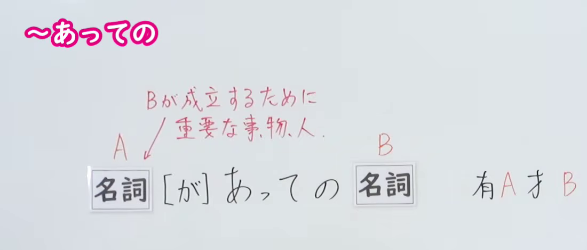
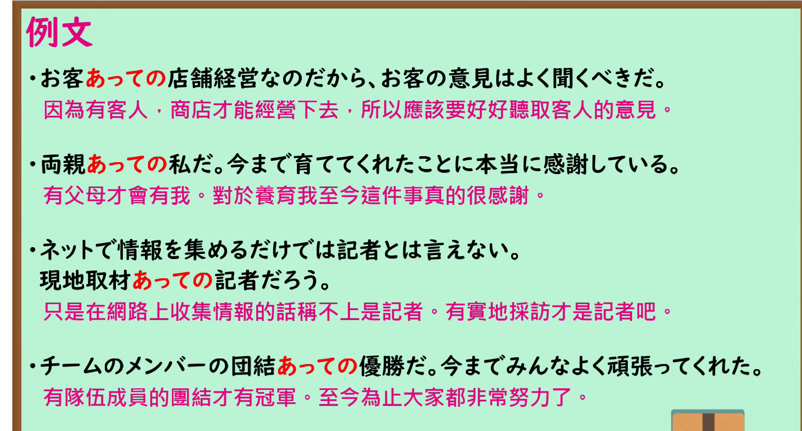

---
{
  "id": "N1-G-0001",
  "kind": "grammar",
  "level": "N1",
  "title": "～あっての：有 A 才有 B",
  "card_revision": 1,
  "schema_version": 1,
  "source": {
    "lesson": "N1 第1个语法",
    "material": "出口日語原视频板书、日语自动字幕与 Hagoromo「 あっての（媒介） 」正文",
    "video": "https://www.youtube.com/watch?v=riUjVcsPbqo",
    "screenshot": "assets/grammar/n1/N1-G-0001-connection.png",
    "screenshot_seconds": 1.0,
    "screenshot_crop": {
      "x": 0,
      "y": 0,
      "width": 1100,
      "height": 470
    }
  },
  "tags": [
    "あっての",
    "N1"
  ],
  "confusions": [
    "あればこそ",
    "あってこそ"
  ]
}
---

# N1 第1个语法：～あっての

# 视频学习资料整理

- 课程：[出口日語「～あっての」](https://www.youtube.com/watch?v=riUjVcsPbqo)，时长 5 分 10 秒。
- 接续图：原视频 0:01.00；原图 1920×1080，固定左上角裁切区域 `(0, 0, 1100, 470)`。保留「名詞［が］あっての名詞」和红字「Bが成立するために重要な事物、人」，裁去右侧人物和下方空白。

- 例句图：原视频 3:52.37；原图 1920×1080，固定左上角裁切区域 `(0, 0, 1875, 1010)`。保留四组完整日语例句及原视频的中文说明，裁去右侧与下方边缘。

# 核心

## 功能一：对 B 的成立至关重要的事物或人

**最上位意味カテゴリー：**

- **あっての：** ものごとの関係（事物间的关系）

**中位意味カテゴリー：**

- **あっての：** 手段・媒介（手段与媒介）

**意味：**

- **あっての：** 媒介（媒介）

**くわしい意味記述：**

- **あっての：** 「AあってのB」で，「Bは，Aがあるから存在できる」という意味を表す。「＜個人名＞あっての＜グループ名＞」という構造も多い。（以「AあってのB」表示“B 因为有 A 才能存在”之意。「某个人名あっての某个团体名」这样的结构也很多。）

**派生語：** 未列出

### 例句

1. 米国では所有者、つまり株主あっての企業という考え方が根強い。

   （在美国，“企业依靠所有者，也就是股东才得以存在”这一观念根深蒂固。）

2. これが江戸中に広まり、にぎりずしは、江戸前の名をあげるもととなった。 江戸でにぎりずしが生まれたのは、新鮮な魚があってのことであったと考えてよい。

   （这在江户各地传播开来，握寿司也因此成为打响“江户前”名声的契机。可以认为，握寿司之所以在江户诞生，正是因为有新鲜的鱼。）

3. わが国が九一年に、「互いの安心感を高める」ため日本の政策を含め共通の関心事を討議する場として、ＡＳＥＡＮ拡大外相会議（ＰＭＣ）の活用を提唱したのも、その背景があってのことだ。

   （我国在 1991 年提议利用东盟扩大外长会议，就包括日本政策在内的共同关切展开讨论，以“增进彼此的安全感”，也正是基于这一背景。）

# 来源

- [出口日語原视频「～あっての」](https://www.youtube.com/watch?v=riUjVcsPbqo)
- [Hagoromo 文型检索「 あっての（媒介） 」](https://hagoromo-text.work/)（查询日期：2026-09-24；页面内检索「あっての」）
