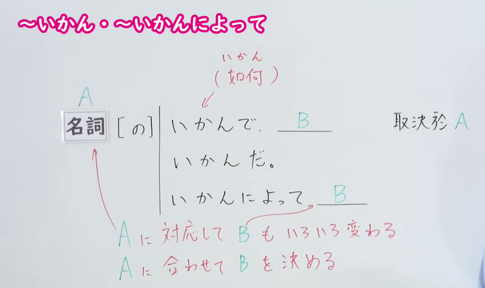
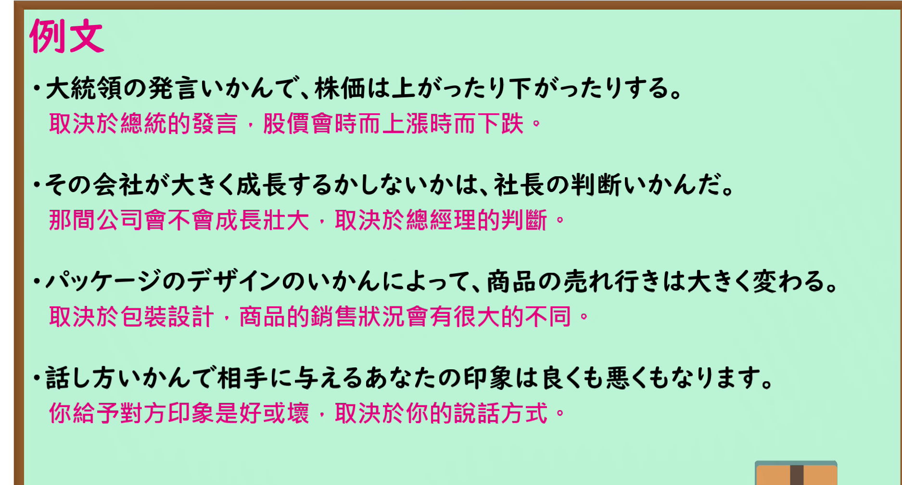

---
{
  "id": "N1-G-0002",
  "kind": "grammar",
  "level": "N1",
  "title": "～いかん・～いかんによって：取决于",
  "card_revision": 1,
  "schema_version": 1,
  "source": {
    "lesson": "N1 第2个语法",
    "material": "出口日語原视频板书、日语自动字幕与 Hagoromo「いかんだ（関連）」「いかんによっては（関連）」正文",
    "video": "https://www.youtube.com/watch?v=Y4Nh351IfCs",
    "screenshot": "assets/grammar/n1/N1-G-0002-connection.png",
    "screenshot_seconds": 1.0,
    "screenshot_crop": {
      "x": 0,
      "y": 0,
      "width": 1260,
      "height": 750
    }
  },
  "tags": [
    "いかん",
    "N1"
  ],
  "confusions": [
    "いかんにかかわらず",
    "いかんによらず"
  ]
}
---

# N1 第2个语法：～いかん・～いかんによって

# 视频学习资料整理

- 课程：[出口日語「～いかん・～いかんによって」](https://www.youtube.com/watch?v=Y4Nh351IfCs)，时长 4 分 49 秒。
- 接续图：原视频 0:01.00；原图 1920×1080，固定左上角裁切区域 `(0, 0, 1260, 750)`。保留「名詞［の］いかんで」「いかんだ」「いかんによって」以及「Aに対応してBもいろいろ変わる」「Aに合わせてBを決める」两行红字说明，裁去右侧人物和下方空白。

- 例句图：原视频 3:36.05；原图 1920×1080，固定左上角裁切区域 `(0, 0, 1875, 1010)`。保留四组完整日语例句及原视频中文说明，裁去右侧与下方边缘。

# 核心

## 功能一：B 随 A 而变化，或根据 A 决定 B

**最上位意味カテゴリー：**

- **いかんだ（含いかんで、いかんでは）：** ものごとの関係（事物间的关系）
- **いかんによっては：** ものごとの関係（事物间的关系）

**中位意味カテゴリー：**

- **いかんだ（含いかんで、いかんでは）：** 関連・対応（关联与对应）
- **いかんによっては：** 関連・対応（关联与对应）

**意味：**

- **いかんだ（含いかんで、いかんでは）：** 関連（关联）
- **いかんによっては：** 関連（关联）

**くわしい意味記述：**

- **いかんだ（含いかんで、いかんでは）：** 「Xが実現するかどうかはNの内容・状態による」という意味を表す。（表示“X 是否实现取决于 N 的内容或状态”。）
- **いかんによっては：** 「Nの内容・状態によって（Nの内容・状態しだいで），Xが変わるかもしれない」という意味を表す。「いかんだ」，「しだいだ」，「による」と同じ意味を表す。（表示“随着 N 的内容或状态不同，即视 N 的情况而定，X 可能发生变化”。与「いかんだ」「しだいだ」「による」表达相同的意思。）

**派生語：** いかんだ：いかんで、いかんでは；いかんによっては：未列出。

### 例句

1. 塾と学校のどちらを信じるかは親の考え方いかんだ。

   （究竟相信补习班还是学校，取决于家长的想法。）

2. 試験の結果いかんで将来が決まる。

   （未来取决于考试结果。）

3. 今後の経済状況いかんによっては、工場の建設計画が中止になることもあり得る。

   （根据今后的经济形势，工厂建设计划也有可能被取消。）

# 来源

- [出口日語原视频「～いかん・～いかんによって」](https://www.youtube.com/watch?v=Y4Nh351IfCs)
- [Hagoromo 文型检索「いかんだ（関連）」「いかんによっては（関連）」](https://hagoromo-text.work/)（查询日期：2026-09-24；页面内检索「いかん」）
