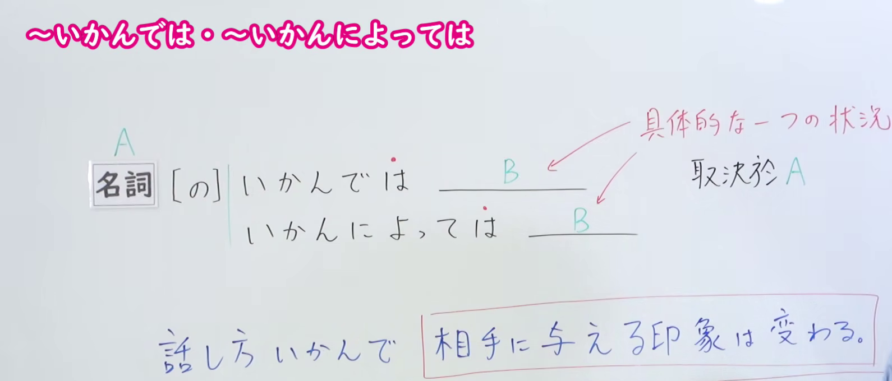
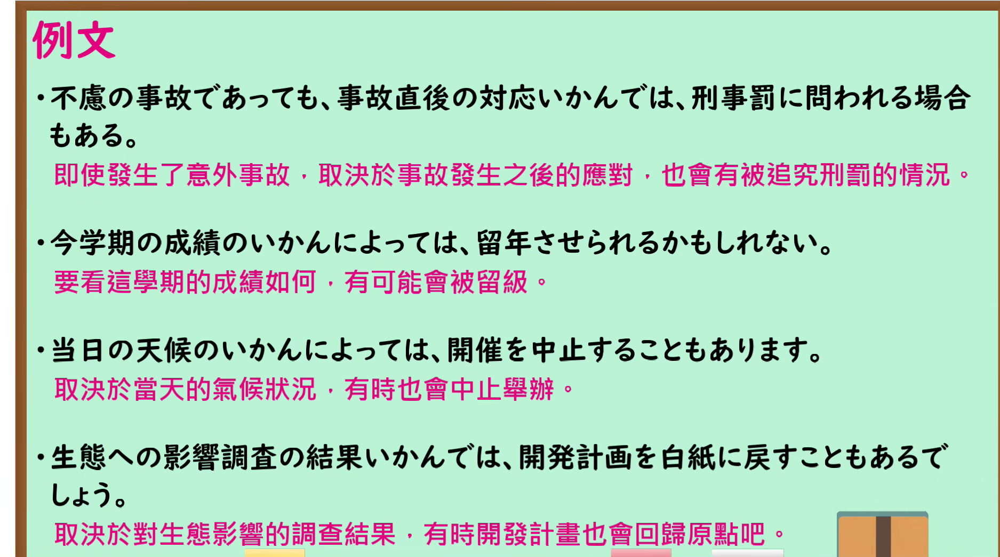

---
{
  "id": "N1-G-0003",
  "kind": "grammar",
  "level": "N1",
  "title": "～いかんでは・～いかんによっては：视情况可能……",
  "card_revision": 1,
  "schema_version": 1,
  "source": {
    "lesson": "N1 第3个语法",
    "material": "出口日語原视频板书、日语自动字幕与 Hagoromo「いかんだ（関連）」「いかんによっては（関連）」正文",
    "video": "https://www.youtube.com/watch?v=C0v1rOwoVsE",
    "screenshot": "assets/grammar/n1/N1-G-0003-connection.png",
    "screenshot_seconds": 115.0,
    "screenshot_crop": {
      "x": 0,
      "y": 0,
      "width": 1590,
      "height": 680
    }
  },
  "tags": [
    "いかんでは",
    "いかんによっては",
    "N1"
  ],
  "confusions": [
    "いかんで",
    "いかんによって"
  ]
}
---

# N1 第3个语法：～いかんでは・～いかんによっては

# 视频学习资料整理

- 课程：[出口日語「～いかんでは・～いかんによっては」](https://www.youtube.com/watch?v=C0v1rOwoVsE)，时长 5 分 43 秒。
- 接续图：原视频 1:55.00；原图 1920×1080，固定左上角裁切区域 `(0, 0, 1590, 680)`。0:01 的红字说明被人物遮挡，故改用此时点；保留两种形式、「具体的な一つの状況」及「話し方いかんで相手に与える印象は変わる」板书，裁去右侧人物和下方多余画面。

- 例句图：原视频 4:02.12；原图 1920×1080，固定左上角裁切区域 `(0, 0, 1875, 1045)`。保留四组完整日语例句及原视频中文说明，裁去右侧与下方边缘。

# 核心

## 功能一：一种具体的情况

**最上位意味カテゴリー：**

- **いかんでは（「いかんだ」の派生語）：** ものごとの関係（事物间的关系）
- **いかんによっては：** ものごとの関係（事物间的关系）

**中位意味カテゴリー：**

- **いかんでは（「いかんだ」の派生語）：** 関連・対応（关联与对应）
- **いかんによっては：** 関連・対応（关联与对应）

**意味：**

- **いかんでは（「いかんだ」の派生語）：** 関連（关联）
- **いかんによっては：** 関連（关联）

**くわしい意味記述：**

- **いかんでは（「いかんだ」の派生語）：** 「Xが実現するかどうかはNの内容・状態による」という意味を表す。（表示“X 是否实现取决于 N 的内容或状态”。）
- **いかんによっては：** 「Nの内容・状態によって（Nの内容・状態しだいで），Xが変わるかもしれない」という意味を表す。「いかんだ」，「しだいだ」，「による」と同じ意味を表す。（表示“随着 N 的内容或状态不同，即视 N 的情况而定，X 可能发生变化”。与「いかんだ」「しだいだ」「による」表达相同的意思。）

**派生語：** いかんだ：いかんで、いかんでは；いかんによっては：未列出。

### 例句

1. 返済・処理の方法いかんでは今後の財政運営だけでなく、国民生活や経済全体にも大きな影響を及ぼす。

   （偿还和处理方式不同，不仅会对今后的财政运作，也会对国民生活和整个经济产生重大影响。）

2. 今後の経済状況いかんによっては、工場の建設計画が中止になることもあり得る。

   （视今后的经济形势而定，工厂建设计划也有可能被取消。）

3. しかし、一方で「中国側は日本側が直ちに誤った決定と差別的なやり方をただし、問題をできるだけ早く解決するよう要求する」と呼びかけ、今後の日本側の出方いかんによっては柔軟に対応していく考えを示唆した。

   （但另一方面，发言者呼吁日方立即纠正错误决定和歧视性做法，尽快解决问题，并暗示将视日方今后的态度，考虑灵活应对。）

# 来源

- [出口日語原视频「～いかんでは・～いかんによっては」](https://www.youtube.com/watch?v=C0v1rOwoVsE)
- [Hagoromo 文型检索「いかんだ（関連）」「いかんによっては（関連）」](https://hagoromo-text.work/)（查询日期：2026-09-24；页面内检索「いかん」）
