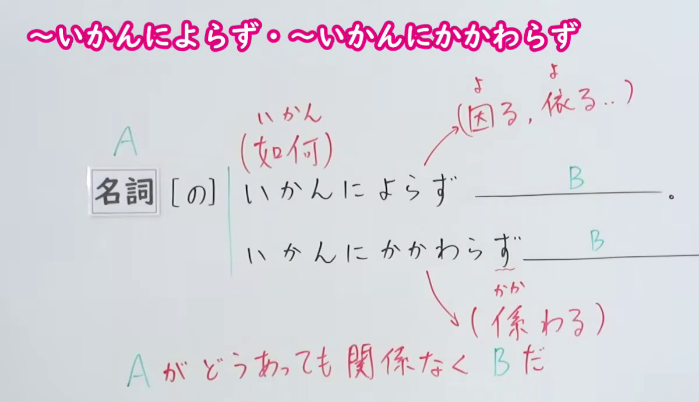
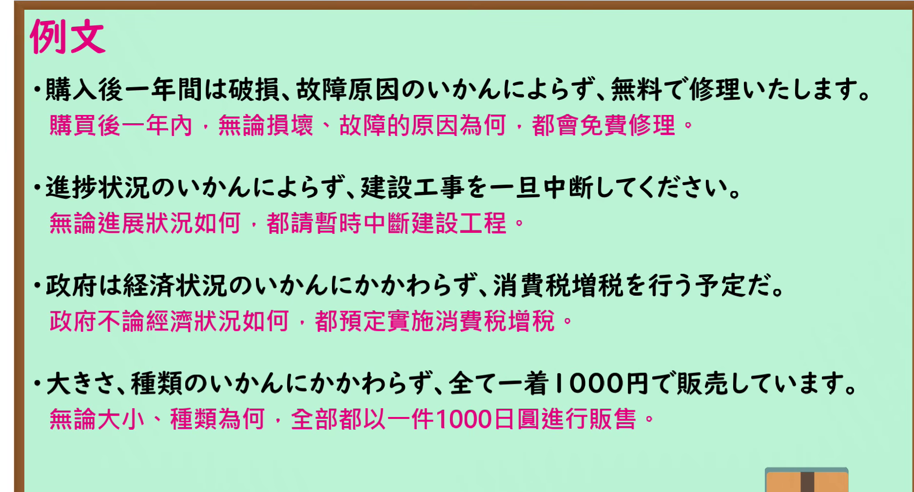

---
{
  "id": "N1-G-0004",
  "kind": "grammar",
  "level": "N1",
  "title": "～いかんによらず・～いかんにかかわらず：无论如何",
  "card_revision": 1,
  "schema_version": 1,
  "source": {
    "lesson": "N1 第4个语法",
    "material": "出口日語原视频板书、日语自动字幕与 Hagoromo「いかんによらず（無関係）」「いかんにかかわらず（無関係）」正文",
    "video": "https://www.youtube.com/watch?v=LAC4eykNJNA",
    "screenshot": "assets/grammar/n1/N1-G-0004-connection.png",
    "screenshot_seconds": 1.0,
    "screenshot_crop": {
      "x": 0,
      "y": 0,
      "width": 1200,
      "height": 690
    }
  },
  "tags": [
    "いかんによらず",
    "いかんにかかわらず",
    "N1"
  ],
  "confusions": [
    "いかんで",
    "いかんによっては"
  ]
}
---

# N1 第4个语法：～いかんによらず・～いかんにかかわらず

# 视频学习资料整理

- 课程：[出口日語「～いかんによらず・～いかんにかかわらず」](https://www.youtube.com/watch?v=LAC4eykNJNA)，时长 6 分 49 秒。
- 接续图：原视频 0:01.00；原图 1920×1080，固定左上角裁切区域 `(0, 0, 1200, 690)`。保留两种形式和红字「Aがどうあっても関係なくBだ」，裁去右侧人物和下方多余画面。

- 例句图：原视频 5:20.32；原图 1920×1080，固定左上角裁切区域 `(0, 0, 1875, 1010)`。保留四组完整日语例句及原视频中文说明，裁去右侧与下方边缘。

# 核心

## 功能一：无论 A 如何，B 都成立

**最上位意味カテゴリー：**

- **いかんによらず：** ものごとの関係（事物间的关系）
- **いかんにかかわらず：** ものごとの関係（事物间的关系）

**中位意味カテゴリー：**

- **いかんによらず：** 無関係・除外（无关与排除）
- **いかんにかかわらず：** 無関係・除外（无关与排除）

**意味：**

- **いかんによらず：** 無関係（无关）
- **いかんにかかわらず：** 無関係（无关）

**くわしい意味記述：**

- **いかんによらず：** Nがどうであっても，それに関係なく後のことが成立する，と言いたい時に使う。「Nを問わず」，「N(の）いかんにかかわらず」と同じ意味で使う。（想表达“无论 N 是什么情况，后项都不受其影响而成立”时使用。与「Nを問わず」「N(の）いかんにかかわらず」意思相同。）
- **いかんにかかわらず：** Nがどうであっても，それに関係なく後のことが成立する、と言いたい時に使う。「Nを問わず」，「N(の）いかんによらず」と同じ意味で使う。（想表达“无论 N 是什么情况，后项都不受其影响而成立”时使用。与「Nを問わず」「N(の）いかんによらず」意思相同。）

**派生語：** いかんによらず：未列出；いかんにかかわらず：未列出。

### 例句

1. 人類を宇宙に送り出すプロジェクトは、成否のいかんにかかわらず、巨額の資金を要する。

   （将人类送入太空的项目，无论成败，都需要巨额资金。）

2. だから、大統領、議会側とも、国民投票の結果いかんにかかわらず、あらかじめ自陣営に有利な解釈を行うことを決めていた。

   （因此，总统和议会双方都决定，无论公投结果如何，事先都要作出有利于己方阵营的解释。）

3. 政府の対応のいかんによらず、少子化の流れを止めることは難しい。

   （无论政府如何应对，都很难阻止少子化的趋势。）

# 来源

- [出口日語原视频「～いかんによらず・～いかんにかかわらず」](https://www.youtube.com/watch?v=LAC4eykNJNA)
- [Hagoromo 文型检索「いかんによらず（無関係）」](https://hagoromo-text.work/)（查询日期：2026-09-24；页面内检索「いかん」）
- [Hagoromo 文型检索「いかんにかかわらず（無関係）」](https://hagoromo-text.work/)（查询日期：2026-09-24；页面内检索「いかん」）
