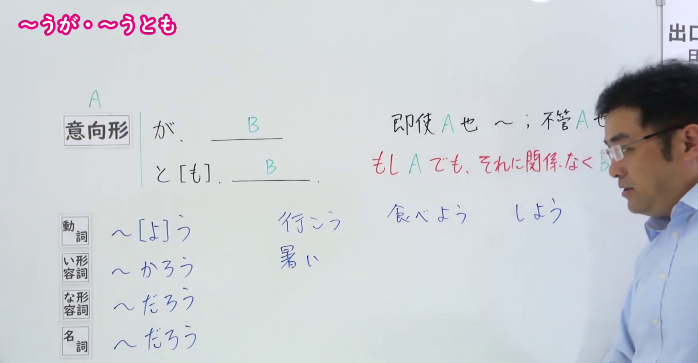
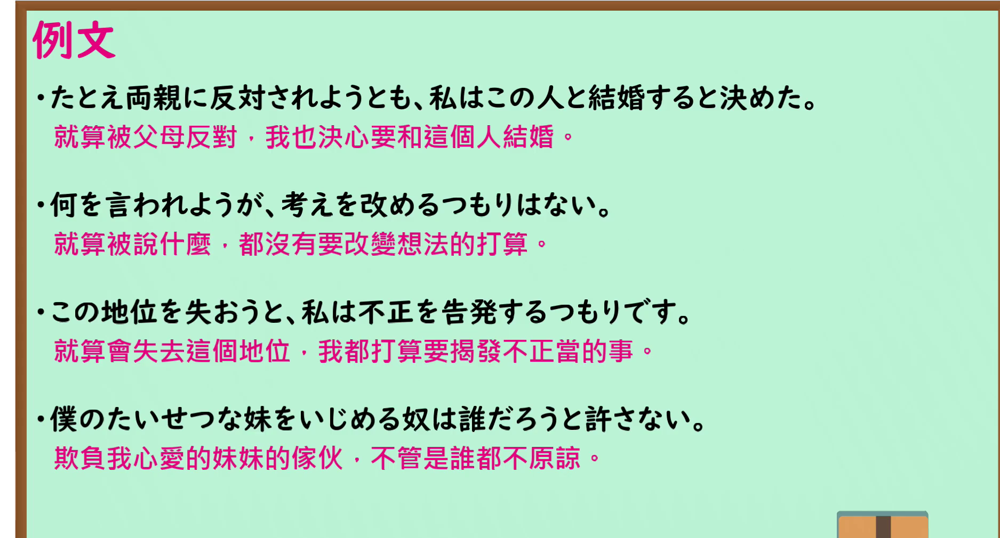

---
{
  "id": "N1-G-0005",
  "kind": "grammar",
  "level": "N1",
  "title": "～うが・～うと（も）：即使……也……",
  "card_revision": 1,
  "schema_version": 1,
  "source": {
    "lesson": "N1 第5个语法",
    "material": "出口日語原视频板书、日语自动字幕与 毎日のんびり日本語教師「～ようが／ようと／ようとも」正文",
    "video": "https://www.youtube.com/watch?v=Gaqkb8oKX8A",
    "screenshot": "assets/grammar/n1/N1-G-0005-connection.png",
    "screenshot_seconds": 120.0,
    "screenshot_crop": {
      "x": 0,
      "y": 0,
      "width": 1750,
      "height": 910
    }
  },
  "tags": [
    "うが",
    "うと",
    "N1"
  ],
  "confusions": [
    "うがまいが",
    "うともまいとも"
  ]
}
---

# N1 第5个语法：～うが・～うと（も）

# 视频学习资料整理

- 课程：[出口日語「～うが・～うと（も）」](https://www.youtube.com/watch?v=Gaqkb8oKX8A)，时长 7 分 24 秒。
- 接续图：原视频 2:00.00；原图 1920×1080，固定左上角裁切区域 `(0, 0, 1750, 910)`。0:01 的含义板书遮挡更重，故改用此时点。画面保留「意向形＋が／と［も］」及动词、形容词、名词的板书形式；右端「もしAでも、それに関係なくBだ」的末尾仍被人物遮挡，未裁断可见文字。

- 例句图：原视频 5:50.23；原图 1920×1080，固定左上角裁切区域 `(0, 0, 1875, 1010)`。保留四组完整日语例句及原视频中文说明，裁去右侧与下方边缘。

# 核心

## 功能一：即使 A，B 也不受其影响

**くわしい意味記述：**

- **～ようが／ようと／ようとも：** 仮定条件の逆接を表します。どのような状況であっても変わらないことを後件で述べます。「たとえ」「どれだけ」「どんなに」「いくら」などの語が呼応することもあります。（表示假设条件的逆接关系。后项叙述无论处于何种情况都不会改变的事情。有时会与「たとえ」「どれだけ」「どんなに」「いくら」等词呼应。）

### 例句

1. たくさん本を買おうと、読まないなら無駄だ。

   （即使买了很多书，如果不读，还是浪费。）

2. たとえ反対されようが、自分のことは自分で決める。

   （即使遭到反对，自己的事也要由自己决定。）

3. 今どんなに晴れていようと、登山中はいつ天気が急変するか分からないので注意しなければならない。

   （即使现在天气再晴朗，登山时也不知道何时会骤变，所以必须小心。）

4. 犬だろうが、猫だろうが、母はペットを飼うのを許してくれない。

   （不论是狗还是猫，母亲都不允许我养宠物。）

# 来源

- [出口日語原视频「～うが・～うと（も）」](https://www.youtube.com/watch?v=Gaqkb8oKX8A)
- [毎日のんびり日本語教師「～ようが／ようと／ようとも」](https://mainichi-nonbiri.com/grammar/n1-youga/)（查询日期：2026-09-24；采用「解説」与例句）
