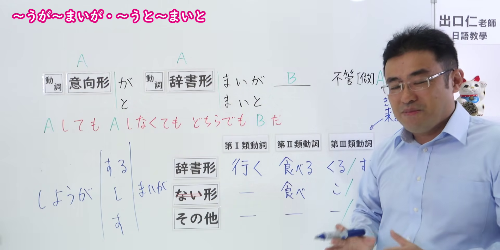
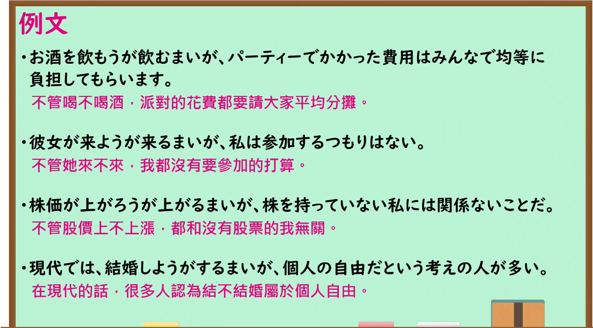

---
{
  "id": "N1-G-0006",
  "kind": "grammar",
  "level": "N1",
  "title": "～うが～まいが・～うと～まいと：无论做或不做，结果都不变",
  "card_revision": 1,
  "schema_version": 1,
  "source": {
    "lesson": "N1 第6个语法",
    "material": "出口日語原视频板书、日语自动字幕与 Hagoromo 文型检索正文",
    "video": "https://www.youtube.com/watch?v=3LzYcy8oU_A",
    "screenshot": "assets/grammar/n1/N1-G-0006-connection.png",
    "screenshot_seconds": 330.0,
    "screenshot_crop": {
      "x": 0,
      "y": 0,
      "width": 1920,
      "height": 960
    }
  },
  "tags": [
    "逆接・譲歩",
    "N1"
  ],
  "confusions": [
    "～うが／～うと（只表示无论A如何，本课还明确并列A做与不做）"
  ]
}
---

# ～うが～まいが・～うと～まいと

# 视频学习资料整理

- 课程：[出口日語 N1 第6课](https://www.youtube.com/watch?v=3LzYcy8oU_A)，讲解「～うが～まいが・～うと～まいと」。
- 接续图：视频 5:30（330.00 秒）；原图 1920×1080；从左上角 (0, 0) 裁至 (1920, 960)。保留意向形／辞书形与「まい」的接续表，以及红字「AしてもAしなくてもどちらでもBだ」。画面右侧少量板书被讲师遮挡。

- 例句图：视频 6:05.41（365.41 秒）；原图 1920×1080；从左上角 (0, 0) 裁至 (1895, 1050)。四条例句及课程译文完整可读。

# 核心

## 功能一：无论 A 做还是不做，B 都一样

**最上位意味カテゴリー：**

- **～うが～まいが：** ものごとの関係（事物之间的关系）
- **～うと～まいと：** ものごとの関係（事物之间的关系）

**中位意味カテゴリー：**

- **～うが～まいが：** 逆接・譲歩（逆接与让步）
- **～うと～まいと：** 逆接・譲歩（逆接与让步）

**意味：**

- **～うが～まいが：** 逆接：仮定（逆接：假设）
- **～うと～まいと：** 逆接：仮定（逆接：假设）

**くわしい意味記述：**

- **～うが～まいが：** 「〜しても，〜しなくても結果は変わらず」の意味。（表示「做也好，不做也好，结果都不变」。）
- **～うと～まいと：** 「〜しても，〜しなくても結果は変わらず」の意味。書き言葉的。（表示「做也好，不做也好，结果都不变」。偏书面语。）

**派生語：** 未列出

### 例句

1. 彼が読んでくれようが（読んで）くれまいが、ともかく謝りの手紙だけは出そう。

   （不管他会不会读，姑且先把道歉信寄出去吧。）

2. あの先生は、学生がその時はわかろうがわかるまいが、人生にとって大切なことを話してくれた。

   （那位老师不管学生当时懂不懂，都给他们讲了人生中重要的事。）

3. 彼は、人に迷惑をかけようとかけまいとお構いなしだ。

   （他才不在乎会不会给别人添麻烦。）

# 来源

- [出口日語 N1 第6课原视频](https://www.youtube.com/watch?v=3LzYcy8oU_A)
- [Hagoromo 文型检索「～うが～まいが」](https://hagoromo-text.work/)（站内实际条目；查询日期：2026-09-24）
- [Hagoromo 文型检索「～うと～まいと」](https://hagoromo-text.work/)（站内实际条目；查询日期：2026-09-24）
