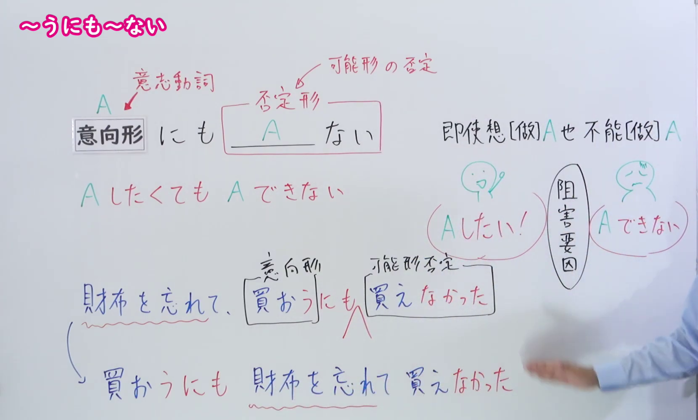
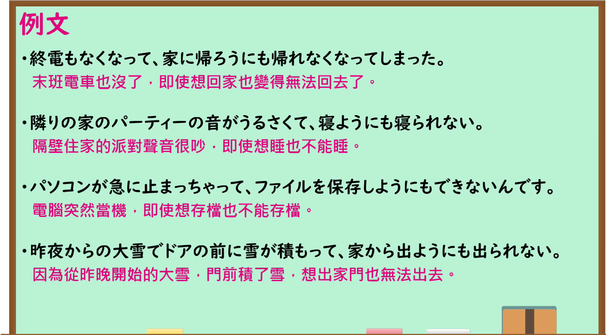

---
{
  "id": "N1-G-0007",
  "kind": "grammar",
  "level": "N1",
  "title": "～うにも～ない：想做却做不到",
  "card_revision": 1,
  "schema_version": 1,
  "source": {
    "lesson": "N1 第7个语法",
    "material": "出口日語原视频板书、日语自动字幕与 Hagoromo 文型检索正文",
    "video": "https://www.youtube.com/watch?v=mk8zPc2fwP0",
    "screenshot": "assets/grammar/n1/N1-G-0007-connection.png",
    "screenshot_seconds": 140.0,
    "screenshot_crop": {
      "x": 0,
      "y": 0,
      "width": 1660,
      "height": 1000
    }
  },
  "tags": [
    "可能・難易",
    "N1"
  ],
  "confusions": [
    "～ようとしても（强调尝试做某事；～うにも～ない强调想做却因阻碍而做不到）"
  ]
}
---

# ～うにも～ない

# 视频学习资料整理

- 课程：[出口日語 N1 第7课](https://www.youtube.com/watch?v=mk8zPc2fwP0)，讲解「～うにも～ない」。
- 接续图：视频 2:20（140.00 秒）；原图 1920×1080；从左上角 (0, 0) 裁至 (1660, 1000)。0:01 画面右侧板书被讲师遮挡，因此选用这一帧；意向形、后项否定、红字「AしたくてもAできない」及阻碍因素的说明均可读。

- 例句图：视频 3:36.25（216.25 秒）；原图 1920×1080；从左上角 (0, 0) 裁至 (1895, 1050)。四条例句及课程译文完整可读。

# 核心

## 功能一：A 想做却做不到

**最上位意味カテゴリー：**

- **Vようにも〜Vれない：** ものごとの様子（事物的状态）
- **Vようにも〜〔否定〕：** ものごとの様子（事物的状态）

**中位意味カテゴリー：**

- **Vようにも〜Vれない：** 可能・難易（可能与难易）
- **Vようにも〜〔否定〕：** 可能・難易（可能与难易）

**意味：**

- **Vようにも〜Vれない：** 可能：不可能（可能：不可能）
- **Vようにも〜〔否定〕：** 可能：不可能（可能：不可能）

**くわしい意味記述：**

- **Vようにも〜Vれない：** 「あることをしようと思ってもそれができない」ことを表す。「Vるに＋V可能形＋ない」「Vものも+V可能形＋ない」といった言い方もある。（表示即使想做某件事也做不到。还有「Vるに＋V可能形＋ない」「Vものも+V可能形＋ない」等说法。）
- **Vようにも〜〔否定〕：** 「あることをしようと思ってもそれができない」ことを表す。（表示即使想做某件事也做不到。）

**派生語：** 未列出

### 例句

1. 激しい雨が降ってきて、出かけようにも出かけられない。

   （下起了大雨，想出门也出不了门。）

2. 田舎では、出かけようにも車がなければかなわない。

   （在乡下，要是没有车，想出门也出不去。）

3. この形はあまり使わないので、例文を考えようにも思い浮かばない。

   （这种形式不太常用，想举例也想不出来。）

# 来源

- [出口日語 N1 第7课原视频](https://www.youtube.com/watch?v=mk8zPc2fwP0)
- [Hagoromo 文型检索「Vようにも〜Vれない」](https://hagoromo-text.work/)（站内实际条目；查询日期：2026-09-24）
- [Hagoromo 文型检索「Vようにも〜〔否定〕」](https://hagoromo-text.work/)（站内实际条目；查询日期：2026-09-24）
