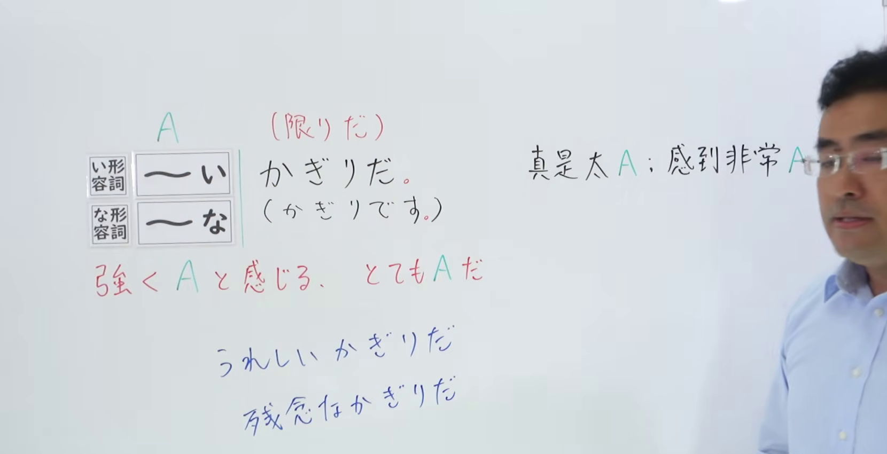
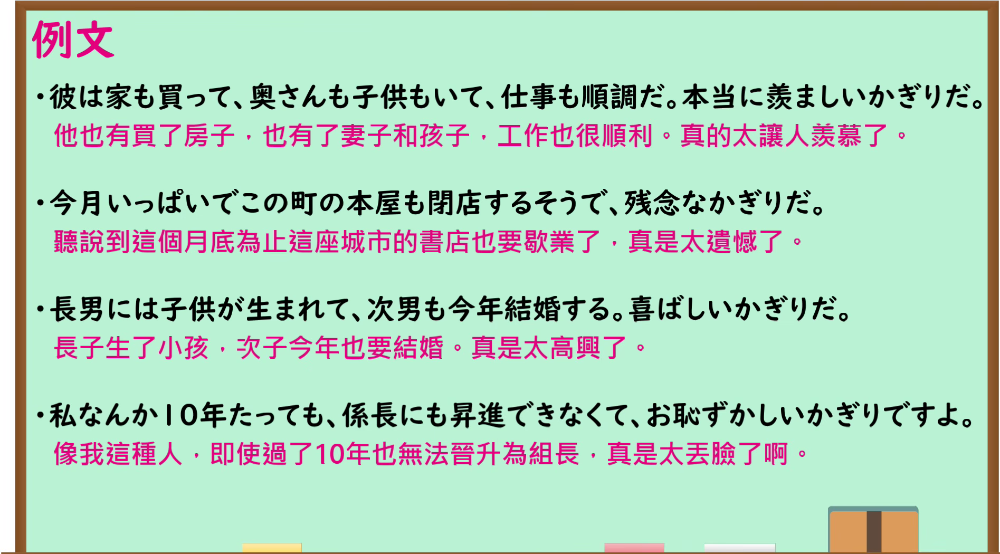

---
{
  "id": "N1-G-0008",
  "kind": "grammar",
  "level": "N1",
  "title": "～かぎりだ：强烈感到……",
  "card_revision": 1,
  "schema_version": 1,
  "source": {
    "lesson": "N1 第8个语法",
    "material": "出口日語原视频板书、日语自动字幕与 Hagoromo 文型检索正文",
    "video": "https://www.youtube.com/watch?v=_jp5TCfHXPY",
    "screenshot": "assets/grammar/n1/N1-G-0008-connection.png",
    "screenshot_seconds": 130.0,
    "screenshot_crop": {
      "x": 0,
      "y": 0,
      "width": 1660,
      "height": 850
    }
  },
  "tags": [
    "感情强调",
    "N1"
  ],
  "confusions": [
    "～かぎり（限り：只要、在某范围内；本课的～かぎりだ强调说话者的感情）"
  ]
}
---

# ～かぎりだ

# 视频学习资料整理

- 课程：[出口日語 N1 第8课](https://www.youtube.com/watch?v=_jp5TCfHXPY)，讲解「～かぎりだ」。
- 接续图：视频 2:10（130.00 秒）；原图 1920×1080；从左上角 (0, 0) 裁至 (1660, 850)。0:01 画面右侧板书被讲师遮挡，因此选用这一帧；形容词接续、红字「強くAと感じる、とてもAだ」及情感词例子可读。右侧黑字释义末尾仍有少量遮挡。

- 例句图：视频 4:00.30（240.30 秒）；原图 1920×1080；从左上角 (0, 0) 裁至 (1895, 1050)。四条例句及课程译文完整可读。

# 核心

## 功能一：强烈感到 A，非常 A

**最上位意味カテゴリー：**

- **かぎりだ：** 考え・感情（想法与感情）

**中位意味カテゴリー：**

- **かぎりだ：** 主張・断定的評価（主张与断定性评价）

**意味：**

- **かぎりだ：** 主張（主张）

**くわしい意味記述：**

- **かぎりだ：** 「〜の気持ちでいっぱいだ」という話し手の感情を表すときに使う。（用于表达说话者满怀某种心情。）

**派生語：** 未列出

### 例句

1. ひとりで言葉のわからない国を旅行するのは、心細いかぎりだ

   （一个人去语言不通的国家旅行，真让人心里没底。）

2. 全国大会で優勝できたのは、うれしい限りです。

   （能够在全国大赛夺冠，真是高兴极了。）

3. 語彙不足は何とも心細いかぎりである。

   （词汇量不足，实在让人心里没底。）

4. 痛ましいかぎりだ。

   （真叫人痛心。）

# 来源

- [出口日語 N1 第8课原视频](https://www.youtube.com/watch?v=_jp5TCfHXPY)
- [Hagoromo 文型检索「かぎりだ」](https://hagoromo-text.work/)（站内实际条目；查询日期：2026-09-24）
