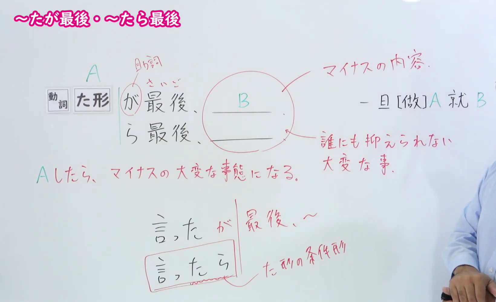
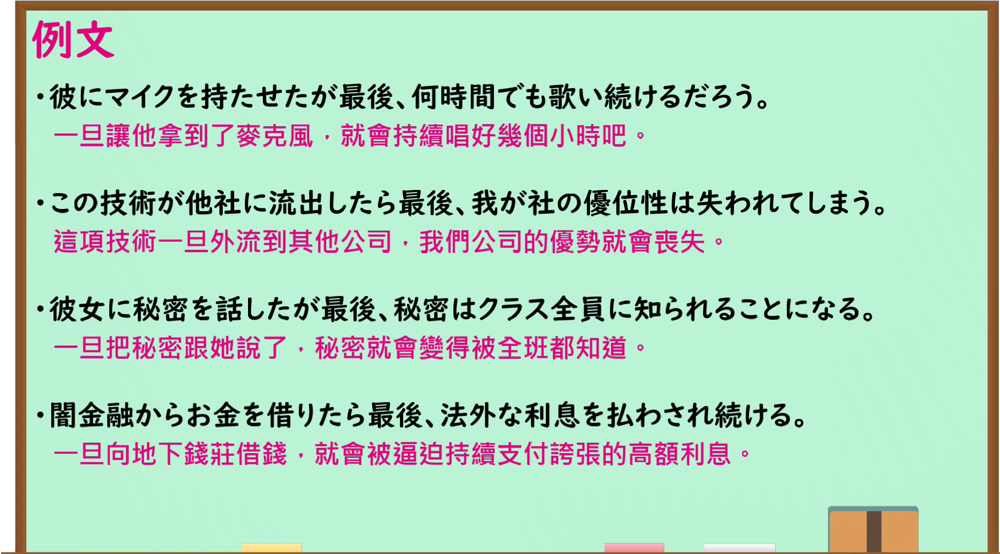

---
{
  "id": "N1-G-0009",
  "kind": "grammar",
  "level": "N1",
  "title": "～たがさいご(最後)・～たらさいご(最後)：一旦做了便难以挽回",
  "card_revision": 1,
  "schema_version": 1,
  "source": {
    "lesson": "N1 第9个语法",
    "material": "出口日語原视频板书、日语自动字幕与毎日のんびり日本語教師正文",
    "video": "https://www.youtube.com/watch?v=4ozbLvudSQ8",
    "screenshot": "assets/grammar/n1/N1-G-0009-connection.png",
    "screenshot_seconds": 177.18,
    "screenshot_crop": {
      "x": 0,
      "y": 0,
      "width": 1640,
      "height": 1000
    }
  },
  "tags": [
    "条件",
    "N1"
  ],
  "confusions": [
    "普通的～たら（表示条件；本课的～たらさいご(最後)强调一旦发生便难以避免不利后果）"
  ]
}
---

# ～たがさいご(最後)・～たらさいご(最後)

# 视频学习资料整理

- 课程：[出口日語 N1 第9课](https://www.youtube.com/watch?v=4ozbLvudSQ8)，讲解「～たが最後・～たら最後」。
- 接续图：视频 2:57.18（177.18 秒）；原图 1920×1080；从左上角 (0, 0) 裁至 (1640, 1000)。0:01 的右侧板书被讲师遮挡，因此选用这一帧；两种形式的接续、红字「Aしたら、マイナスの大変な事態になる」及必要讲解均可读。

- 例句图：视频 3:08.07（188.07 秒）；原图 1920×1080；从左上角 (0, 0) 裁至 (1895, 1050)。四条例句及课程译文完整可读。

# 核心

## 功能一：一旦做了 A，就会陷入负面的严重情况

**くわしい意味記述：**

- **～たがさいご(最後)・～たらさいご(最後)：** 前件が発生したら、必ず後件が発生することを表す仮定の文法です。後件は原則悪いことで、悲劇的、絶望的なことが述べられます。（表示前一件事一旦发生，后一件事必然发生的假设表达。后项原则上是不好的事，会述及悲剧性、令人绝望的结果。）

### 例句

1. それは触れたが最後、全身に激しい痛みが襲ってくるほど危険な植物だ。

   （那是一种危险的植物，一碰就会全身剧痛。）

2. 信頼関係は失ったが最後、取り戻すのは難しい。

   （信任关系一旦失去，就很难挽回。）

3. 浮気も不倫もバレたら最後だ。

   （劈腿或婚外情一旦败露，就完了。）

4. 道を見失ったが最後、死ぬまで彷徨うはめになるかもしれない。

   （一旦迷失方向，可能就会落得一直徘徊到死的下场。）

# 来源

- [出口日語 N1 第9课原视频](https://www.youtube.com/watch?v=4ozbLvudSQ8)
- [毎日のんびり日本語教師「～たが最後／～たら最後」](https://mainichi-nonbiri.com/grammar/n1-tagasaigo/)（语法说明与例句；查询日期：2026-09-24）
