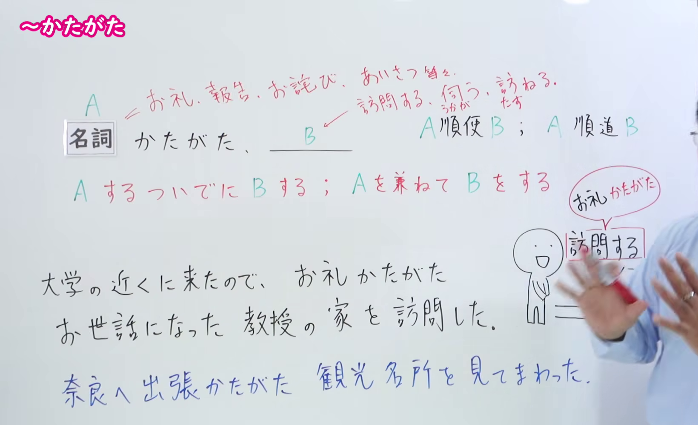
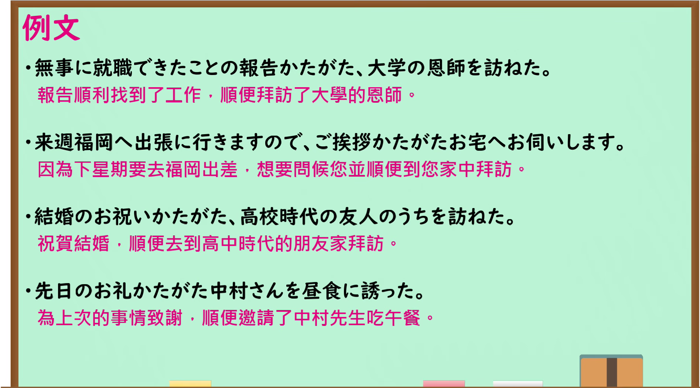

---
{
  "id": "N1-G-0010",
  "kind": "grammar",
  "level": "N1",
  "title": "～かたがた：做一件事时顺便做另一件事",
  "card_revision": 1,
  "schema_version": 1,
  "source": {
    "lesson": "N1 第10个语法",
    "material": "出口日語原视频板书、日语自动字幕与日本語NET正文",
    "video": "https://www.youtube.com/watch?v=NNV7XdJmV54",
    "screenshot": "assets/grammar/n1/N1-G-0010-connection.png",
    "screenshot_seconds": 100.0,
    "screenshot_crop": {
      "x": 0,
      "y": 0,
      "width": 1640,
      "height": 1000
    }
  },
  "tags": [
    "兼做",
    "N1"
  ],
  "confusions": [
    "～がてら（同样表示兼做另一件事；留意本课～かたがた常用于问候、感谢等正式场合）"
  ]
}
---

# ～かたがた

# 视频学习资料整理

- 课程：[出口日語 N1 第10课](https://www.youtube.com/watch?v=NNV7XdJmV54)，讲解「～かたがた」。
- 接续图：视频 1:40（100.00 秒）；原图 1920×1080；从左上角 (0, 0) 裁至 (1640, 1000)。0:01 画面右侧板书被讲师遮挡，因此选用这一帧；名词接续、红字「AするついでにBする；Aを兼ねてBをする」及课堂例子可读，右下角少量示意文字仍被讲师手部遮挡。

- 例句图：视频 4:25.90（265.90 秒）；原图 1920×1080；从左上角 (0, 0) 裁至 (1895, 1050)。四条例句及课程译文完整可读。

# 核心

## 功能一：做 A 时顺便做 B；兼做 A 与 B

**くわしい意味記述：**

- **～かたがた：** 〜のついでに / 〜も兼ねて（做某事的同时顺便做另一件事；也兼做某事。）

### 例句

1. 今度、結婚の挨拶かたがた、そちらに伺います。

   （下次我会登门拜访，顺便向您报告结婚的事。）

2. 近くに寄ったので、先日のお礼かたがた挨拶に伺いました。

   （正好到了附近，我便来向您问候，也为前些日子的事道谢。）

3. ご出張かたがた、ぜひ京都を観光なさってください。

   （您出差时，也请顺道到京都观光。）

4. メールにて大変恐縮ではございますが、ご報告かたがたお礼申し上げます。

   （冒昧通过邮件向您汇报，同时也向您致谢。）

# 来源

- [出口日語 N1 第10课原视频](https://www.youtube.com/watch?v=NNV7XdJmV54)
- [日本語NET「〜かたがた」](https://nihongokyoshi-net.com/2019/06/26/jlptn1-grammar-katagata/)（语法说明与例句；查询日期：2026-09-24）
