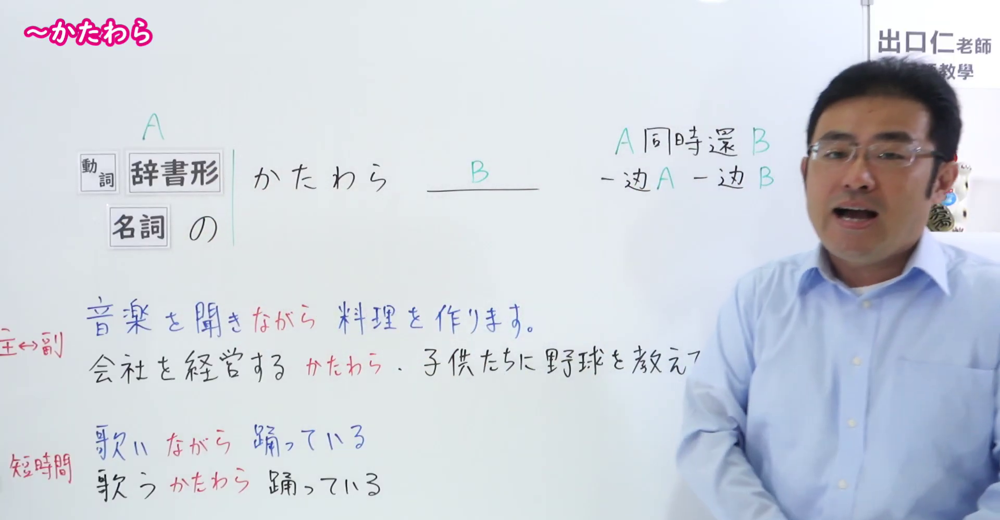
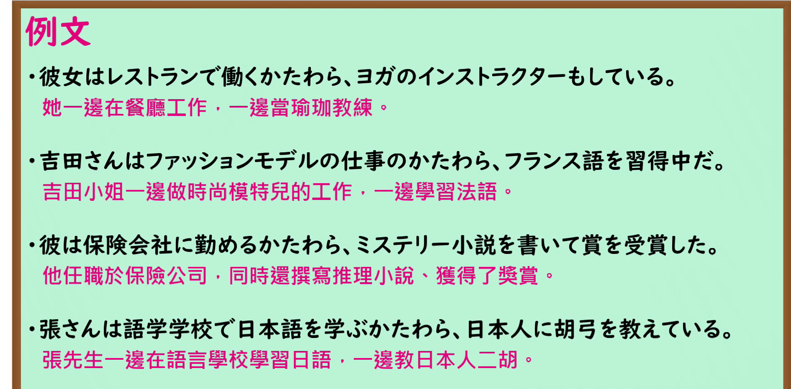

---
{
  "id": "N1-G-0011",
  "kind": "grammar",
  "level": "N1",
  "title": "かたわら：做一项长期活动的同时兼做另一项活动",
  "card_revision": 1,
  "schema_version": 1,
  "source": {
    "lesson": "N1 第11个语法",
    "material": "出口日語原视频板书、日语自动字幕与毎日のんびり日本語教師正文",
    "video": "https://www.youtube.com/watch?v=RupR_qZkfJ8",
    "screenshot": "assets/grammar/n1/N1-G-0011-connection.png",
    "screenshot_seconds": 15,
    "screenshot_crop": {
      "x": 0,
      "y": 0,
      "width": 1920,
      "height": 1000
    }
  },
  "tags": [
    "长期并行活动",
    "主业与副业",
    "N1"
  ],
  "confusions": [
    "ながら",
    "ついでに"
  ]
}
---

# ～かたわら

## 视频学习资料整理

- 课程：[出口日語 N1 第11个语法「～かたわら」](https://www.youtube.com/watch?v=RupR_qZkfJ8)。
- 接续图：原视频 00:15.00；原图 1920×1080；从左上角裁切至 `(0, 0, 1920, 1000)`。画面保留动词辞书形、名词加「の」、同时进行两项活动的说明及板书例句。教师遮挡了右侧部分板书。

- 例句图：原视频 04:02.18；原图 1920×1080；从左上角裁切至 `(0, 0, 1890, 930)`，保留四个完整的课程例句及视频中的中文译文。

# 核心

## 功能一：做 A 的同时，还做 B

**くわしい意味記述：**

- **かたわら：** 仕事や学校などの社会的活動をしながら、別のこともしていることを表します。（表示在从事工作、上学等社会活动的同时，也在做另一件事。）

### 例句

1. 彼女はモデルのかたわら、歌手でも活躍している。

   （她从事模特工作的同时，也作为歌手活跃着。）

2. 大学に通うかたわら、会社の社長をしている。

   （上大学的同时，还担任着公司的社长。）

3. 母は家事のかたわら、ピアノを教えている。

   （母亲操持家务的同时，还教授钢琴。）

4. 会社に勤めるかたわら、夜は家でも副業をしている。

   （他在公司工作的同时，晚上还在家做副业。）

# 来源

- [出口日語原视频](https://www.youtube.com/watch?v=RupR_qZkfJ8)
- [毎日のんびり日本語教師「【Ｎ１文法】～かたわら」用法①](https://mainichi-nonbiri.com/grammar/n1-katawara/)（查询日期：2026-09-24；采用意义说明及例句）
