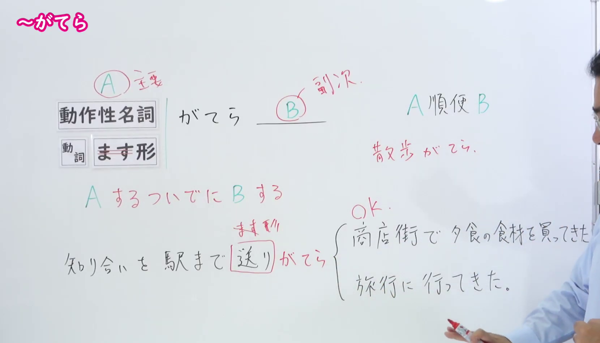
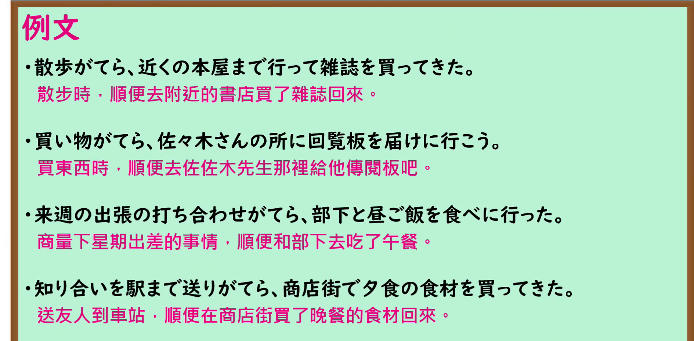

---
{
  "id": "N1-G-0012",
  "kind": "grammar",
  "level": "N1",
  "title": "がてら：做一件事时顺便做另一件事",
  "card_revision": 1,
  "schema_version": 1,
  "source": {
    "lesson": "N1 第12个语法",
    "material": "出口日語原视频板书、日语自动字幕与毎日のんびり日本語教師正文",
    "video": "https://www.youtube.com/watch?v=ED5RvhDzlFU",
    "screenshot": "assets/grammar/n1/N1-G-0012-connection.png",
    "screenshot_seconds": 135,
    "screenshot_crop": {
      "x": 0,
      "y": 0,
      "width": 1660,
      "height": 950
    }
  },
  "tags": [
    "顺便",
    "附带动作",
    "N1"
  ],
  "confusions": [
    "ついでに",
    "かたがた"
  ]
}
---

# ～がてら

## 视频学习资料整理

- 课程：[出口日語 N1 第12个语法「～がてら」](https://www.youtube.com/watch?v=ED5RvhDzlFU)。
- 接续图：原视频 02:15.00；原图 1920×1080；从左上角裁切至 `(0, 0, 1660, 950)`。画面保留接续、红字含义说明、主次关系及板书例句；教师位于右侧画面边缘。

- 例句图：原视频 03:39.33；原图 1920×1080；从左上角裁切至 `(0, 0, 1890, 930)`，保留四个完整的课程例句及视频中的中文译文。

# 核心

## 功能一：做 A 时顺便做 B

**くわしい意味記述：**

- **がてら：** 前件のついでに後件の動作を行うことを表します。（表示趁着做前项的机会，顺便做后项的动作。）

### 例句

1. 買い物がてら友人の家に立ち寄る。

   （买东西时顺便去朋友家坐坐。）

2. 帰省がてら故郷を満喫する。

   （回乡探亲时，顺便尽情感受故乡。）

3. 週末にはドライブがてら、新しい水族館に行ってみようと思う。

   （我想周末去兜风，顺便到新开的水族馆看看。）

4. 散歩がてら買い物してきました。

   （我去散步时顺便买了些东西回来。）

# 来源

- [出口日語原视频](https://www.youtube.com/watch?v=ED5RvhDzlFU)
- [毎日のんびり日本語教師「【Ｎ１文法】～がてら」](https://mainichi-nonbiri.com/grammar/n1-gatera/)（查询日期：2026-09-24；采用意义说明及例句）
