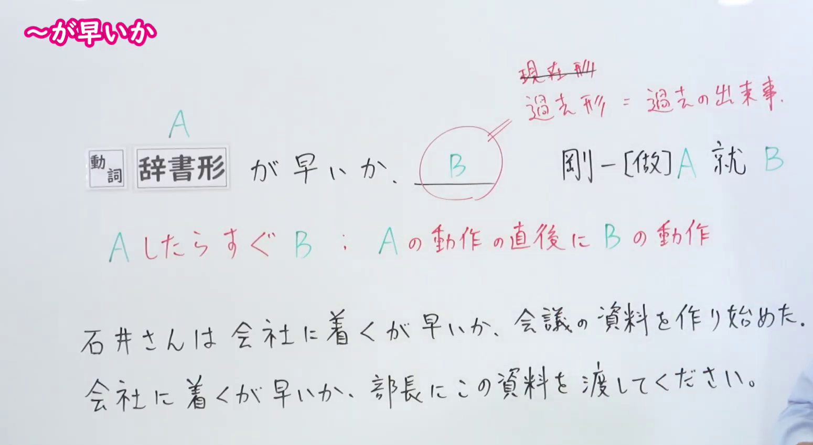
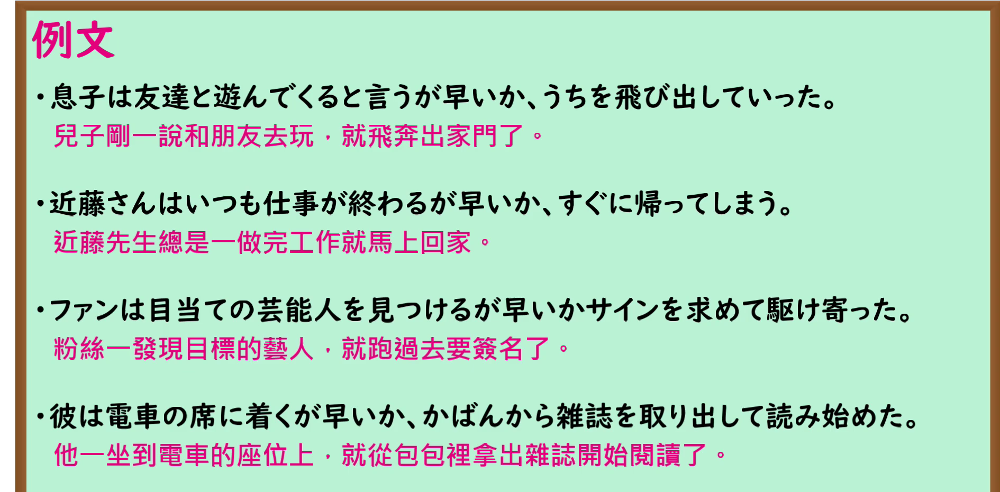

---
{
  "id": "N1-G-0013",
  "kind": "grammar",
  "level": "N1",
  "title": "がはやいか(が早いか)：一做完前项就立刻发生后项",
  "card_revision": 1,
  "schema_version": 1,
  "source": {
    "lesson": "N1 第13个语法",
    "material": "出口日語原视频板书、日语自动字幕与毎日のんびり日本語教師正文",
    "video": "https://www.youtube.com/watch?v=dC3rxVvGU4s",
    "screenshot": "assets/grammar/n1/N1-G-0013-connection.png",
    "screenshot_seconds": 60,
    "screenshot_crop": {
      "x": 0,
      "y": 0,
      "width": 1550,
      "height": 850
    }
  },
  "tags": [
    "紧接发生",
    "时间顺序",
    "N1"
  ],
  "confusions": [
    "やいなや(や否や)",
    "かないかのうちに"
  ]
}
---

# ～がはやいか(が早いか)

## 视频学习资料整理

- 课程：[出口日語 N1 第13个语法「～が早いか」](https://www.youtube.com/watch?v=dC3rxVvGU4s)。
- 接续图：原视频 01:00.00；原图 1920×1080；从左上角裁切至 `(0, 0, 1550, 850)`。画面保留接续、红字含义说明及两句板书例句。

- 例句图：原视频 04:01.63；原图 1920×1080；从左上角裁切至 `(0, 0, 1890, 930)`，保留四个完整的课程例句及视频中的中文译文。

# 核心

## 功能一：一做完 A，B 就立刻发生

**くわしい意味記述：**

- **がはやいか(が早いか)：** 前後の動作がほぼ同時発生していることを強調します。前件と後件の時間的感覚は非常に短いです。（强调前后两个动作几乎同时发生；前项与后项之间的时间间隔极短。）

### 例句

1. チャイムが鳴るが早いか、生徒たちは教室を飛び出していった。

   （铃声刚响，学生们就冲出了教室。）

2. お金を手にするが早いか、どこかへ遊びに行った。

   （钱一到手，他就跑出去玩了。）

3. あの鷹は獲物を捕まえるが早いか、すぐ飛び立っていった。

   （那只鹰刚抓住猎物，就立刻飞走了。）

4. 極度の疲れからか、ベッドに入るが早いか、すぐ寝付いてしまった。

   （也许是太累了，他刚上床就睡着了。）

# 来源

- [出口日語原视频](https://www.youtube.com/watch?v=dC3rxVvGU4s)
- [毎日のんびり日本語教師「【Ｎ１文法】～が早いか」](https://mainichi-nonbiri.com/grammar/n1-gahayaika/)（查询日期：2026-09-24；采用意义说明及例句）
