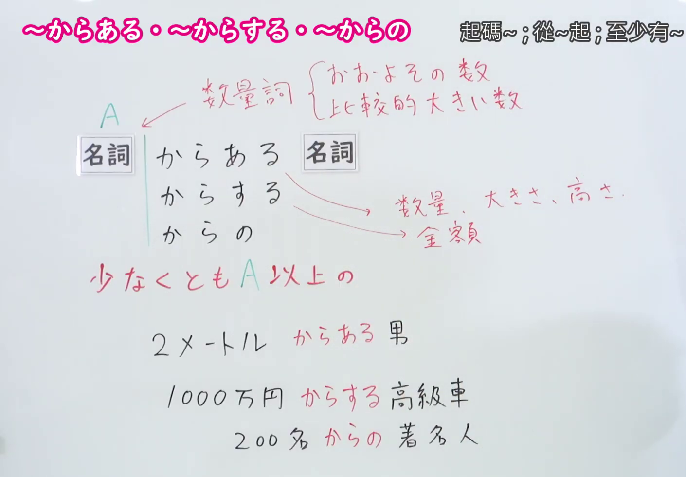
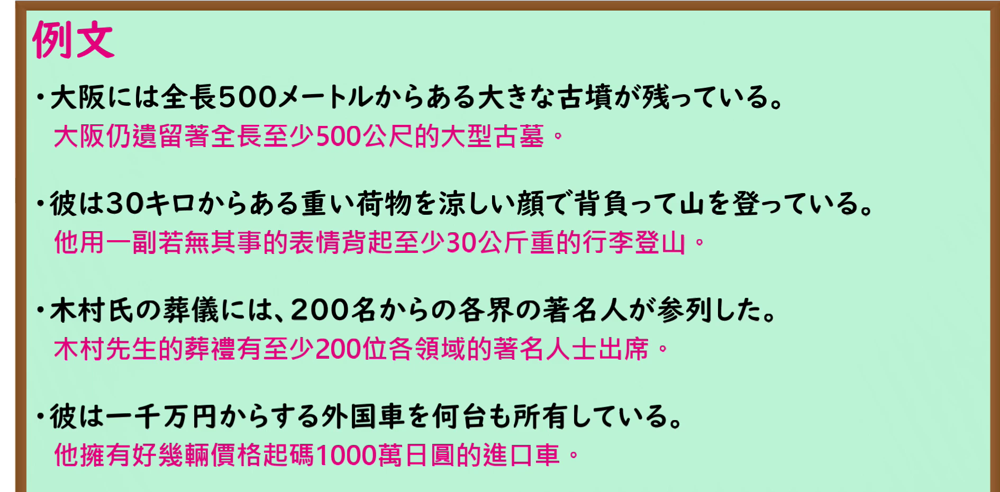

---
{
  "id": "N1-G-0014",
  "kind": "grammar",
  "level": "N1",
  "title": "からある・からする・からの：至少达到所说的数量",
  "card_revision": 1,
  "schema_version": 1,
  "source": {
    "lesson": "N1 第14个语法",
    "material": "出口日語原视频板书、日语自动字幕与毎日のんびり日本語教師正文",
    "video": "https://www.youtube.com/watch?v=VuggbOJwNpc",
    "screenshot": "assets/grammar/n1/N1-G-0014-connection.png",
    "screenshot_seconds": 162.4,
    "screenshot_crop": {
      "x": 0,
      "y": 0,
      "width": 1410,
      "height": 980
    }
  },
  "tags": [
    "数量强调",
    "数量下限",
    "N1"
  ],
  "confusions": [
    "からいる",
    "もの",
    "からなる"
  ]
}
---

# ～からある・～からする・～からの

## 视频学习资料整理

- 课程：[出口日語 N1 第14个语法「～からある・～からする・～からの」](https://www.youtube.com/watch?v=VuggbOJwNpc)。
- 接续图：原视频 02:42.40；原图 1920×1080；从左上角裁切至 `(0, 0, 1410, 980)`。画面保留三个形式、数量说明、红字含义和板书例句。

- 例句图：原视频 05:05.00；原图 1920×1080；从左上角裁切至 `(0, 0, 1890, 930)`，保留四个完整的课程例句及视频中的中文译文。

# 核心

## 功能一：数量至少达到 A

**くわしい意味記述：**

- **からある・からする・からの：** 金額、人数、大きさ、長さ、高さ、重さ、広さ、距離などがおよそその程度であること、あるいはそれ以上であることを表します。「～以上の」とほぼ同じ意味です。金額の大きさや価値を表す場合は「からする」、人数を表す場合は「からの」「からいる」、それ以外の数量を表す場合は「からある」を用います。（表示金额、人数、大小、长度、高度、重量、面积、距离等大约达到所说的程度，或超过这一程度；意思与「～以上の」大致相同。表示金额大小或价值时用「からする」；表示人数时用「からの」「からいる」；表示其他数量时用「からある」。）

### 例句

1. ２００万からする車を買った。

   （买了一辆价值至少二百万日元的车。）

2. 玉突き事故で２０人からの人が怪我を負った。

   （连环追尾事故中，至少有二十人受伤。）

3. ５００ｋｍからある距離を車で移動するのは疲れる。

   （开车走五百公里之远的路，确实很累。）

4. 連日の大雨で地盤が緩み、５トンからある岩が山から落ちてきた。

   （连日大雨使地基松动，一块重达五吨的岩石从山上滚落下来。）

5. この辺りは立地条件が良いので、最も安いものでも家賃は１０万円からする。

   （这一带地段好，即使是最便宜的房子，租金也要十万日元起。）

# 来源

- [出口日語原视频](https://www.youtube.com/watch?v=VuggbOJwNpc)
- [毎日のんびり日本語教師「【Ｎ１文法】～からある／からいる／からする／からの」](https://mainichi-nonbiri.com/grammar/n1-karaaru/)（查询日期：2026-09-24；采用意义说明及例句）
