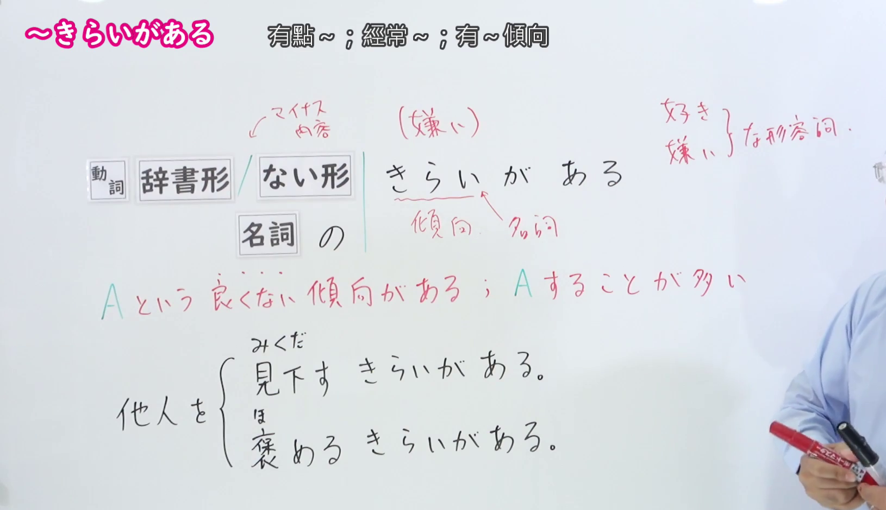
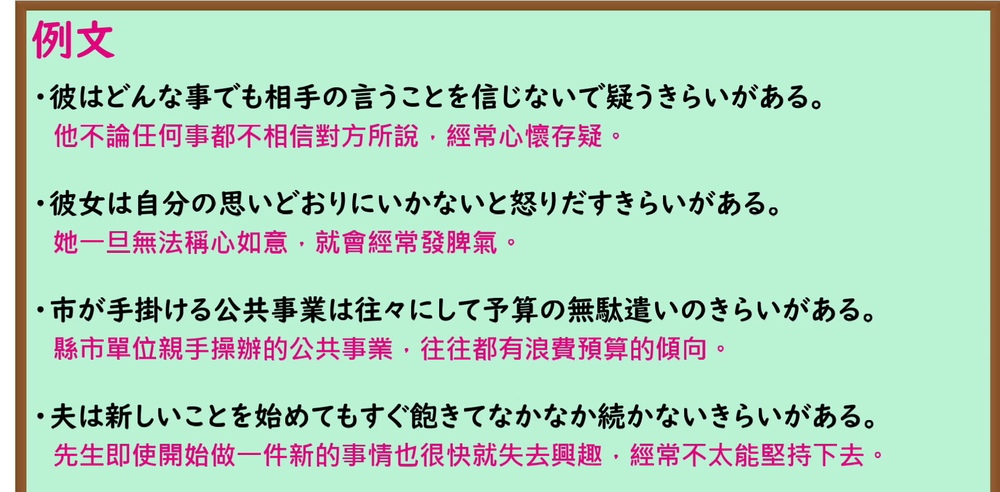

---
{
  "id": "N1-G-0015",
  "kind": "grammar",
  "level": "N1",
  "title": "きらいがある：有某种不良倾向",
  "card_revision": 1,
  "schema_version": 1,
  "source": {
    "lesson": "N1 第15个语法",
    "material": "出口日語原视频板书、日语自动字幕与毎日のんびり日本語教師正文",
    "video": "https://www.youtube.com/watch?v=0Nf7LXUgPLI",
    "screenshot": "assets/grammar/n1/N1-G-0015-connection.png",
    "screenshot_seconds": 120,
    "screenshot_crop": {
      "x": 0,
      "y": 0,
      "width": 1630,
      "height": 940
    }
  },
  "tags": [
    "不良倾向",
    "性格特点",
    "N1"
  ],
  "confusions": [
    "がち",
    "嫌い（不喜欢）"
  ]
}
---

# ～きらいがある

## 视频学习资料整理

- 课程：[出口日語 N1 第15个语法「～きらいがある」](https://www.youtube.com/watch?v=0Nf7LXUgPLI)。
- 接续图：原视频 02:00.00；原图 1920×1080；从左上角裁切至 `(0, 0, 1630, 940)`。画面保留接续、红字含义说明和板书例句；教师位于右侧边缘。

- 例句图：原视频 03:53.00；原图 1920×1080；从左上角裁切至 `(0, 0, 1890, 930)`，保留四个完整的课程例句及视频中的中文译文。

# 核心

## 功能一：有做 A 的不良倾向，经常做 A

**くわしい意味記述：**

- **きらいがある：** 良くない傾向や性質があることを表します。（表示存在不好的倾向或性格特点。）

### 例句

1. 彼は物事を独断で考えるきらいがある。

   （他有独断地看待事物的倾向。）

2. 今の子供は野菜をあまり食べないきらいがある。

   （如今的孩子有不太爱吃蔬菜的倾向。）

3. 苦労知らずな人ほど、他人を見下すきらいがある。

   （越是没吃过苦的人，越有轻视他人的倾向。）

4. 彼は人の言うことを何でも信じてしまうきらいがある。

   （他有轻信别人所说一切的倾向。）

5. 君は何でも頑張りすぎるきらいがあるから、そんな時は周りの人に頼ったらいい。

   （你做什么都有过于拼命的倾向，遇到这种情况可以依靠身边的人。）

# 来源

- [出口日語原视频](https://www.youtube.com/watch?v=0Nf7LXUgPLI)
- [毎日のんびり日本語教師「【Ｎ１文法】～嫌いがある／きらいがある」](https://mainichi-nonbiri.com/grammar/n1-kiraigaaru/)（查询日期：2026-09-24；采用意义说明及例句）
