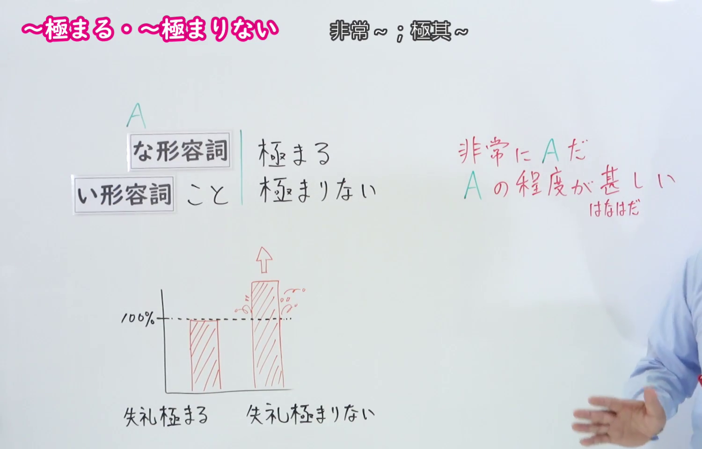
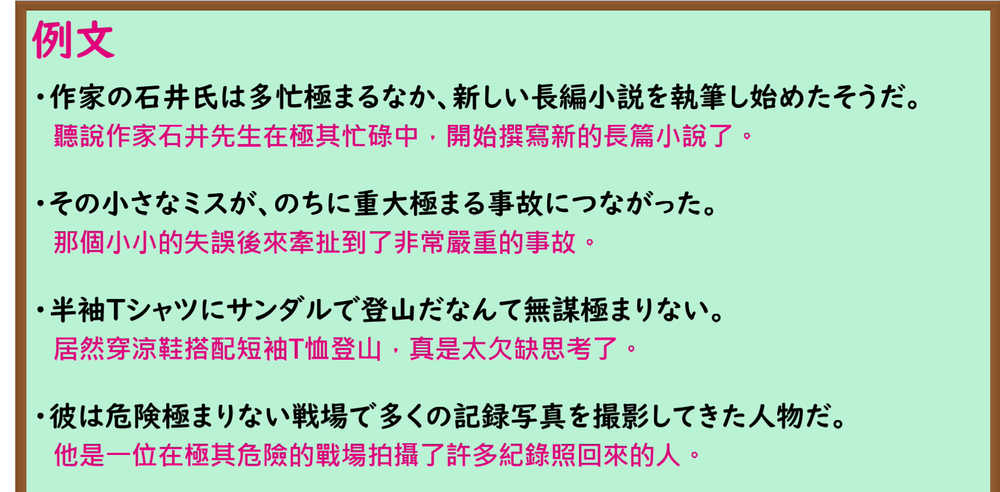

---
{
  "id": "N1-G-0016",
  "kind": "grammar",
  "level": "N1",
  "title": "きわまる(極まる)・きわまりない(極まりない)：程度极高",
  "card_revision": 1,
  "schema_version": 1,
  "source": {
    "lesson": "N1 第16个语法",
    "material": "出口日語原视频板书、日语自动字幕与毎日のんびり日本語教師正文",
    "video": "https://www.youtube.com/watch?v=2Ue4JyitjxI",
    "screenshot": "assets/grammar/n1/N1-G-0016-connection.png",
    "screenshot_seconds": 30,
    "screenshot_crop": {
      "x": 0,
      "y": 0,
      "width": 1500,
      "height": 960
    }
  },
  "tags": [
    "程度强调",
    "书面语",
    "N1"
  ],
  "confusions": [
    "かぎりだ(限りだ)",
    "きわまる(極まる)与きわまりない(極まりない)同义"
  ]
}
---

# ～きわまる(極まる)・～きわまりない(極まりない)

## 视频学习资料整理

- 课程：[出口日語 N1 第16个语法「～極まる・～極まりない」](https://www.youtube.com/watch?v=2Ue4JyitjxI)。
- 接续图：原视频 00:30.00；原图 1920×1080；从左上角裁切至 `(0, 0, 1500, 960)`。画面保留两种形式、红字程度说明及程度对比图；教师位于右侧边缘。

- 例句图：原视频 04:33.90；原图 1920×1080；从左上角裁切至 `(0, 0, 1890, 930)`，保留四个完整的课程例句及视频中的中文译文。

# 核心

## 功能一：非常 A，A 的程度极高

**くわしい意味記述：**

- **きわまる(極まる)・きわまりない(極まりない)：** 極限の程度を表します。「極まる」「極まりない」は形式上肯否の対立が見られますが、この言い方の時はその対立が解消され、いずれも同じ意味となります。（表示程度达到极限。「極まる」与「極まりない」形式上有肯定与否定的区别，但在这个用法中这种区别已消失，两者意思相同。）

### 例句

1. 彼の失礼極まりない態度に我慢できなかった。

   （我无法忍受他那极其无礼的态度。）

2. 法定速度を守らないのは危険極まる行動だ。

   （不遵守法定限速是极其危险的行为。）

3. 高層ビルなのにエレベーターが故障していて不便極まりない。

   （明明是高层建筑，电梯却坏了，实在不方便。）

4. 社会とは理不尽極まりないものだ。

   （社会是极其不讲理的。）

5. 恥ずかしいこと極まりない。穴があったら入りたい。

   （真是羞愧至极，恨不得找个洞钻进去。）

# 来源

- [出口日語原视频](https://www.youtube.com/watch?v=2Ue4JyitjxI)
- [毎日のんびり日本語教師「【Ｎ１文法】～極まる／～極まりない」](https://mainichi-nonbiri.com/grammar/n1-kiwamaru/)（查询日期：2026-09-24；采用意义说明及例句）
