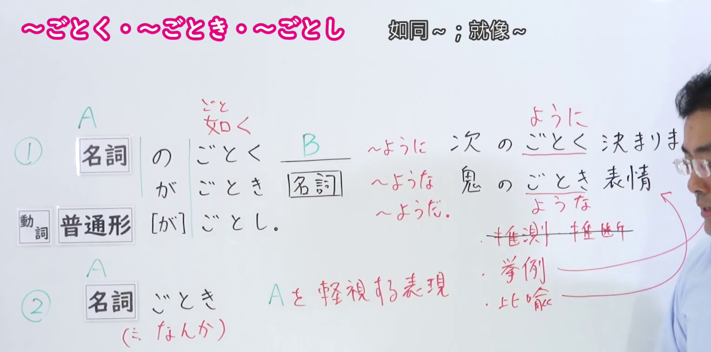
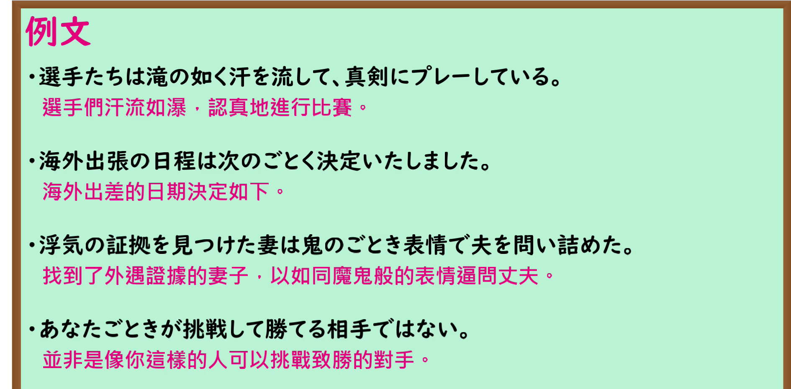

---
{
  "id": "N1-G-0017",
  "kind": "grammar",
  "level": "N1",
  "title": "～ごとく(如く)・～ごとき(如き)・～ごとし(如し)：如同；区区",
  "card_revision": 1,
  "schema_version": 1,
  "source": {
    "lesson": "N1 第17个语法",
    "material": "出口日語原视频板书、日语自动字幕与毎日のんびり日本語教師正文",
    "video": "https://www.youtube.com/watch?v=6hRUifeyN5o",
    "screenshot": "assets/grammar/n1/N1-G-0017-connection.png",
    "screenshot_seconds": 296.97,
    "screenshot_crop": {
      "x": 0,
      "y": 0,
      "width": 1530,
      "height": 760
    }
  },
  "tags": [
    "比喻",
    "轻视",
    "N1"
  ],
  "confusions": [
    "比喻的ごとき与轻视的ごとき同形异义；前者相当于～ような，后者接名词表示轻视，接自称时可表示自谦"
  ]
}
---

# ～ごとく(如く)・～ごとき(如き)・～ごとし(如し)

# 视频学习资料整理

- 课程：[出口日語 N1 第17个语法](https://www.youtube.com/watch?v=6hRUifeyN5o)，原视频长 7 分 25 秒。
- 接续与讲解板书：296.97 秒，原图 1920 × 1080，从左上角裁取 `(0, 0, 1530, 760)`。板书保留三种比喻形式及「～ように／～ような／～ようだ」的对应关系，也保留「ごとき」表示轻视的说明；右侧教师遮住部分板书。

- 例句板书：378.17 秒，原图 1920 × 1080，从左上角裁取 `(0, 0, 1890, 930)`。四句日语例句及视频中的中文翻译均完整可见。

# 核心

## 功能一：像 A 一样

**くわしい意味記述：**

- **ごとく(如く)・ごとき(如き)・ごとし(如し)：** 比喩の文型です。現代では書き言葉として用いられることが多く、古語表現です。「如き」は「～ような」と同じで、後ろは名詞に接続します。「如く」は「～ように」と同じで、後ろは動詞や形容詞に接続します。「如し」は「～ようだ」と同じで、文末に使われます。一般に会話では「～ようだ」「みたいだ」等を使います。（这是比喻句型，属于古语表达，如今多用于书面语。「如き」相当于「～ような」，后接名词；「如く」相当于「～ように」，后接动词或形容词；「如し」相当于「～ようだ」，用于句末。日常会话通常使用「～ようだ」「みたいだ」等。）

### 例句

1. 汗が滝のごとく流れ出す。

   （汗水如瀑布般流下。）

2. 何事もないかのごとく振る舞った。

   （表现得仿佛什么事都没发生过。）

3. 光陰矢の如し

   （光阴似箭。）

4. 業火の如き猛攻。

   （烈火般的猛烈攻势。）

## 功能二：以轻视的语气称 A

**くわしい意味記述：**

- **ごとき：** 人や物を表す名詞につき、対象を貶す語気を強めます。自分を表す語につくと謙遜の意味になります。例文（３）。（接在人或物的名词后，加强贬低对象的语气。接表示自己的词语时，则带有自谦的意思；该条目例句三属于这种情况。）

### 例句

1. お前ごときが私に勝てるわけがない。

   （你这种人不可能赢过我。）

2. なぜ１杯の水ごときに１０００円も払わなければいけないのか。

   （为什么区区一杯水要花一千日元？）

3. 神殿の中は私ごときが立ち入ってはいけない場所だ。

   （神殿是我这种人不该进入的地方。）

4. 俺の気持ちがお前ごときに分かるものか。

   （你这种人怎么可能理解我的心情？）

# 来源

- [出口日語 N1 第17课原视频](https://www.youtube.com/watch?v=6hRUifeyN5o)
- [毎日のんびり日本語教師「～如き／如く／如し」](https://mainichi-nonbiri.com/grammar/n1-gotoki-2/)（比喻功能的说明与例句；查询日期：2026-09-24）
- [毎日のんびり日本語教師「～ごとき／ごときに／ごときが／ごときで」](https://mainichi-nonbiri.com/grammar/n1-gotoki/)（轻视功能的说明与例句；查询日期：2026-09-24）
