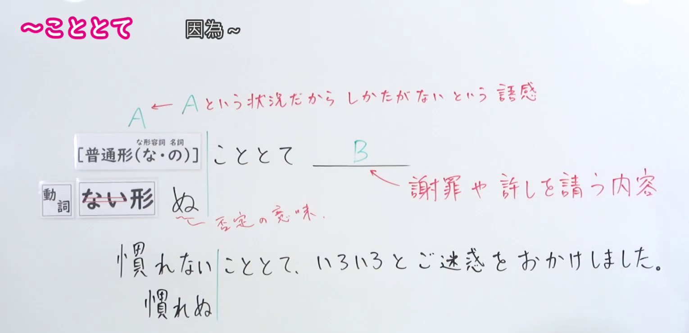
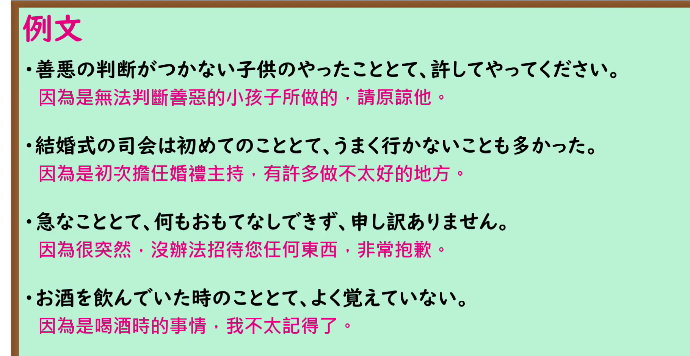

---
{
  "id": "N1-G-0018",
  "kind": "grammar",
  "level": "N1",
  "title": "～こととて：因为处于这种情况，所以难以避免",
  "card_revision": 1,
  "schema_version": 1,
  "source": {
    "lesson": "N1 第18个语法",
    "material": "出口日語原视频板书、日语自动字幕与毎日のんびり日本語教師正文",
    "video": "https://www.youtube.com/watch?v=oUyO4AcEwF0",
    "screenshot": "assets/grammar/n1/N1-G-0018-connection.png",
    "screenshot_seconds": 130.0,
    "screenshot_crop": {
      "x": 0,
      "y": 0,
      "width": 1530,
      "height": 740
    }
  },
  "tags": [
    "原因理由",
    "书面语",
    "N1"
  ],
  "confusions": [
    "与～だから、～なので同表原因，但～こととて语气较郑重，常用于说明难以避免的情况或请求谅解"
  ]
}
---

# ～こととて

# 视频学习资料整理

- 课程：[出口日語 N1 第18个语法](https://www.youtube.com/watch?v=oUyO4AcEwF0)，原视频长 5 分 20 秒。
- 接续与讲解板书：130.00 秒，原图 1920 × 1080，从左上角裁取 `(0, 0, 1530, 740)`。0:01 画面中教师遮住了右侧说明，因此采用后段清晰画面；本图保留接续、原因解释、致歉或请求谅解的说明及板书例句。

- 例句板书：238.38 秒，原图 1920 × 1080，从左上角裁取 `(0, 0, 1820, 940)`。四句日语例句及视频中的中文翻译完整可见。

# 核心

## 功能一：因为处于 A 这种情况，所以也难以避免

**くわしい意味記述：**

- **こととて：** 理由を表す文型です。意味は「～だから」と同じですが、こちらはやや硬い表現です。「急なこととて」は慣用表現です。動詞の否定形は「～ぬ」を使う場合もあります。謝罪や許可を得るような場面で使いやすいです。（表示理由的句型。意思与「～だから」相同，但语气略显郑重。「急なこととて」是惯用表达。动词的否定形式有时使用「～ぬ」。常用于致歉或请求许可的场合。）

### 例句

1. ７年前のこととて、何も憶えてない。

   （毕竟是七年前的事，什么都不记得了。）

2. 急なこととて何のおもてなしもできず申し訳ありません。

   （事出突然，没能好好招待您，非常抱歉。）

3. 週末のこととて、幹線道路は渋滞が始まっていた。

   （正值周末，主干道已经开始堵车。）

4. 慣れないこととて、レシピを見ても上手には作れなかった。

   （因为还不熟悉，即使照着食谱也没做好。）

# 来源

- [出口日語 N1 第18课原视频](https://www.youtube.com/watch?v=oUyO4AcEwF0)
- [毎日のんびり日本語教師「～こととて」](https://mainichi-nonbiri.com/grammar/n1-kototote/)（用法说明与例句；查询日期：2026-09-24）
