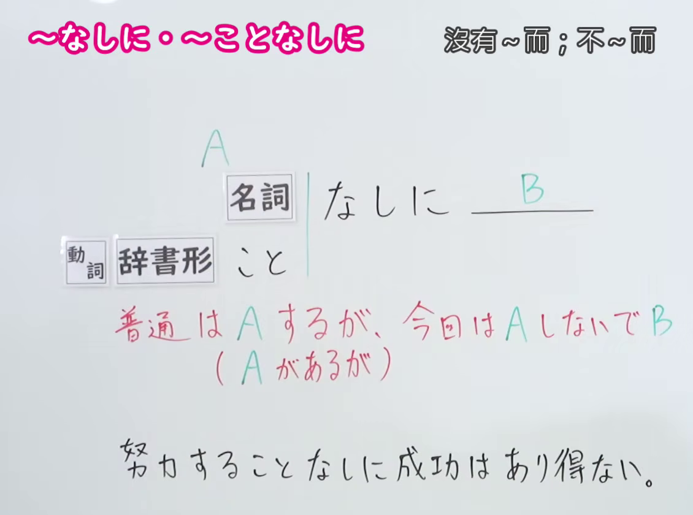
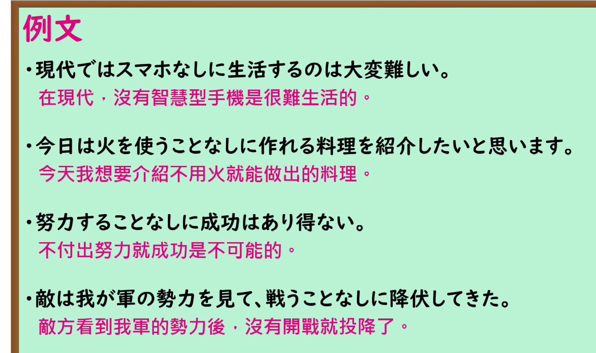

---
{
  "id": "N1-G-0019",
  "kind": "grammar",
  "level": "N1",
  "title": "～なしに・～ことなしに：不做 A 而做 B；不做 A 就无法 B",
  "card_revision": 1,
  "schema_version": 1,
  "source": {
    "lesson": "N1 第19个语法",
    "material": "出口日語原视频板书、日语自动字幕与Hagoromo文型条目正文",
    "video": "https://www.youtube.com/watch?v=vzEonWw5Qg0",
    "screenshot": "assets/grammar/n1/N1-G-0019-connection.png",
    "screenshot_seconds": 1.0,
    "screenshot_crop": {
      "x": 0,
      "y": 0,
      "width": 1130,
      "height": 840
    }
  },
  "tags": [
    "非伴随",
    "必要条件",
    "N1"
  ],
  "confusions": [
    "普通的～ことなしに表示不做 A 而做 B；后项接否定时可表达不做 A 就无法 B，即 A 不可缺少"
  ]
}
---

# ～なしに・～ことなしに

# 视频学习资料整理

- 课程：[出口日語 N1 第19个语法](https://www.youtube.com/watch?v=vzEonWw5Qg0)，原视频长 4 分 51 秒。
- 接续与讲解板书：1.00 秒，原图 1920 × 1080，从左上角裁取 `(0, 0, 1130, 840)`。保留两种形式、红字用法说明及板书例句；右侧教师画面已裁去。

- 例句板书：207.40 秒，原图 1920 × 1080，从左上角裁取 `(0, 0, 1570, 930)`。四句日语例句及视频中的中文翻译完整可见。

# 核心

## 功能一：通常会做 A，这次却不做 A 而做 B

**最上位意味カテゴリー：**

- **ことなしに：** ものごとの関係（事物之间的关系）
- **なしに(は)：** ものごとの様子（事物的状态）

**中位意味カテゴリー：**

- **ことなしに：** 付帯状態・非付帯状態（伴随状态与非伴随状态）
- **なしに(は)：** 否定（否定）

**意味：**

- **ことなしに：** 付帯状況（伴随情况）
- **なしに(は)：** 付帯状況（伴随情况）

**くわしい意味記述：**

- **ことなしに：** 普通はVをするが，今回はVをしないで，という意味をあらわす。（表示通常会做 V，但这次不做 V。）
- **なしに(は)：** 普通はNをするが，今回はNをしないで，という意味をあらわす。Nには決まった語が来ることが多い。（表示通常会做 N，但这次不做 N；N 多为固定搭配中的词语。）

**派生語：** ことなしに：未列出；なしに(は)：なしには。

### 例句

1. 親の力を借りることなしに、起業した。

   （没有借助父母的力量就创业了。）

2. 日曜日も休むことなしに働いた。

   （星期天也不休息，一直在工作。）

3. 断りなしに入るな。

   （未经允许不要进来。）

4. 免許証を得ることなしに、車を運転することは違法です。

   （未取得驾照就开车是违法的。）

## 功能二：不做 A 就无法 B，A 不可缺少

**最上位意味カテゴリー：**

- **ことなしに～〔否定〕：** ものごとの関係（事物之间的关系）

**中位意味カテゴリー：**

- **ことなしに～〔否定〕：** 付帯状態・非付帯状態（伴随状态与非伴随状态）

**意味：**

- **ことなしに～〔否定〕：** 付帯状況（伴随情况）

**くわしい意味記述：**

- **ことなしに～〔否定〕：** Xという状態なしで・Xということをしないで，Yはできない。Yには可能性を否定する表現が来る。「Yをするためには，Xをしなければならない・Xは不可欠だ」という意味を表す。（没有 X 这种状态，或不做 X，就无法做到 Y。Y 部分使用否定可能性的表达；意为要做 Y 就必须做 X，X 不可缺少。）

**派生語：** 未列出。

### 例句

1. 屈むことなしに、前進はありえない。

   （不懂得低头，就不可能前进。）

2. 先生の許可を得ることなしに、勝手に休みを取ることはできない。

   （没有得到老师的许可，就不能擅自请假。）

3. 予算削減は、議員が身を切る覚悟で自分の給与カットを提言することなしにはできない。

   （议员若没有以自身承担代价的决心提议削减自己的薪酬，就无法削减预算。）

4. 戦後最大の経済危機は政治家や官僚、経済界だけではなく、国民全体が自らの問題として取り組むことなしには克服できない。

   （这场战后最严重的经济危机，光靠政治家、官员和经济界无法克服；全体国民也必须当作自己的问题来应对。）

# 来源

- [出口日語 N1 第19课原视频](https://www.youtube.com/watch?v=vzEonWw5Qg0)
- [Hagoromo 文型检索](https://www.hagoromo-text.work/)「ことなしに」「なしに（は）」「ことなしに～〔否定〕」（用法分类、意义说明与例句；查询日期：2026-09-24）
