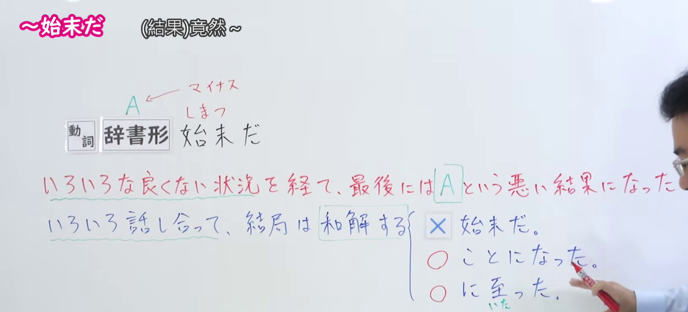
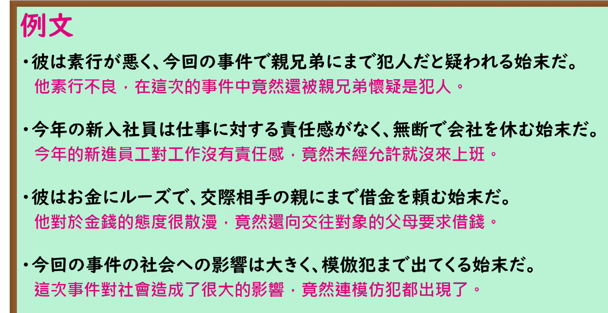

---
{
  "id": "N1-G-0020",
  "kind": "grammar",
  "level": "N1",
  "title": "～しまつだ(始末だ)：最终落得不好的结果",
  "card_revision": 1,
  "schema_version": 1,
  "source": {
    "lesson": "N1 第20个语法",
    "material": "出口日語原视频板书、日语自动字幕与Hagoromo文型条目正文",
    "video": "https://www.youtube.com/watch?v=bLtfjT8RYt0",
    "screenshot": "assets/grammar/n1/N1-G-0020-connection.png",
    "screenshot_seconds": 120.0,
    "screenshot_crop": {
      "x": 0,
      "y": 0,
      "width": 1630,
      "height": 740
    }
  },
  "tags": [
    "不良结果",
    "经过结局",
    "N1"
  ],
  "confusions": [
    "～しまつだ(始末だ)用于前面经过不好的发展、最后又出现更坏的结果；不用于经过讨论后达成和解等好结果"
  ]
}
---

# ～しまつだ(始末だ)

# 视频学习资料整理

- 课程：[出口日語 N1 第20个语法](https://www.youtube.com/watch?v=bLtfjT8RYt0)，原视频长 4 分 49 秒。
- 接续与讲解板书：120.00 秒，原图 1920 × 1080，从左上角裁取 `(0, 0, 1630, 740)`。0:01 画面中教师遮住红字解释，因此采用后段画面；本图保留接续、完整的红字解释，以及「和解」不能作为该语法结局的板书对照。

- 例句板书：199.50 秒，原图 1920 × 1080，从左上角裁取 `(0, 0, 1800, 930)`。四句日语例句及视频中的中文翻译完整可见。

# 核心

## 功能一：经过多种不好的情况，最后落得 A 这一坏结果

**最上位意味カテゴリー：**

- **しまつだ(始末だ)：** ものごとの関係（事物之间的关系）

**中位意味カテゴリー：**

- **しまつだ(始末だ)：** 経過・結末（经过与结局）

**意味：**

- **しまつだ(始末だ)：** 結果（结果）

**くわしい意味記述：**

- **しまつだ(始末だ)：** 悪いことが続いて，最後にはさらに悪い結果になったことを表す。（表示不好的事情接连发生，最后又落得更坏的结果。）

**派生語：** 未列出。

### 例句

1. 彼は子どものころからわがままで、ついには家出までするしまつだ。

   （他从小就任性，最后甚至离家出走了。）

2. 充電が満タンの状態からメールを３、４通送受信するだけで、電池が切れてしまう。緊急用の充電器を持ち歩いてる始末だ。

   （电池明明充满了，只收发三四封邮件就没电，最后只能随身带着应急充电器。）

3. 国連平和維持活動（ＰＫＯ）への参加問題に至っては、機関銃一丁ならよいが二丁はダメといった、こっけいきわまりないレベルの議論に終始している始末だ。

   （谈到参加联合国维和行动的问题，最后竟一直在争论「一挺机枪可以、两挺不行」这种荒唐至极的细节。）

# 来源

- [出口日語 N1 第20课原视频](https://www.youtube.com/watch?v=bLtfjT8RYt0)
- [Hagoromo 文型检索](https://www.hagoromo-text.work/)「しまつだ」（意义分类、详细说明与例句；查询日期：2026-09-24）
