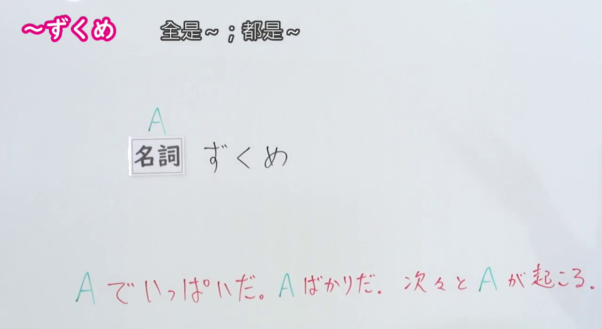
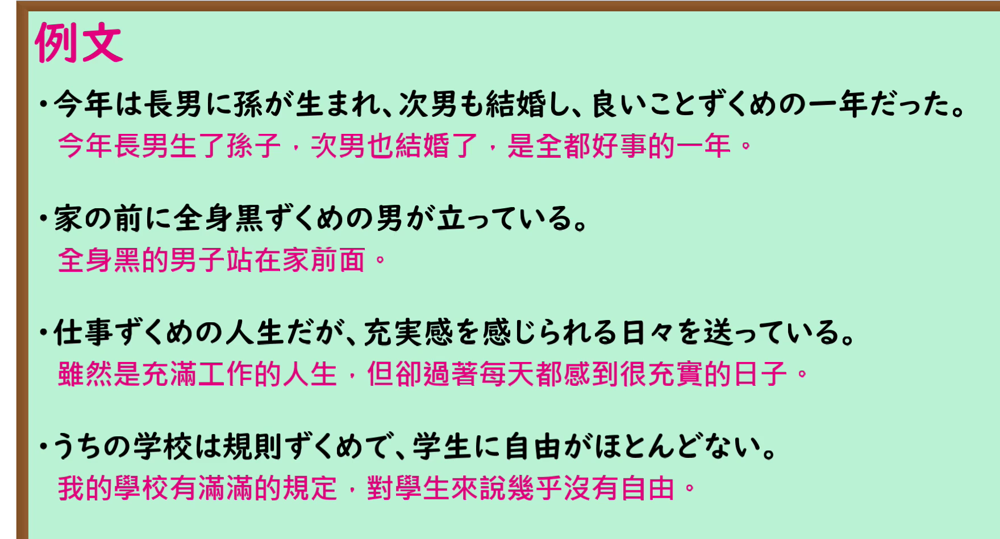

---
{
  "id": "N1-G-0021",
  "kind": "grammar",
  "level": "N1",
  "title": "ずくめ（尽是…；全是…）",
  "card_revision": 1,
  "schema_version": 1,
  "source": {
    "lesson": "N1 第21个语法",
    "material": "出口日語原视频板书、日语自动字幕与毎日のんびり日本語教師正文",
    "video": "https://www.youtube.com/watch?v=tE-RgKDiuHY",
    "screenshot": "assets/grammar/n1/N1-G-0021-connection.png",
    "screenshot_seconds": 13.91,
    "screenshot_crop": {
      "x": 0,
      "y": 0,
      "width": 1280,
      "height": 700
    }
  },
  "tags": [
    "ずくめ",
    "N1"
  ],
  "confusions": [
    "だらけ・まみれ（都表示「满是」，但ずくめ多见于固定搭配，且可用于好事，如「良いことずくめ」）",
    "働きづめ（表示「一直工作」，是づめ不是ずくめ；本课指出「働きずくめ」为误用）"
  ]
}
---

# N1 第21个语法：ずくめ（尽是…；全是…）

## 视频学习资料整理

原视频：[出口日語 N1 第21课「ずくめ」](https://www.youtube.com/watch?v=tE-RgKDiuHY)（时长 5:30）

### 接续图（真实时间 0:13.91）

- 原图尺寸：1920×1080；裁切区域：x=0, y=0, width=1280, height=700。
- 固定左上角、收拢右下角，裁去底部空白与右侧人像。
- 板书内容：名詞＋ずくめ，红色含义说明「A でいっぱいだ。A ばかりだ。次々と A が起こる。」。
- 替换说明：0:01 时点板书内容相同，但教师头部进入必要板书区；改用同一板书的 0:13.91 清晰时点，教师已让开板书，全部板书文字完整无遮挡。

### 例句图（真实时间 4:01.60）

- 原图尺寸：1920×1080；裁切区域：x=0, y=0, width=1760, height=950。
- 固定左上角、收拢右下角，裁去底部空白与桌面物品。
- 板书内容：课程例句页的四条例句及其中文翻译。

# 核心

## 功能一：满是A／净是A／A接连不断发生

**くわしい意味記述：**

- **ずくめ：** 全体的にそればかりであることを表します。「黒ずくめ（一身净黑的）」「幸せずくめ（全是好事）」「ご馳走ずくめ（全是好吃的）」などの慣用表現が多く、「白ずくめ」のような言い方は基本的に言いません。この文型を使った表現は限られています。漢字は「尽くめ」です。（表示整体上净是某种事物。多见于「黒ずくめ（一身净黑的）」「幸せずくめ（全是好事）」「ご馳走ずくめ（全是好吃的）」等惯用表达，而「白ずくめ」这类说法基本不说。使用该句型的表达是有限的。汉字写作「尽くめ」。）

### 例句

1. 防犯カメラに写っている黒ずくめの男が犯人だ。

   （监控摄像头拍到的那个一身黑的男人就是犯人。）

2. 今年は幸せずくめの一年だった。

   （今年是充满幸福的一年。）

3. しかし人生は良いことずくめではない。

   （然而人生并非净是好事。）

4. 仕事ずくめで休む暇がない。

   （整天忙于工作，连休息的时间都没有。）

5. ご馳走ずくめの晩ご飯。

   （净是些好吃的晚餐。）

# 来源

- [出口日語原视频](https://www.youtube.com/watch?v=tE-RgKDiuHY)
- [毎日のんびり日本語教師「【Ｎ１文法】～ずくめ」](https://mainichi-nonbiri.com/grammar/n1-zukume/)（查询日期：2026-09-24）
- Hagoromo 文型検索未收录「ずくめ」，故语法说明与例句采用上列备选网站正文。

