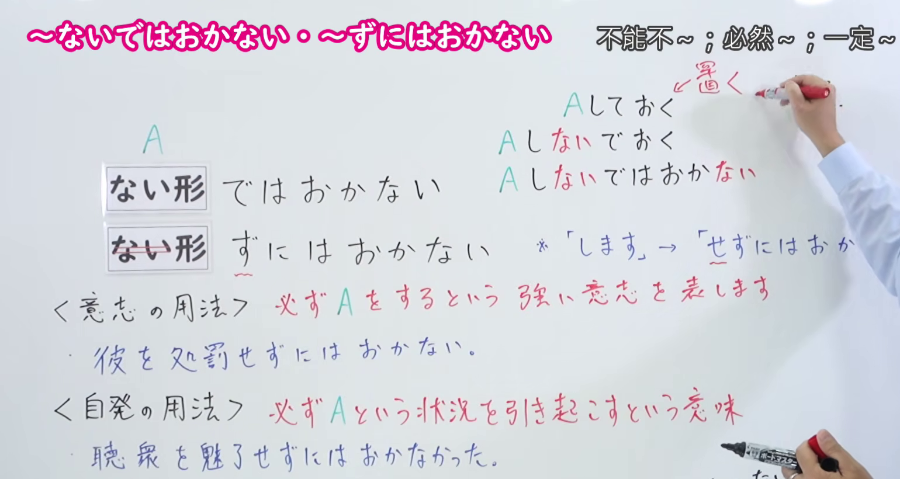
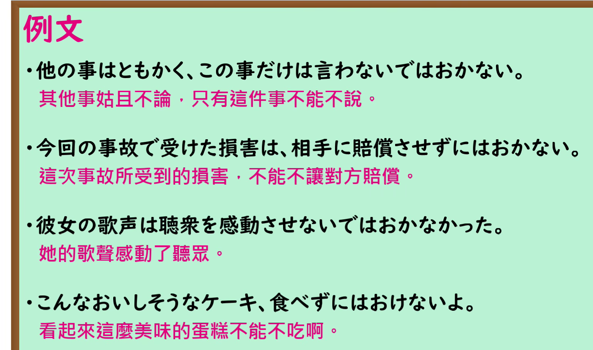

---
{
  "id": "N1-G-0022",
  "kind": "grammar",
  "level": "N1",
  "title": "ないではおかない／ずにはおかない（不能不…；必然…）",
  "card_revision": 1,
  "schema_version": 1,
  "source": {
    "lesson": "N1 第22个语法",
    "material": "出口日語原视频板书、日语自动字幕与 Hagoromo 文型検索正文",
    "video": "https://www.youtube.com/watch?v=Odk60ALwdPI",
    "screenshot": "assets/grammar/n1/N1-G-0022-connection.png",
    "screenshot_seconds": 180,
    "screenshot_crop": {
      "x": 0,
      "y": 0,
      "width": 1540,
      "height": 820
    }
  },
  "tags": [
    "ずにはおかない",
    "N1"
  ],
  "confusions": [
    "ずにはいられない（说话人自己忍不住做某事）与 ずにはおかない（必然引起某状况／强烈意志）不同",
    "ないではすまない・ずにはすまない（不…就不算完）与 ないではおかない（必然…）用法不同",
    "接续注意：する 用「せずにはおかない」，不说「しずにはおかない」"
  ]
}
---

# N1 第22个语法：ないではおかない／ずにはおかない（不能不…；必然…）

## 视频学习资料整理

原视频：[出口日語 N1 第22课「ないではおかない／ずにはおかない」](https://www.youtube.com/watch?v=Odk60ALwdPI)（时长 8:36）

### 接续图（真实时间 3:00.00）

- 原图尺寸：1920×1080；裁切区域：x=0, y=0, width=1540, height=820。
- 固定左上角、收拢右下角，裁去底部空白与教师躯干，仅保留右侧书写的手部。
- 板书内容：接续「ない形＋ではおかない」「ない形＋ずにはおかない」及「する→せずにはおかない」，红色用法说明「必ずAをするという強い意志を表します」「必ずAという状況を引き起こすという意味」，以及两条课程例句。
- 替换说明：0:01 时点教师站在板书中部遮挡讲解内容，改用教师让开板书、板书最完整的 3:00.00 时点；该时点教师抬右手书写右上角注释，遮住了「※「します」→「せずにはおかない」」的句尾，其余板书文字完整。

### 例句图（真实时间 7:12.06）

- 原图尺寸：1920×1080；裁切区域：x=0, y=0, width=1540, height=910。
- 固定左上角、收拢右下角，裁去底部空白与桌面物品。
- 板书内容：课程例句页的四条例句及其中文翻译。

# 核心

## 功能一：表示一定要做A的强烈意志，或必然引起A这种状况

**最上位意味カテゴリー：**

- **Vずに（は）おかない：** 考え・感情（思考与感情）
- **Vないで（は）おかない：** 考え・感情（思考与感情）

**中位意味カテゴリー：**

- **Vずに（は）おかない：** 避けられない心情・行動（无法回避的心情与行动）
- **Vないで（は）おかない：** 避けられない心情・行動（无法回避的心情与行动）

**意味：**

- **Vずに（は）おかない：** 行動（行动）
- **Vないで（は）おかない：** 行動（行动）

**くわしい意味記述：**

- **Vずに（は）おかない：** 話し手の意志と関係なく，自然とそのような状況や行動が引き起こされるという意味。「ないではおかない」と同じ意味。書きことばで使う。（表示与说话人的意志无关，自然而然地引发那样的状况或行动。与「ないではおかない」意思相同。用于书面语。）
- **Vないで（は）おかない：** 話し手の意志と関係なく，自然とそのような状況や行動が引き起こされるという意味。「ずにはおかない」と同じ意味。書きことばで使う。（表示与说话人的意志无关，自然而然地引发那样的状况或行动。与「ずにはおかない」意思相同。用于书面语。）

**派生語：** Vずにおかない，Vずにはおかない（Vずに（は）おかない）；Vないではおかない（Vないで（は）おかない）

### 例句

1. やつには罰を与えずにはおかない。

   （对那家伙，一定要给予惩罚。）

2. 期待を裏切られたのだ。文句を言わないではおかない。

   （期待被辜负了。我非抱怨不可。）

3. 細分化された単純な労働の繰り返しは確かに仕事の能率をたかめるけれど、一方で一人の人間にとっての労働の姿を歪めずにはおかない。

   （细分后的单纯劳动的重复确实能提高工作效率，但另一方面，也必然会扭曲一个人所面对的劳动形态。）

4. この状況は、もちろん日本を含めた国際社会に人道上の深刻な憂慮を呼び起こさずにおかない。

   （这种状况，当然会在包括日本在内的国际社会上引起人道上的深切忧虑。）

5. この食に対する考え方の差は、生に対する考え方の上に、ひいては国の文化の上に強く影響を与えずにはおかないものである。

   （这种对饮食看法的差异，必然会对看待人生的方式、进而对国家的文化产生强烈影响。）

# 来源

- [出口日語原视频](https://www.youtube.com/watch?v=Odk60ALwdPI)
- [Hagoromo 文型検索「Vずに（は）おかない」](https://www.hagoromo-text.work/lookup?vid=605)（查询日期：2026-09-24）
- [Hagoromo 文型検索「Vないで（は）おかない」](https://www.hagoromo-text.work/lookup?vid=1103)（查询日期：2026-09-24）

