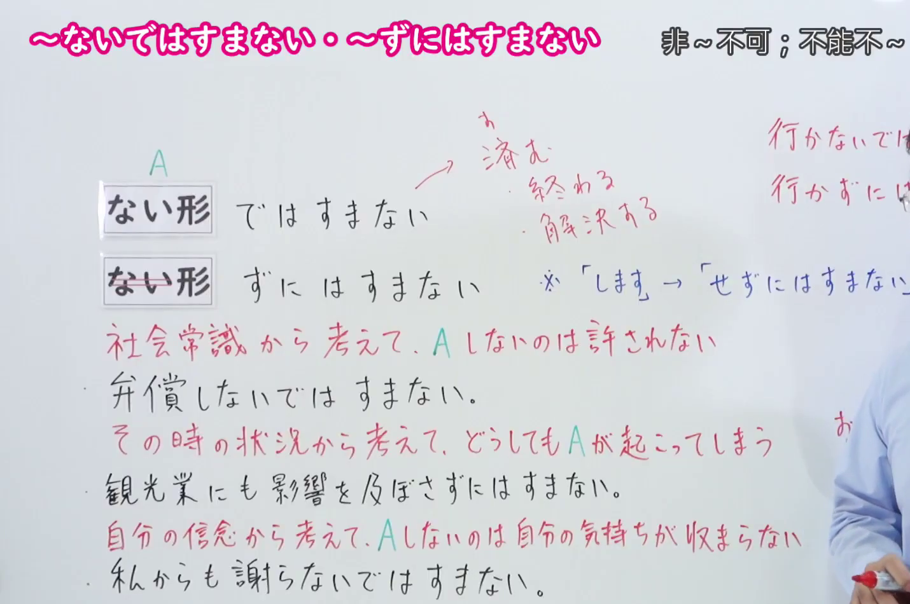

---
{
  "id": "N1-G-0023",
  "kind": "grammar",
  "level": "N1",
  "title": "ないでは済まない／ずには済まない（不能不…；非得…不可）",
  "card_revision": 1,
  "schema_version": 1,
  "source": {
    "lesson": "N1 第23个语法",
    "material": "出口日語原视频板书、日语自动字幕与毎日のんびり日本語教師正文",
    "video": "https://www.youtube.com/watch?v=HRIhcdUJEp0",
    "screenshot": "assets/grammar/n1/N1-G-0023-connection.png",
    "screenshot_seconds": 289.55,
    "screenshot_crop": {
      "x": 0,
      "y": 0,
      "width": 1430,
      "height": 950
    }
  },
  "tags": [
    "ずには済まない",
    "N1"
  ],
  "confusions": [
    "ずにはおかない・ないではおかない（自然而然引起某种感情或行动）与 ずには済まない（从常识、状况、信念看必须那样做）不同",
    "ずにはいられない・ないではいられない（说话人自己情不自禁）与 ずには済まない 不同",
    "では済まない・では済まされない（那样并不能解决问题）与本课「不做A就说不过去」不同",
    "接续注意：する 用「せずには済まない」，不说「しずには済まない」"
  ]
}
---

# N1 第23个语法：ないでは済まない／ずには済まない（不能不…；非得…不可）

## 视频学习资料整理

原视频：[出口日語 N1 第23课「ないでは済まない／ずには済まない」](https://www.youtube.com/watch?v=HRIhcdUJEp0)（时长 6:27）

### 接续图（真实时间 4:49.55）

- 原图尺寸：1920×1080；裁切区域：x=0, y=0, width=1430, height=950。
- 固定左上角、收拢右下角，裁去底部空白与人像躯干。
- 板书内容：接续「ない形＋では済まない」「ない形＋ずには済まない」，红色语源说明「済む→終わる・解決する」，以及三条红色用法说明「社会常識から考えて、Aしないのは許されない」「その時の状況から考えて、どうしてもAが起こってしまう」「自分の信念から考えて、Aしないのは自分の気持ちが収まらない」并各附例句。
- 替换说明：0:01 时点教师站在板书中部遮挡讲解内容，改用板书最完整、教师站位最靠右的 4:49.55 时点。该时点画面右缘仍留有教师持笔的手臂，未遮挡任何板书文字；右上角手写补充「行かないでは…／行かずには…」被裁切。

### 例句图（真实时间 5:02.07）

- 原图尺寸：1920×1080；裁切区域：x=0, y=0, width=1760, height=910。
- 固定左上角、收拢右下角，裁去底部空白与桌面物品。
- 板书内容：课程例句页的四条例句及其中文翻译。

# 核心

## 功能一：从社会常识看不得不做A，从当时状况看A必然发生，从自己的信念看不做A心里过不去

**くわしい意味記述：**

- **ずには済まない／ないでは済まない：** 一般常識、社会通念、状況などから鑑みて、必ずそうしなければならないことを表します。「する」は「せずには済まない」になります。（表示从一般常识、社会普遍观念、状况等来看，必须那样做。「する」要变成「せずには済まない」。）

### 例句

1. 君が悪いのなら謝らないではすまない。

   （如果你有错，就不能不道歉。）

2. 結婚に際しては相手の親に挨拶しに行かずにはすまない。

   （结婚时，必须去对方父母那里问候。）

3. 検査結果によっては手術せずにはすまなくなるだろう。

   （根据检查结果，恐怕会变成不得不做手术。）

4. 国民の命が脅かされている今、議論ではなくもうやらずには済まない状況だ。

   （在国民生命受到威胁的现在，这已不是讨论的问题，而是不能不付诸行动的状况。）

5. 多くの人をないがしろにする政治判断。その行為の責任は問わないでは済まない。

   （无视众多人的政治决策。其行为的责任不能不追究。）

# 来源

- [出口日語原视频](https://www.youtube.com/watch?v=HRIhcdUJEp0)
- [毎日のんびり日本語教師「【Ｎ１文法】～ずには済まない／ないでは済まない／ずには済まされない／ないでは済まされない」](https://mainichi-nonbiri.com/grammar/n1-zunihasumanai/)（查询日期：2026-09-24）
- Hagoromo 文型検索未收录该形式，故语法说明与例句采用上列备选网站正文。

