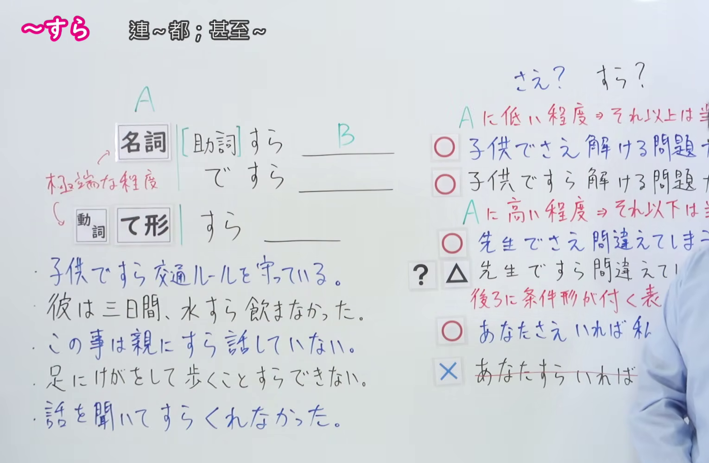
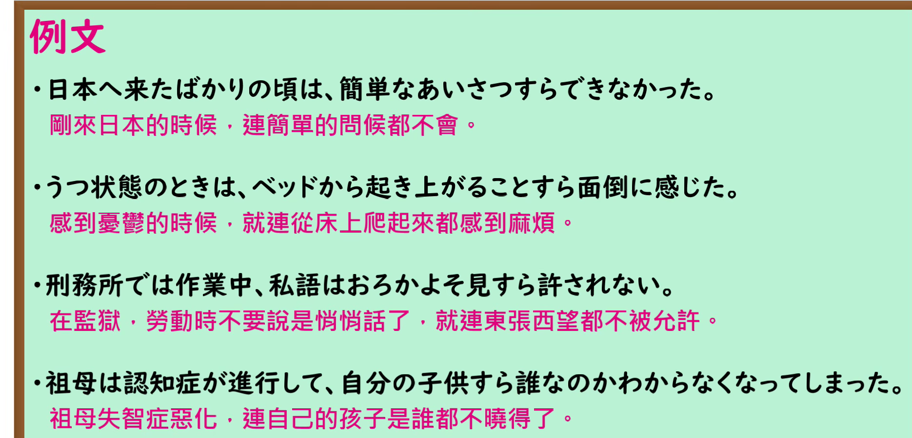

---
{
  "id": "N1-G-0024",
  "kind": "grammar",
  "level": "N1",
  "title": "すら／ですら（连…都；甚至…）",
  "card_revision": 1,
  "schema_version": 1,
  "source": {
    "lesson": "N1 第24个语法",
    "material": "出口日語原视频板书、日语自动字幕与 Hagoromo 文型検索正文",
    "video": "https://www.youtube.com/watch?v=1qiZzY_VywU",
    "screenshot": "assets/grammar/n1/N1-G-0024-connection.png",
    "screenshot_seconds": 535.05,
    "screenshot_crop": {
      "x": 0,
      "y": 0,
      "width": 1530,
      "height": 1000
    }
  },
  "tags": [
    "すら",
    "N1"
  ],
  "confusions": [
    "さえ 与本课 すら 意思相近；但 さえ 可接条件形（あなたさえいれば私は幸せ），すら 不能（×あなたすらいれば）",
    "提示较低程度时两者都自然（子供でさえ／子供ですら解ける）；提示较高程度时多用 さえ（先生でさえ間違えてしまう），用 すら 略显不自然",
    "接续注意：动作的对象需加「に」（親にすら話していない）",
    "接续注意：也可接动词て形（話を聞いてすらくれなかった）与形式名词（歩くことすらできない）"
  ]
}
---

# N1 第24个语法：すら／ですら（连…都；甚至…）

## 视频学习资料整理

原视频：[出口日語 N1 第24课「すら／ですら」](https://www.youtube.com/watch?v=1qiZzY_VywU)（时长 10:30）

### 接续图（真实时间 8:55.05）

- 原图尺寸：1920×1080；裁切区域：x=0, y=0, width=1530, height=1000。
- 固定左上角、收拢右下角，裁去底部空白与人像躯干。
- 板书内容：接续「名詞［助詞］＋すら」「名詞［助詞］＋ですら」「動詞て形＋すら」，红色说明「極端な程度」，五条课程例句，以及右侧「さえ？ すら？」对比栏（Aに低い程度／Aに高い程度、条件形可否的○△×标记）。
- 替换说明：0:01 时点接续与例句已写全，但红色「極端な程度」说明尚未写出、右侧对比栏仍为浅色底稿，故改用教师让开、板书完整的 8:55.05 时点。该时点右侧对比栏各行的句尾被教师身体遮挡，画面右缘另留有教师衣袖，其余板书文字完整。

### 例句图（真实时间 9:04.57）

- 原图尺寸：1920×1080；裁切区域：x=0, y=0, width=1870, height=900。
- 固定左上角、收拢右下角，裁去底部空白与桌面物品。
- 板书内容：课程例句页的四条例句及其中文翻译。

# 核心

## 功能一：提示极端程度，表示「连A都…，其他东西当然也…」

**最上位意味カテゴリー：**

- **すら〜肯定：** 考え・感情（思考与感情）
- **ですら：** 考え・感情（思考与感情）

**中位意味カテゴリー：**

- **すら〜肯定：** 軽重の強調（轻重程度的强调）
- **ですら：** 軽重の強調（轻重程度的强调）

**意味：**

- **すら〜肯定：** 極端な例からの類推（从极端例子作出类推）
- **ですら：** 程度の強調（程度的强调）

**くわしい意味記述：**

- **すら〜肯定：** 極端な例をあげ，「他のものはもちろん，〜も」という意味を表す。（举出极端的例子，表示「其他的东西自不必说，连〜也…」。）
- **ですら：** 極端な例をあげ，「他のものはもちろん，〜も」という意味を表す。（举出极端的例子，表示「其他的东西自不必说，连〜也…」。）

**派生語：** 未列出

### 例句

1. 高校生ですら株のネット取引をする時代になった。

   （已经到了连高中生都在网上炒股的时代了。）

2. この問題は子供すら回答できます。

   （这道题连小孩都能回答。）

3. 小学生の子ですらパソコンの使い方を知っている。

   （连小学生都知道怎么用电脑。）

4. 学校に行く時ですら、かばんを開けてケータイが入っていないと不安になってしまいます。

   （连去学校的时候，打开书包发现没带手机都会感到不安。）

5. 味覚が鋭くない僕ですら、何か物が違うということが分かる。

   （连味觉并不敏锐的我都明白有什么不一样。）

## 功能二：提示极端程度，表示「连A都不…，其他东西当然也不…」

**最上位意味カテゴリー：**

- **すら〜〔否定表現〕：** 考え・感情（思考与感情）

**中位意味カテゴリー：**

- **すら〜〔否定表現〕：** 軽重の強調（轻重程度的强调）

**意味：**

- **すら〜〔否定表現〕：** 程度の強調（程度的强调）

**くわしい意味記述：**

- **すら〜〔否定表現〕：** 極端な例をあげ，「他のものはもちろん，〜も〜ない」という意味を表す。簡単に出来ることをあげ，「簡単な〜もしない」という意味になることが多い。（举出极端的例子，表示「其他的东西自不必说，连〜也不…」。多举出简单就能做到的事，表示「连简单的〜都不做」。）

**派生語：** 未列出

### 例句

1. ビール２、３杯で自転車どころか歩くことすらできなくなっちゃった。

   （才喝了两三杯啤酒，别说骑自行车了，连走路都走不了了。）

2. うちの息子は恥ずかしがり屋で、女性と言葉を交わすことすら無理です。

   （我儿子很怕生，连和女性说句话都不行。）

3. 教科書すら買ってないしさー。

   （连教科书都没买呢。）

4. ラグーン（礁湖）の中のこの海は、池よりも穏やかで、波音すらしない。

   （礁湖里的这片海比池水还平静，连波浪声都没有。）

5. 湾岸戦争以降、日本では、人道支援をどう実施するかといった議論すらなされなかった。

   （海湾战争之后，日本连「如何实施人道支援」这样的讨论都没有进行过。）

# 来源

- [出口日語原视频](https://www.youtube.com/watch?v=1qiZzY_VywU)
- [Hagoromo 文型検索「すら〜肯定」](https://www.hagoromo-text.work/lookup?vid=607)（查询日期：2026-09-24）
- [Hagoromo 文型検索「すら〜〔否定表現〕」](https://www.hagoromo-text.work/lookup?vid=608)（查询日期：2026-09-24）
- [Hagoromo 文型検索「ですら」](https://www.hagoromo-text.work/lookup?vid=829)（查询日期：2026-09-24）

