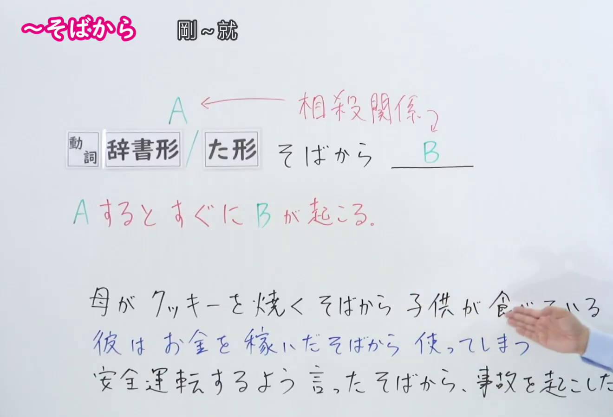
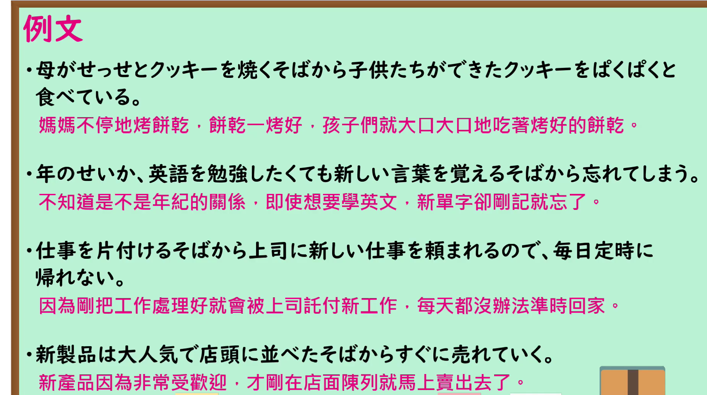

---
{
  "id": "N1-G-0025",
  "kind": "grammar",
  "level": "N1",
  "title": "そばから（刚…就…）",
  "card_revision": 1,
  "schema_version": 1,
  "source": {
    "lesson": "N1 第25个语法",
    "material": "出口日語原视频板书、日语自动字幕与 Hagoromo 文型検索正文（例句另采毎日のんびり日本語教師正文）",
    "video": "https://www.youtube.com/watch?v=If7aoh7fN1k",
    "screenshot": "assets/grammar/n1/N1-G-0025-connection.png",
    "screenshot_seconds": 90,
    "screenshot_crop": {
      "x": 0,
      "y": 0,
      "width": 1320,
      "height": 900
    }
  },
  "tags": [
    "そばから",
    "N1"
  ],
  "confusions": [
    "〜たとたん（に）只表示某一瞬间的偶然发生，不能像 そばから 那样表示同样的现象反复发生",
    "〜が早いか・〜や否や 也表「刚…就…」，但后件多为一次性事件，不表示反复",
    "本课强调 A 与 B 须构成相杀关系（做A的效果被B立刻抵消）：如「家を出たそばから雨が降った」因两者无相杀关系而不成立",
    "接续：動詞辞書形／た形＋そばから；后件多为说话人不希望发生的事"
  ]
}
---

# N1 第25个语法：そばから（刚…就…）

## 视频学习资料整理

原视频：[出口日語 N1 第25课「そばから」](https://www.youtube.com/watch?v=If7aoh7fN1k)（时长 4:46）

### 接续图（真实时间 1:30.00）

- 原图尺寸：1920×1080；裁切区域：x=0, y=0, width=1320, height=900。
- 固定左上角、收拢右下角，裁去底部空白与人像躯干。
- 板书内容：接续「動詞辞書形／た形＋そばから」，红色说明「相殺関係」（A 与 B 相互抵消）与「A するとすぐに B が起こる。」，以及三条课程例句。
- 替换说明：0:01 时点教师俯身挡住例句行，改用教师让开板书、红字说明已写全的 1:30.00 时点。该时点教师右手仍伸入画面右侧，遮住第二条例句「彼はお金を稼いだそばから使ってしまう」的句尾；其余板书文字完整。

### 例句图（真实时间 3:15.67）

- 原图尺寸：1920×1080；裁切区域：x=0, y=0, width=1850, height=1035。
- 固定左上角、收拢右下角，裁去底部空白与边框。
- 板书内容：课程例句页的四条例句及其中文翻译。

# 核心

## 功能一：一做A，B就立刻发生

**最上位意味カテゴリー：**

- **そばから：** 場所・時間（场所与时间）

**中位意味カテゴリー：**

- **そばから：** 時間的前後（时间上的前后）

**意味：**

- **そばから：** 継起（後）（相继发生・后项）

**くわしい意味記述：**

- **そばから：** 何かをしてもすぐ後で別のことが起こることを表す。別のことは望ましくないことが多い。（表示即使做了某事，紧接着马上又发生别的事。别的事多为不希望发生的事。）

**派生語：** 未列出

### 例句

1. あの子は、私がおもちゃを片付けるそばから、また出してくる。

   （那孩子，我刚把玩具收拾好，他就又拿出来了。）

2. 筆者など、人の名前はもとより、新しい知識や単語など、覚えるそばから忘れる（覚えていく一方で、またどんどん忘れていくこと）のだから、話にならない。

   （像我这样的人，别说人名了，新的知识和单词都是刚记住就忘（一边记住，一边又不断忘掉），所以根本没法谈。）

3. 食事したそばから食事したことを忘れる。

   （刚吃完饭就忘了自己吃过饭。）

4. 「気をつけてね」と言ったそばから怪我をした。

   （刚说完「小心点」就受伤了。）

5. 痩せたいと言ったそばから焼きそばとラーメンを食べている。

   （刚说完想减肥，就吃起了炒面和拉面。）

# 来源

- [出口日語原视频](https://www.youtube.com/watch?v=If7aoh7fN1k)
- [Hagoromo 文型検索「そばから」](https://www.hagoromo-text.work/lookup?vid=638)（查询日期：2026-09-24）
- [毎日のんびり日本語教師「【Ｎ１文法】～そばから」](https://mainichi-nonbiri.com/grammar/n1-sobakara/)（查询日期：2026-09-24；Hagoromo 该条目可用例句不足3条，缺额部分由此条目正文补充）

