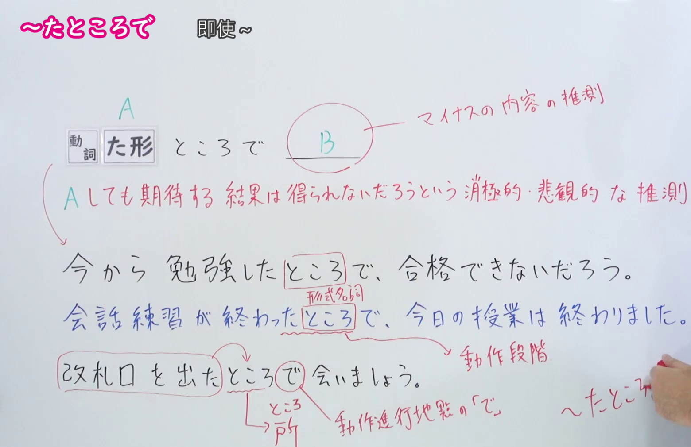
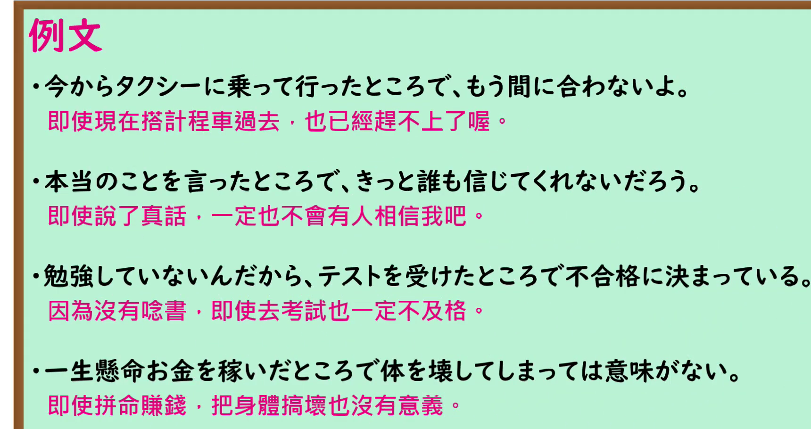

---
{
  "id": "N1-G-0026",
  "kind": "grammar",
  "level": "N1",
  "title": "たところで（即使…也…）",
  "card_revision": 1,
  "schema_version": 1,
  "source": {
    "lesson": "N1 第26个语法",
    "material": "出口日語原视频板书、日语自动字幕与毎日のんびり日本語教師正文",
    "video": "https://www.youtube.com/watch?v=gIDYYqhXVJo",
    "screenshot": "assets/grammar/n1/N1-G-0026-connection.png",
    "screenshot_seconds": 250,
    "screenshot_crop": {
      "x": 0,
      "y": 0,
      "width": 1560,
      "height": 1010
    }
  },
  "tags": [
    "たところで",
    "N1"
  ],
  "confusions": [
    "同形的「〜たところで」还表示「在…时」（動作段階），如「会話練習が終わったところで、今日の授業は終わりました」，与「即使…也…」用法不同",
    "同形的「〜たところで」还可表示场所，如「改札口を出たところで会いましょう」，此时「ところ」是表场所的名词，不是形式名词",
    "前件常与「いくら」「どんなに」「たとえ」呼应；后件多为否定性判断（しょうがない／無駄だ／意味がない）",
    "接续固定为 動た形＋ところで"
  ]
}
---

# N1 第26个语法：たところで（即使…也…）

## 视频学习资料整理

原视频：[出口日語 N1 第26课「たところで」](https://www.youtube.com/watch?v=gIDYYqhXVJo)（时长 5:59）

### 接续图（真实时间 4:10.00）

- 原图尺寸：1920×1080；裁切区域：x=0, y=0, width=1560, height=1010。
- 固定左上角、收拢右下角，裁去底部空白与人像躯干。
- 板书内容：接续「動詞た形＋ところで」，圈出的 B 及红色说明「マイナスの内容の推測」，红色含义说明「A しても期待する結果は得られないだろうという消極的・悲観的な推測」，以及三条课程例句（分别标注「形式名詞」「動作段階」「ところ→場所、動作進行地点の「で」」）。
- 替换说明：0:01 时点教师站在板书中部挡住例句行，改用板书批注写全、教师退到画面最右侧的 4:10.00 时点。该时点教师持笔的手仍留在画面右下角，遮住右下角红色小注「〜たところで」的末字；其余板书文字完整。

### 例句图（真实时间 4:28.66）

- 原图尺寸：1920×1080；裁切区域：x=0, y=0, width=1720, height=910。
- 固定左上角、收拢右下角，裁去底部空白与桌面物品。
- 板书内容：课程例句页的四条例句及其中文翻译。

# 核心

## 功能一：即使做A，也得不到期待的结果（消极、悲观的推测）

**くわしい意味記述：**

- **たところで：** 「たとえ～でも」と同じ意味です。後件に肯定形がくるか否定形がくるかで使い方が多少違います。肯定形の場合、後件では量的な不足、質的な不足が述べられます。否定形の場合、後件には「しょうがない」「無駄だ」「意味がない」などの否定的な判断を含む内容が述べられます。後件の動作をしても意味がないというニュアンスを含みます。前件には「いくら」「どんなに」「たとえ」などが呼応します。（与「たとえ～でも」意思相同。后件用肯定形还是否定形，用法略有不同。后件为肯定形时，多陈述量上的不足、质上的不足；后件为否定形时，多陈述含有「しょうがない」「無駄だ」「意味がない」等否定性判断的内容，含有「即使做后件的动作也没有意义」的语感。前件常与「いくら」「どんなに」「たとえ」呼应。）

### 例句

1. 昇給したところで数百円程度だろう。

   （即使加薪，大概也就几百日元吧。）

2. どれだけ遅れたところで、５分程度だろうと思う。

   （不管迟到多久，我想顶多也就五分钟吧。）

3. 一度勝機を逃したところで、大勢には影響はない。

   （即使错过一次胜机，对大局也没有影响。）

4. テスト前日になってから勉強したところで結果は変わらない。

   （到了考试前一天才开始学，结果也不会改变。）

5. 努力したところで運命は変わらない。

   （即使努力，命运也不会改变。）

# 来源

- [出口日語原视频](https://www.youtube.com/watch?v=gIDYYqhXVJo)
- [毎日のんびり日本語教師「【Ｎ１文法】～たところで」](https://mainichi-nonbiri.com/grammar/n1-tatokorode/)（查询日期：2026-09-24）
- Hagoromo 文型検索没有「たところで」的专属条目，仅在上位条目「ところ」中收录该用法，不符合条目须直接对应目标语法的要求，故语法说明与例句采用上列备选网站正文。

