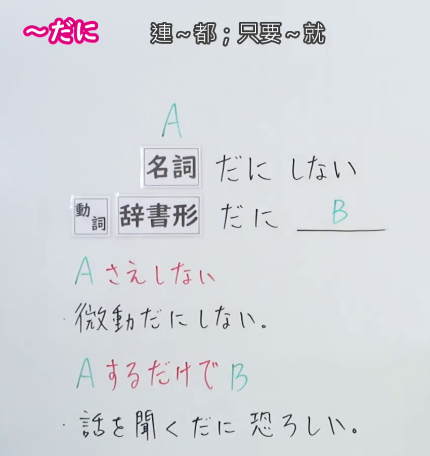
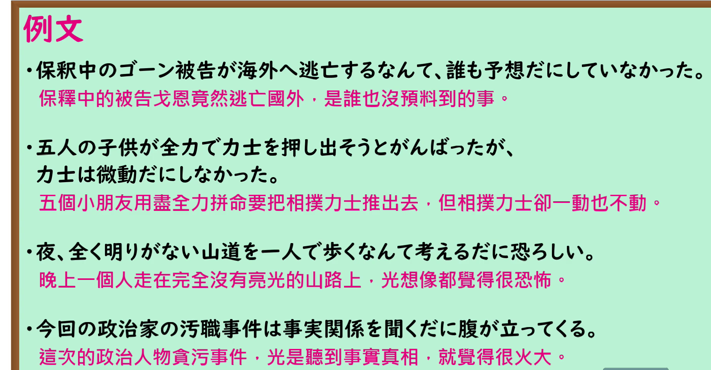

---
{
  "id": "N1-G-0027",
  "kind": "grammar",
  "level": "N1",
  "title": "だに（连…都；光是…就…）",
  "card_revision": 1,
  "schema_version": 1,
  "source": {
    "lesson": "N1 第27个语法",
    "material": "出口日語原视频板书、日语自动字幕与 Hagoromo 文型検索正文",
    "video": "https://www.youtube.com/watch?v=Hm9iR1CyJQs",
    "screenshot": "assets/grammar/n1/N1-G-0027-connection.png",
    "screenshot_seconds": 1,
    "screenshot_crop": {
      "x": 0,
      "y": 0,
      "width": 850,
      "height": 900
    }
  },
  "tags": [
    "だに",
    "N1"
  ],
  "confusions": [
    "さえ・すら 与本课 だに 意思相近，但 だに 属文语（話し言葉ではあまり使わない），且多与固定搭配连用",
    "「名詞＋だに＋しない」表示「连A都不」，能搭配的词有限（微動だにしない、予想だにしない、想像だにしない、一顧だにしない 等）",
    "「動詞辞書形＋だに」表示「光是做A就已经B」，如 話を聞くだに恐ろしい、考えるだに恐ろしい",
    "接续为两类：名詞＋だに＋しない／動詞辞書形＋だに＋后件"
  ]
}
---

# N1 第27个语法：だに（连…都；光是…就…）

## 视频学习资料整理

原视频：[出口日語 N1 第27课「だに」](https://www.youtube.com/watch?v=Hm9iR1CyJQs)（时长 4:49）

### 接续图（真实时间 0:01.00）

- 原图尺寸：1920×1080；裁切区域：x=0, y=0, width=850, height=900。
- 固定左上角、收拢右下角，裁去底部空白与人像。
- 板书内容：两类接续「名詞＋だに＋しない」「動詞辞書形＋だに＋B」，红色含义说明「A さえしない」「A するだけで B」，以及两条课程例句「微動だにしない。」「話を聞くだに恐ろしい。」。
- 说明：本课 0:01 时点板书接续已写全、教师站在板书右侧未遮挡，故直接采用该时点，无需替换。

### 例句图（真实时间 3:36.16）

- 原图尺寸：1920×1080；裁切区域：x=0, y=0, width=1850, height=965。
- 固定左上角、收拢右下角，裁去底部空白与桌面物品。
- 板书内容：课程例句页的四条例句及其中文翻译。

# 核心

## 功能一：连A都不做；光是做A就已经B

**最上位意味カテゴリー：**

- **だに：** 考え・感情（思考与感情）

**中位意味カテゴリー：**

- **だに：** 軽重の強調（轻重程度的强调）

**意味：**

- **だに：** 程度の強調（程度的强调）

**くわしい意味記述：**

- **だに：** 「さえ」「すら」という意味。極点な例を挙げてそれを否定することで，「他のことはなおさら〜ない」という意味を表す。話し言葉ではあまり使わない。（与「さえ」「すら」同义。举出极端的例子并加以否定，表示「其他的事就更不〜」。口语中不太使用。）

**派生語：** 未列出

### 例句

1. 宝くじで1億円当たるなんて、予想だにしなかった。

   （彩票中了一亿日元这种事，连想都没预想到。）

2. そんなことは夢にだに考えなかった。

   （那样的事情连做梦都没想过。）

3. 北朝鮮は日本の懸念を一顧だにしていない。

   （北朝鲜对日本的担忧连看都不看一眼。）

4. 私こと昨年中を振り返れば、思い起こすだに恥ずかしいことの数々、今はただひたすら反省の日々をうち過ごしております。

   （回首去年一年，想起来都觉得羞愧的事数不胜数，如今只是一味地过着反省的日子。）

5. 徳川幕府というのは、不合理な封建反動の権力といわれる。しかし信長、秀吉など、武芸者を一顧だにしなかったのに対し、家康は武芸者好みだったにもかかわらず、こういうことになっている。

   （德川幕府被称为不合理的封建反动政权。然而织田信长、丰臣秀吉等人对武士连看都不屑一看，家康虽喜好武士，结果却成了这样。）

# 来源

- [出口日語原视频](https://www.youtube.com/watch?v=Hm9iR1CyJQs)
- [Hagoromo 文型検索「だに」](https://www.hagoromo-text.work/lookup?vid=718)（查询日期：2026-09-24）

