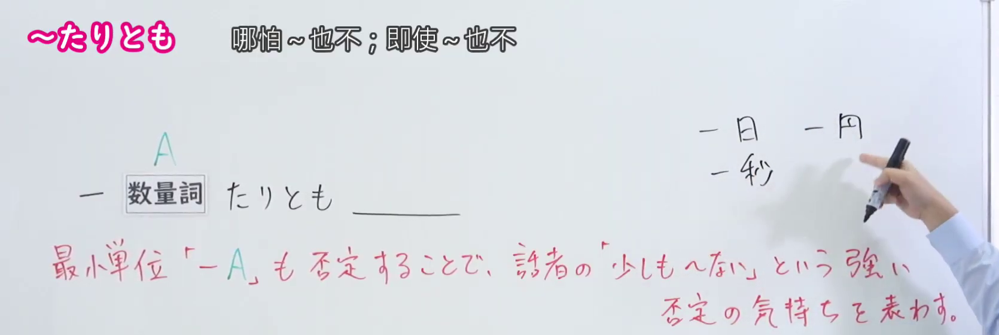
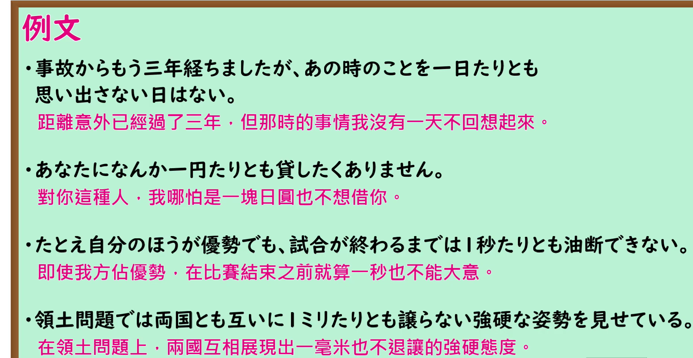

---
{
  "id": "N1-G-0028",
  "kind": "grammar",
  "level": "N1",
  "title": "たりとも（连…也（不）；哪怕…也（不））",
  "card_revision": 1,
  "schema_version": 1,
  "source": {
    "lesson": "N1 第28个语法",
    "material": "出口日語原视频板书、日语自动字幕与 Hagoromo 文型検索正文",
    "video": "https://www.youtube.com/watch?v=tduUORrsEpc",
    "screenshot": "assets/grammar/n1/N1-G-0028-connection.png",
    "screenshot_seconds": 25,
    "screenshot_crop": {
      "x": 0,
      "y": 0,
      "width": 1670,
      "height": 560
    }
  },
  "tags": [
    "たりとも",
    "N1"
  ],
  "confusions": [
    "「1＋数量詞＋も＋否定」与本课意思基本相同，但 たりとも 更书面、语气更强",
    "接续固定为「1＋助数詞＋たりとも＋否定」，助数詞如 一日、一秒、一円、一ミリ、一刻",
    "后件必须是否定表达，不能接肯定内容",
    "属较生硬的书面表达（堅い表現）"
  ]
}
---

# N1 第28个语法：たりとも（连…也（不）；哪怕…也（不））

## 视频学习资料整理

原视频：[出口日語 N1 第28课「たりとも」](https://www.youtube.com/watch?v=tduUORrsEpc)（时长 3:50）

### 接续图（真实时间 0:25.00）

- 原图尺寸：1920×1080；裁切区域：x=0, y=0, width=1670, height=560。
- 固定左上角、收拢右下角，裁去下方空白与人像躯干。
- 板书内容：接续「1＋数量詞＋たりとも＋否定」，红色含义说明「最小単位「1A」も否定することで、話者の「少しも〜ない」という強い否定の気持ちを表わす。」，以及右上角手写可搭配的数量词「一日／一円／一秒」。
- 替换说明：0:01 时点红色说明只写到一半，改用说明写全、教师让开板书主体的 0:25.00 时点。该时点教师持笔的手仍在画面右缘，但未遮挡任何板书文字。

### 例句图（真实时间 2:17.16）

- 原图尺寸：1920×1080；裁切区域：x=0, y=0, width=1860, height=960。
- 固定左上角、收拢右下角，裁去底部空白与桌面物品。
- 板书内容：课程例句页的四条例句及其中文翻译。

# 核心

## 功能一：连最小单位的A也否定，表达「一点也不〜」的强烈否定语气

**最上位意味カテゴリー：**

- **たりとも〜〔否定表現〕：** 考え・感情（思考与感情）

**中位意味カテゴリー：**

- **たりとも〜〔否定表現〕：** 軽重の強調（轻重程度的强调）

**意味：**

- **たりとも〜〔否定表現〕：** 程度の強調（程度的强调）

**くわしい意味記述：**

- **たりとも〜〔否定表現〕：** 「１＋助数詞＋たりとも〜ない」という構文で，完全に否定する意味を表す。（用「1＋助数词＋たりとも〜ない」这一句式，表示完全否定。）

**派生語：** 未列出

### 例句

1. １円たりとも無駄には使うな。

   （连一日元也不要浪费。）

2. もしも眼球が凸レンズと同様であり、網膜が乾板と同様であるならば、わたしたちは、すべて逆さにうつし出された生活空間のなかで、一日たりとも正常な暮らしをいとなむことはできないであろう。

   （如果眼球与凸透镜相同、视网膜与干板相同，那么我们在整个倒映出来的生活空间里，恐怕一天也无法过上正常的生活吧。）

3. 本来ならホテルにはいって旅装をとき、シャワーでもあびて、ゆっくり昼寝でもしてからおもむろに見物にでかければよろしかろうとおもわれるのだけれども、なぜか日本人の団体客は、外国に着いたその瞬間から一刻たりとも無駄にしないスケジュールのうえで行動しないと満足できないらしいのだ。

   （按理说，本应住进酒店换下旅装、冲个淋浴、悠闲地睡个午觉，再从容地去观光；可不知为何，日本团体游客似乎从抵达外国的瞬间起，不在连一刻都不浪费的行程上行动就不满足。）

# 来源

- [出口日語原视频](https://www.youtube.com/watch?v=tduUORrsEpc)
- [Hagoromo 文型検索「たりとも〜〔否定表現〕」](https://www.hagoromo-text.work/lookup?vid=747)（查询日期：2026-09-24）

