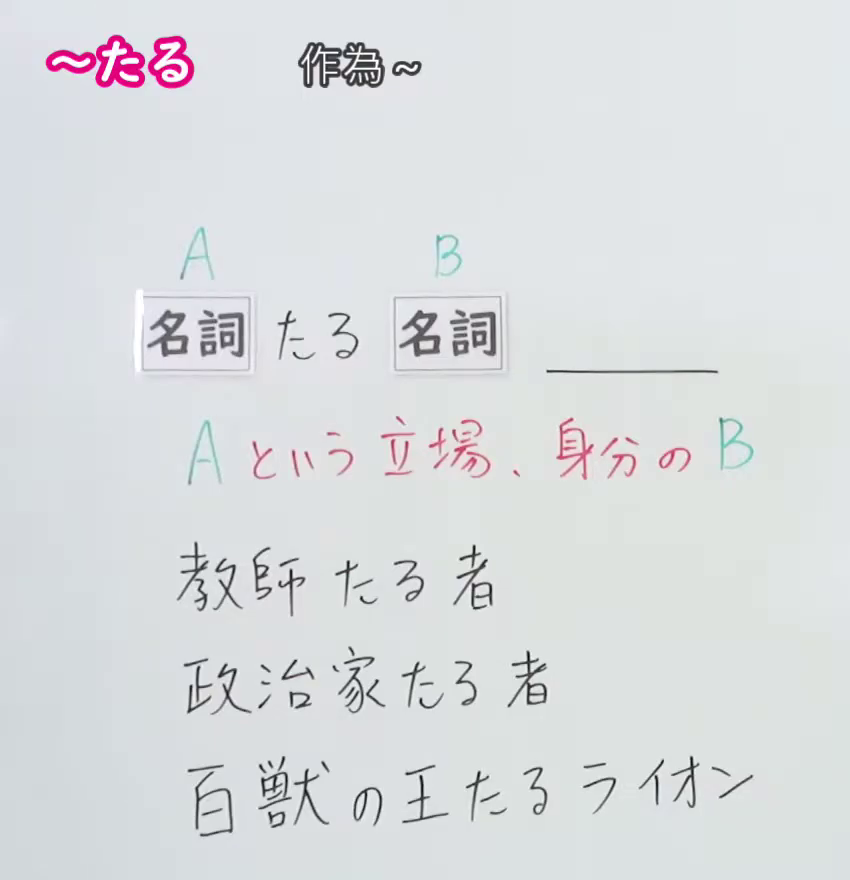
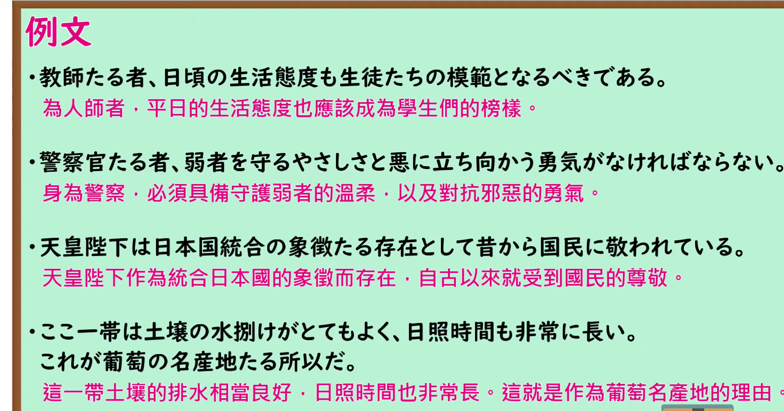

---
{
  "id": "N1-G-0029",
  "kind": "grammar",
  "level": "N1",
  "title": "たる（作为…的；处在…立场的）",
  "card_revision": 1,
  "schema_version": 1,
  "source": {
    "lesson": "N1 第29个语法",
    "material": "出口日語原视频板书、日语自动字幕与 Hagoromo 文型検索正文",
    "video": "https://www.youtube.com/watch?v=1EEKFIErAOo",
    "screenshot": "assets/grammar/n1/N1-G-0029-connection.png",
    "screenshot_seconds": 1,
    "screenshot_crop": {
      "x": 0,
      "y": 0,
      "width": 850,
      "height": 880
    }
  },
  "tags": [
    "たる",
    "N1"
  ],
  "confusions": [
    "同形的「厳然たる」「爛漫たる」「最たる」属タルト型形容動詞，与本课「N1たるN2」的用法不同",
    "「〜たるもの」的「もの」多写成「者」，表示「处在A这一立场的人」（教師たる者、政治家たる者）",
    "后件常接「〜べきだ」「〜なければならない」等表示规范、责务的内容",
    "文語的な表現，较生硬，日常会话很少使用"
  ]
}
---

# N1 第29个语法：たる（作为…的；处在…立场的）

## 视频学习资料整理

原视频：[出口日語 N1 第29课「たる」](https://www.youtube.com/watch?v=1EEKFIErAOo)（时长 4:30）

### 接续图（真实时间 0:01.00）

- 原图尺寸：1920×1080；裁切区域：x=0, y=0, width=850, height=880。
- 固定左上角、收拢右下角，裁去底部空白与人像。
- 板书内容：接续「名詞＋たる＋名詞」（A たる B），红色含义说明「A という立場、身分の B」，以及三条课程例句「教師たる者」「政治家たる者」「百獣の王たるライオン」。
- 说明：本课 0:01 时点板书已写全、教师站在板书右侧未遮挡，故直接采用该时点，无需替换。

### 例句图（真实时间 2:56.31）

- 原图尺寸：1920×1080；裁切区域：x=0, y=0, width=1860, height=975。
- 固定左上角、收拢右下角，裁去底部空白与桌面物品。
- 板书内容：课程例句页的四条例句及其中文翻译。

# 核心

## 功能一：表示「处在A这样的立场、身份的B」，即「身为A就该…」

**最上位意味カテゴリー：**

- **たる：** 考え・感情（思考与感情）

**中位意味カテゴリー：**

- **たる：** 主張・断定的評価（主张与断定性的评价）

**意味：**

- **たる：** 評価（评价）

**くわしい意味記述：**

- **たる：** 「N1たるN2」のかたちで用いることが多い。N1のような立派な立場にあるのだから，それにふさわしい態度でいなければならない，という意味を表す。N2は「者」が多い。文語的な表現。（多用于「N1たるN2」的形式。表示「既然处在N1那样值得尊敬的立场，就必须采取与之相称的态度」。N2多为「者」。属文语性表达。）

**派生語：** 未列出

### 例句

1. 議員たる者、少しの不正があってもいけない。

   （身为议员，哪怕有一点点不正之风也不行。）

2. 大学の教育研究環境の高度化を図り、教育研究活動の活性化を促進するとともに、研究の後継者たる優秀な人材の確保・育成に努めること、

   （在推进大学教育研究环境高度化、促进教育研究活动活性化的同时，努力确保和培养作为研究接班人的优秀人才。）

3. １９１９年に制定されたドイツ共和国憲法（ワイマール憲法）は、人間たるに値する生活の保障や労働者の団結権など、社会権の基礎を確立した。

   （1919年制定的德意志共和国宪法（魏玛宪法）确立了配得上人的生活的保障、劳动者的团结权等社会权的基础。）

# 来源

- [出口日語原视频](https://www.youtube.com/watch?v=1EEKFIErAOo)
- [Hagoromo 文型検索「たる」](https://www.hagoromo-text.work/lookup?vid=749)（查询日期：2026-09-24）

