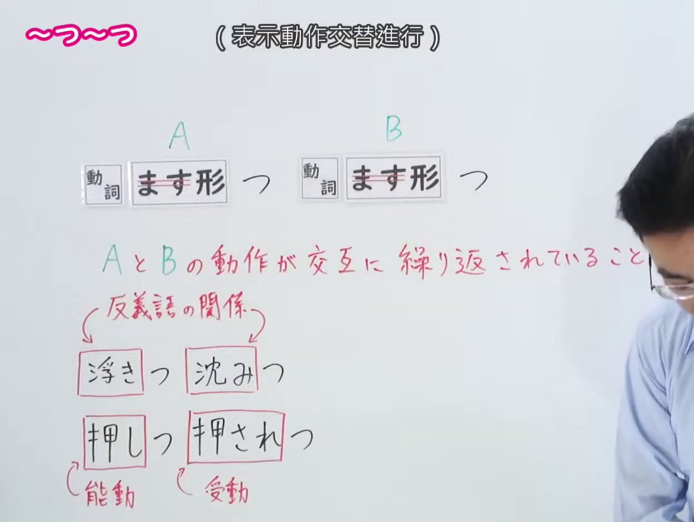
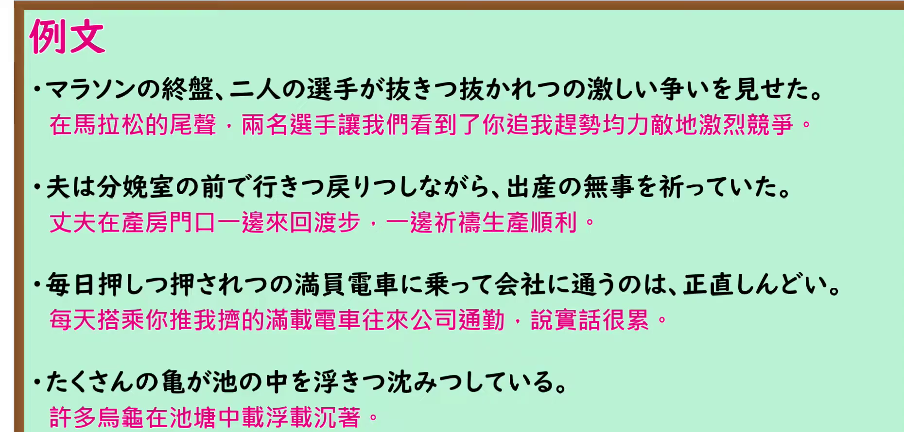

---
{
  "id": "N1-G-0030",
  "kind": "grammar",
  "level": "N1",
  "title": "つ〜つ（…来…去；互相…）",
  "card_revision": 1,
  "schema_version": 1,
  "source": {
    "lesson": "N1 第30个语法",
    "material": "出口日語原视频板书、日语自动字幕与日本語NET 正文",
    "video": "https://www.youtube.com/watch?v=-gAWzoJKHUA",
    "screenshot": "assets/grammar/n1/N1-G-0030-connection.png",
    "screenshot_seconds": 1,
    "screenshot_crop": {
      "x": 0,
      "y": 0,
      "width": 1250,
      "height": 940
    }
  },
  "tags": [
    "つ〜つ",
    "N1"
  ],
  "confusions": [
    "与「〜たり〜たり」意思相同，但 〜つ〜つ 是惯用表达，使用场面有限",
    "只能表示同一场面、同一时间段内交替反复发生的事，如「明日は勉強しつ、本を読みつするつもりだ」不成立",
    "进入A、B的多为反义词（浮きつ沈みつ、行きつ戻りつ）或同一动词的主动／被动（押しつ押されつ）",
    "接续：動詞ます形（去ます）＋つ、動詞ます形（去ます）＋つ"
  ]
}
---

# N1 第30个语法：つ〜つ（…来…去；互相…）

## 视频学习资料整理

原视频：[出口日語 N1 第30课「つ〜つ」](https://www.youtube.com/watch?v=-gAWzoJKHUA)（时长 5:19）

### 接续图（真实时间 0:01.00）

- 原图尺寸：1920×1080；裁切区域：x=0, y=0, width=1250, height=940。
- 固定左上角、收拢右下角，裁去底部空白与人像躯干。
- 板书内容：接续「動詞ます形＋つ ／ 動詞ます形＋つ」，红色含义说明「A と B の動作が交互に繰り返されていること」，以及两类词语搭配示例——反义语关系「浮きつ沈みつ」、能動／受動「押しつ押されつ」。
- 说明：本课 0:01 时点板书已写全、教师站在板书右侧，故直接采用该时点。该时点教师头部出现在画面右缘，但未遮挡任何板书文字。

### 例句图（真实时间 3:59.01）

- 原图尺寸：1920×1080；裁切区域：x=0, y=0, width=1860, height=890。
- 固定左上角、收拢右下角，裁去底部空白与桌面物品。
- 板书内容：课程例句页的四条例句及其中文翻译。

# 核心

## 功能一：A与B的动作交替反复进行

**くわしい意味記述：**

- **つ〜つ：** 「〜たり〜たり」の慣用的な表現で、使用場面は限られる。同一場面、同じ時間帯の中で起こっていることを表すので、次のようなのは使えない。誤用例：明日は勉強しつ、本を読みつするつもりだ。（是「〜たり〜たり」的习惯性表达，使用场面有限。由于表示在同一场面、同一时间段内发生的事，所以下面这种说法不能使用。误用例：明日は勉強しつ、本を読みつするつもりだ。）

### 例句

1. どうしても欲しいパソコンがあって、店の前を行きつ戻りつした。

   （因为有台无论如何都想要的电脑，我在店前走来走去。）

2. 昨日のマラソン大会は抜きつ抜かれつの大接戦で、とても面白かった。

   （昨天的马拉松大赛是你追我赶的激烈角逐，非常有趣。）

3. ジェースムは車で、敵と追いつ追われつのカーチェイスを繰り広げた。

   （ジェースム 开着车，与敌人展开了一场互相追逐的汽车追逐战。）

4. 僕とタカシは持ちつ持たれつの関係で、子供のころからお互い助け合ってきました。

   （我和タカシ是互相扶持的关系，从小就一直互相帮助。）

# 来源

- [出口日語原视频](https://www.youtube.com/watch?v=-gAWzoJKHUA)
- [日本語NET「【JLPT N１】文法・例文：〜つ〜つ」](https://nihongokyoshi-net.com/2019/02/15/jlptn1-grammar-tsu-tsu/)（查询日期：2026-09-24）
- Hagoromo 文型検索与毎日のんびり日本語教師均未收录「〜つ〜つ」（Hagoromo 只有「つつ」的付帯状況、逆接两条他义条目），故按优先级采用日本語NET 正文。

