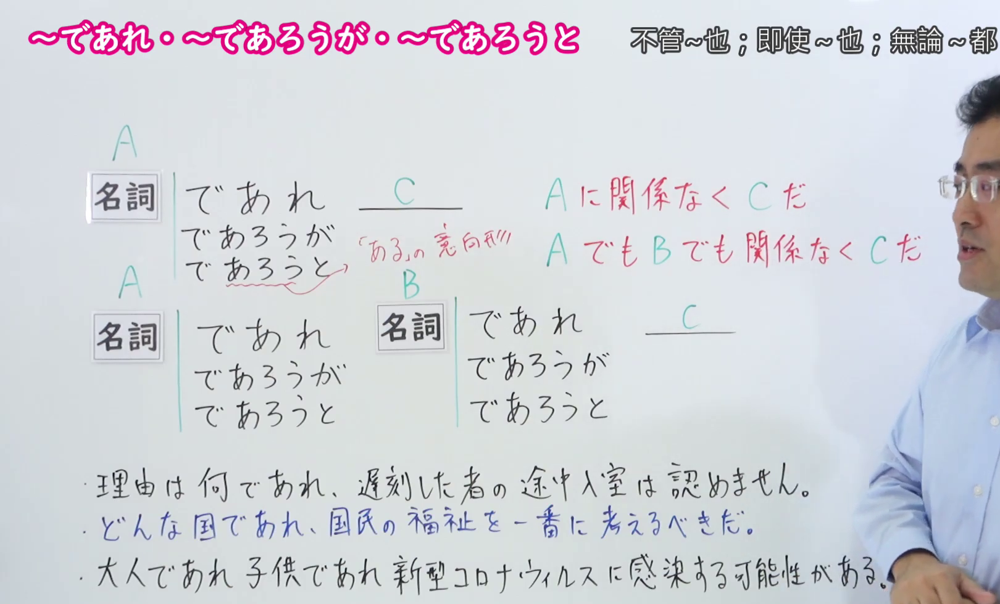
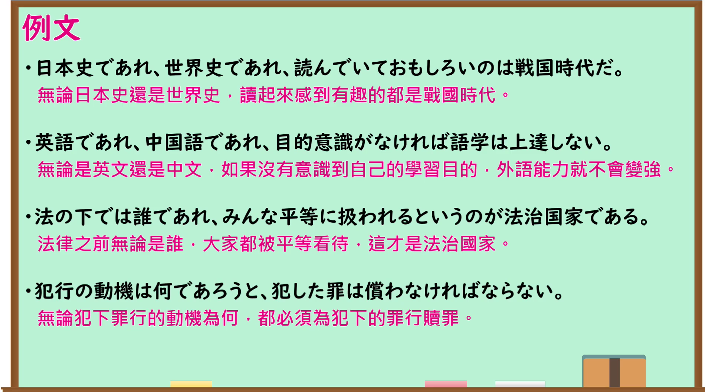

---
{
  "id": "N1-G-0031",
  "kind": "grammar",
  "level": "N1",
  "title": "～であれ・～であろうが・～であろうと（不管～也／即使～也／无论～都）",
  "card_revision": 1,
  "schema_version": 1,
  "source": {
    "lesson": "N1 第31个语法",
    "material": "出口日語原视频板书、日语自动字幕与はごろも（機能語用例文データベース）正文",
    "video": "https://www.youtube.com/watch?v=nSnmDdv0_94",
    "screenshot": "assets/grammar/n1/N1-G-0031-connection.png",
    "screenshot_seconds": 92,
    "screenshot_crop": {
      "x": 0,
      "y": 0,
      "width": 1620,
      "height": 980
    }
  },
  "tags": [
    "逆接・譲歩",
    "N1"
  ],
  "confusions": [
    "～にせよ・～にしろ",
    "～とて",
    "～たところで"
  ]
}
---
# N1 第31个语法：～であれ・～であろうが・～であろうと

# 视频学习资料整理

- 原视频链接：[出口日語 - 【Ｎ１文法】～であれ・～であろうが・～であろうと](https://www.youtube.com/watch?v=nSnmDdv0_94)

## 接续板书截图

- 真实时间：01:32（第92秒）
- 替换说明：原视频00:01处教师鞠躬致意，人像遮挡了黑板右侧的关键红字含义说明「Aに関係なくCだ」「AでもBでも関係なくCだ」及板书例句右端；选择01:32时点，板书完整写毕（含对「あろう」为「ある」的意向形之补充标注），教师让开板书至最右侧，接续公式、红字说明与板书例句均完整清晰。
- 原图尺寸：1920×1080
- 裁切区域：x: 0, y: 0, width: 1620, height: 980（固定左上角，收拢右下角，裁去底部空白与右侧人像多余画面，完整保留接续形式、红字说明与板书例句）
- 图片链接：[../../assets/grammar/n1/N1-G-0031-connection.png](../../assets/grammar/n1/N1-G-0031-connection.png)

## 课程例句截图

- 真实时间：04:37（第277.18秒）
- 原图尺寸：1920×1080
- 裁切区域：x: 0, y: 0, width: 1900, height: 1060（固定左上角，收拢右下角，裁去底部白边，完整保留黑板中的4条课程例句与中文翻译）
- 图片链接：[../../assets/grammar/n1/N1-G-0031-example.png](../../assets/grammar/n1/N1-G-0031-example.png)

# 核心

## 功能一：与A无关，都是C

**最上位意味カテゴリー：**

- **であれ：** ものごとの関係（事物之间的关系）
- **〔疑問詞〕であれ：** ものごとの関係（事物之间的关系）
- **であろうと：** ものごとの関係（事物之间的关系）

**中位意味カテゴリー：**

- **であれ：** 逆接・譲歩（转折与让步）
- **〔疑問詞〕であれ：** 逆接・譲歩（转折与让步）
- **であろうと：** 逆接・譲歩（转折与让步）

**意味：**

- **であれ：** 逆接：譲歩（转折：让步）
- **〔疑問詞〕であれ：** 逆接：譲歩（转折：让步）
- **であろうと：** 逆接：仮定（转折：假定）

**くわしい意味記述：**

- **であれ：** 「〜でも」の意味。どんなものであっても，結果は変わらないということを表す。（表示“即使……”的意思。表示无论是什么，结果都不会改变。）
- **〔疑問詞〕であれ：** 疑問詞の部分にどんな要素を当てはめても，それに関係なく，という意味を表す。（表示无论在疑问词部分代入什么要素，都与其无关的意思。）
- **であろうと：** 「〜しても」の書き言葉的な意味を持つ。「〜であろうと」という言い方が多く，「日本であろうと，どこであろうと」のように使う。（具有“即使……”的书面语含义。常以“～であろうと”的形式使用，如“日本であろうと，どこであろうと”这样用。）

**派生語：** であれ・〔疑問詞〕であれ：未列出；であろうと（うと（も））：Vようと，であろうと，うとも，いかに〜Vようと（も），〔疑問詞〕〜うと，であろうとなかろうと，とも

### 例句

1. たとえ王様であれ、法には従わなければならない。

   （即使是国王，也必须遵守法律。）

2. だれであれ、訪ねてきてくれるのはうれしい。

   （无论是谁，能来拜访我都感到高兴。）

3. 物質は何であれ、１モルの中には同数の原子または分子がふくまれている。

   （不论是什么物质，1摩尔中都包含相同数量的原子或分子。）

4. なお危機を脱したとは言えず、引き続き、必要な政策を迅速に実施するために、その形はどうであれ、公明党の協力は必須だ。

   （尚不能说已经摆脱危机，为了继续迅速实施必要的政策，无论采取何种形式，公明党的协助都是不可或缺的。）

## 功能二：无论是A还是B都无关，都是C

**最上位意味カテゴリー：**

- **であれ〜であれ：** ものごとの関係（事物之间的关系）
- **であろうと〜であろうと：** ものごとの関係（事物之间的关系）

**中位意味カテゴリー：**

- **であれ〜であれ：** 並列・反復（并列与反复）
- **であろうと〜であろうと：** 逆接・譲歩（转折与让步）

**意味：**

- **であれ〜であれ：** 逆接：譲歩（转折：让步）
- **であろうと〜であろうと：** 逆接：仮定（转折：假定）

**くわしい意味記述：**

- **であれ〜であれ：** 「〜でも〜でも」の意味。例をならべて、そのどれであっても、結果は変わらないということを表す。（表示“无论是……还是……”的意思。列举事例，表示无论属于其中哪一种，结果都不会改变。）
- **であろうと〜であろうと：** 「〜しても、〜しても、結果は変わらず」の意味。書き言葉的。（表示“即使……即使……结果也不变”的意思。带有书面语色彩。）

**派生語：** であれ〜であれ：未列出；であろうと〜であろうと（うと〜うと）：であろうと，〜であろうと

### 例句

1. 男であれ女であれ、人であることには変わりはない。

   （无论是男人还是女人，同属于人类这一点是没有改变的。）

2. 反省してであれ、考えぬいてであれ、学問してであれ、自分の意志を他人に押しつけることは不可である。

   （无论是经过反省、深思熟虑，还是出于学问研究，将自己的意志强加于他人都是不可取的。）

3. アメリカであろうと、ヨーロッパであろうと、留学したいならどこへでも行っていいよ。

   （不论是美国还是欧洲，只要想去留学，去哪里都可以。）

4. それが善意であろうと、悪意であろうと、往々にして相手のシステムにさからうことになり、こちら側もまた相手側もたいへん苦しむことになる。

   （那无论是出于善意还是恶意，往往都会违背对方的系统机制，使得我方与对方双方都深陷痛苦。）

# 来源

- [出口日語原视频](https://www.youtube.com/watch?v=nSnmDdv0_94)
- [はごろも「であれ」](https://www.hagoromo-text.work/)（查询日期：2026-09-24）
- [はごろも「〔疑問詞〕であれ」](https://www.hagoromo-text.work/)（查询日期：2026-09-24）
- [はごろも「であれ〜であれ」](https://www.hagoromo-text.work/)（查询日期：2026-09-24）
- [はごろも「うと〜うと」](https://www.hagoromo-text.work/)（查询日期：2026-09-24）
- [はごろも「うと（も）」](https://www.hagoromo-text.work/)（查询日期：2026-09-24）
