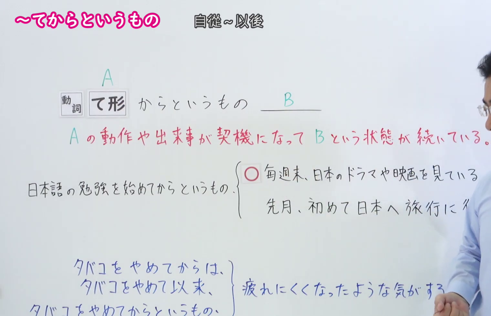
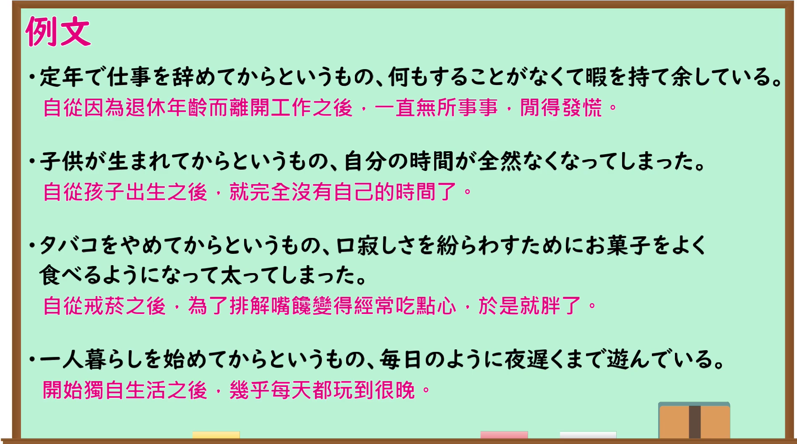

---
{
  "id": "N1-G-0032",
  "kind": "grammar",
  "level": "N1",
  "title": "～てからというもの（自从～以后）",
  "card_revision": 1,
  "schema_version": 1,
  "source": {
    "lesson": "N1 第32个语法",
    "material": "出口日語原视频板书、日语自动字幕与毎日のんびり日本語教師正文",
    "video": "https://www.youtube.com/watch?v=IXTZFJAzyH4",
    "screenshot": "assets/grammar/n1/N1-G-0032-connection.png",
    "screenshot_seconds": 96,
    "screenshot_crop": {
      "x": 0,
      "y": 0,
      "width": 1520,
      "height": 980
    }
  },
  "tags": [
    "時間的前後",
    "N1"
  ],
  "confusions": [
    "～て以来",
    "～てから",
    "～を皮切りに"
  ]
}
---
# N1 第32个语法：～てからというもの

# 视频学习资料整理

- 原视频链接：[出口日語 - 【Ｎ１文法】～てからというもの](https://www.youtube.com/watch?v=IXTZFJAzyH4)

## 接续板书截图

- 真实时间：01:36（第96秒）
- 替换说明：原视频00:01处教师站位于中右侧，人像遮挡了红字释义「Bという状態が続いている」及例句右端；选择01:36时点，教师移至最右侧且双手自然垂于身前，接续公式、红字释义、正误对照例句及底部与「てからは／て以来」的辨析说明均完整清晰。
- 原图尺寸：1920×1080
- 裁切区域：x: 0, y: 0, width: 1520, height: 980（固定左上角，收拢右下角，裁去底部空白与右侧人像多余画面，完整保留接续形式、红字说明、板书例句与对比辨析）
- 图片链接：[../../assets/grammar/n1/N1-G-0032-connection.png](../../assets/grammar/n1/N1-G-0032-connection.png)

## 课程例句截图

- 真实时间：03:13（第193.93秒）
- 原图尺寸：1920×1080
- 裁切区域：x: 0, y: 0, width: 1900, height: 1060（固定左上角，收拢右下角，裁去底部白边，完整保留黑板中的4条课程例句与中文翻译）
- 图片链接：[../../assets/grammar/n1/N1-G-0032-example.png](../../assets/grammar/n1/N1-G-0032-example.png)

# 核心

## 功能一：以A的动作或事件为契机，B的状态一直持续

**くわしい意味記述：**

- **～てからというもの：** ある動作がきっかけとなり、その後何らかの大きな変化が生じたことを表す文型です。「それからというもの」「そこからというもの」という言い方もあります。（以某动作为契机，表示在那之后发生了某种重大变化的句型。也有“それからというもの”“そこからというもの”的说法。）

### 例句

1. 良いライバルができてからというもの、練習にも熱が入る。

   （有了一个好对手之后，训练也更加投入了。）

2. 結婚してからというもの、趣味に費やす時間が減ってきている。

   （结婚之后，花在个人爱好上的时间渐渐减少了。）

3. あのホラー映画を見てからというもの、トイレにすら行けなくなった。

   （看了那部恐怖电影之后，我甚至连厕所都不敢一个人去了。）

4. 子育てが始まってからというもの、外食する機会が極端に減った。

   （开始抚养孩子之后，外出就餐的机会急剧减少了。）

# 来源

- [出口日語原视频](https://www.youtube.com/watch?v=IXTZFJAzyH4)
- [毎日のんびり日本語教師「【Ｎ１文法】～てからというもの」](https://mainichi-nonbiri.com/grammar/n1-tekaratoiumono/)（查询日期：2026-09-24）
