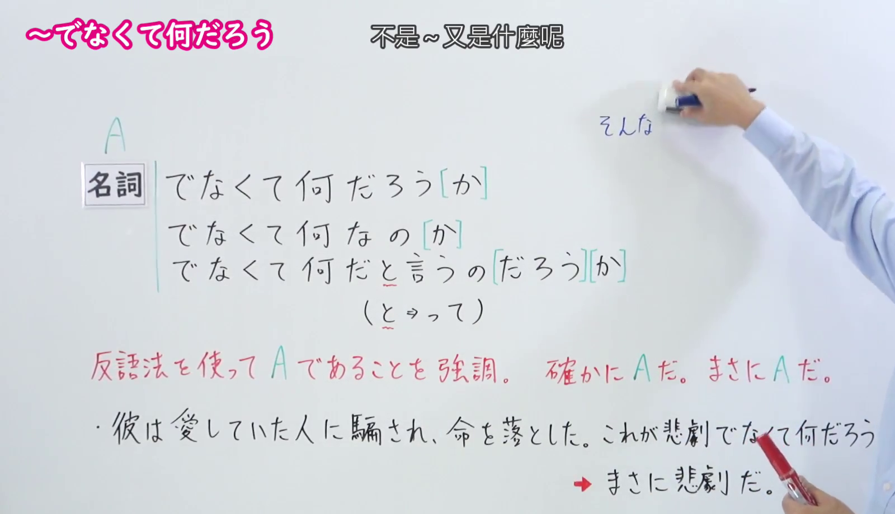
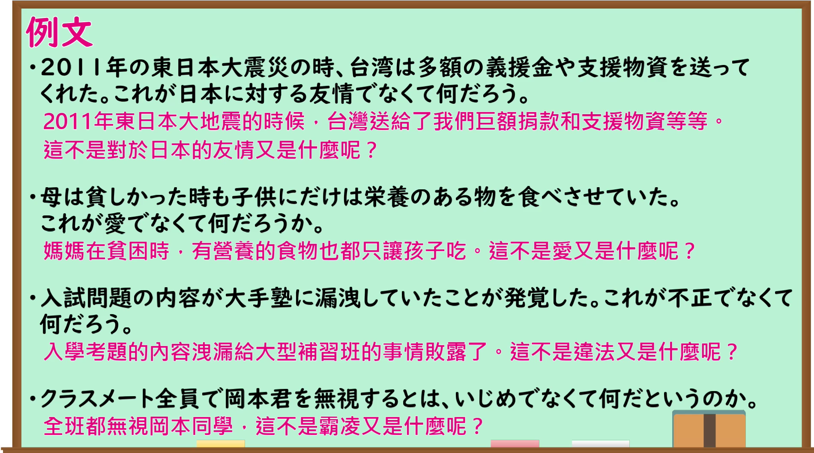

---
{
  "id": "N1-G-0033",
  "kind": "grammar",
  "level": "N1",
  "title": "～でなくてなんだろう（难道不是～又是什么呢）",
  "card_revision": 1,
  "schema_version": 1,
  "source": {
    "lesson": "N1 第33个语法",
    "material": "出口日語原视频板书、日语自动字幕与毎日のんびり日本語教師正文",
    "video": "https://www.youtube.com/watch?v=RLOIgYR_EQE",
    "screenshot": "assets/grammar/n1/N1-G-0033-connection.png",
    "screenshot_seconds": 82,
    "screenshot_crop": {
      "x": 0,
      "y": 0,
      "width": 1600,
      "height": 920
    }
  },
  "tags": [
    "強調",
    "反語",
    "N1"
  ],
  "confusions": [
    "～以外の何ものでもない",
    "～にほかならない",
    "～にすぎない"
  ]
}
---
# N1 第33个语法：～でなくて何だろう

# 视频学习资料整理

- 原视频链接：[出口日語 - 【Ｎ１文法】～でなくて何だろう](https://www.youtube.com/watch?v=RLOIgYR_EQE)

## 接续板书截图

- 真实时间：01:22（第82秒）
- 替换说明：原视频00:01处教师鞠躬并站位于右侧，人像遮挡了板书接续变形与释义右端；选择01:22时点，教师位于右上侧擦拭上方多余文字，双手高举，接续形式（名詞＋でなくて何だろう[か]、でなくて何なのか[か]、でなくて何だと言うの[だろう][か]）、红字释义（反語法を使ってAであることを強調。確かにAだ。まさにAだ。）以及板书例句（彼は愛していた人に騙され、命を落とした。これが悲劇でなくて何だろう ➡ まさに悲劇だ。）均完整清晰无遮挡。
- 原图尺寸：1920×1080
- 裁切区域：x: 0, y: 0, width: 1600, height: 920（固定左上角，收拢右下角，裁去底部托盘与右侧教师身体，完整保留接续变形、红字释义与板书例句）
- 图片链接：[../../assets/grammar/n1/N1-G-0033-connection.png](../../assets/grammar/n1/N1-G-0033-connection.png)

## 课程例句截图

- 真实时间：03:59（第239.59秒）
- 原图尺寸：1920×1080
- 裁切区域：x: 0, y: 0, width: 1900, height: 1060（固定左上角，收拢右下角，裁去底部白边，完整保留黑板中的4条课程例句与中文翻译）
- 图片链接：[../../assets/grammar/n1/N1-G-0033-example.png](../../assets/grammar/n1/N1-G-0033-example.png)

# 核心

## 功能一：使用反问强调确实是 A、正是 A

**くわしい意味記述：**

- **～でなくてなんだろう：** 強調の文型です。それ以外ではなく、まさしくそれであるという意味を表します。「～が～でなくてなんだろう（か）」という文型でよく使います。「一体」が呼応することがあります。（这是表示强调的句型。表示除此之外没有别的可能，正是如此的意思。常用于“～が～でなくてなんだろう（か）”的句型中，有时也会与“一体”呼应。）

### 例句

1. 激しく続くこの腹痛がいったい病気でなくてなんだろうか。

   （持续剧烈的这种腹痛不是生病还能是什么呢。）

2. 命を賭して戦った彼が英雄でなくてなんだろうか。

   （拼上性命战斗的他不是英雄还能是什么呢。）

3. 一目見たときから心が高鳴る。これが運命の赤い糸でなくてなんだろうか。

   （从看的第一眼起就心跳加速。这难道不是命运的红线又是什么呢。）

4. ５階から転落した幼児が無傷だったとは、これが奇跡でなくてなんだろう。

   （从5楼跌落的幼儿竟然毫发无伤，这难道不是奇迹又是什么呢。）

# 来源

- [出口日語原视频](https://www.youtube.com/watch?v=RLOIgYR_EQE)
- [毎日のんびり日本語教師「【Ｎ１文法】～でなくてなんだろう」](https://mainichi-nonbiri.com/grammar/n1-denakutenandarou/)（查询日期：2026-09-24）
