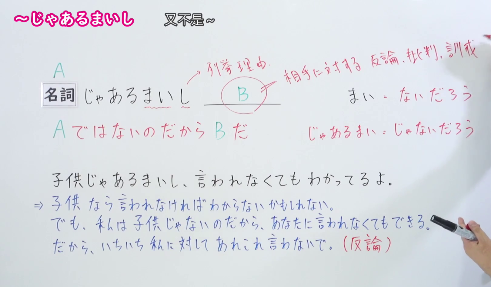
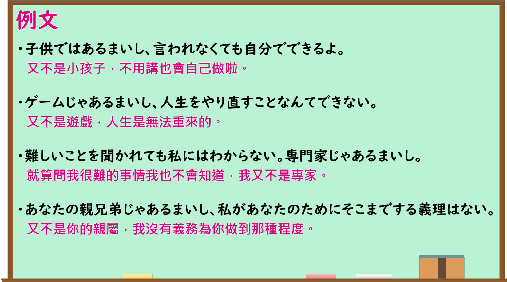

---
{
  "id": "N1-G-0034",
  "kind": "grammar",
  "level": "N1",
  "title": "～じゃあるまいし（又不是～）",
  "card_revision": 1,
  "schema_version": 1,
  "source": {
    "lesson": "N1 第34个语法",
    "material": "出口日語原视频板书、日语自动字幕与はごろも正文",
    "video": "https://www.youtube.com/watch?v=L3ZqQS9QEi8",
    "screenshot": "assets/grammar/n1/N1-G-0034-connection.png",
    "screenshot_seconds": 115,
    "screenshot_crop": {
      "x": 0,
      "y": 0,
      "width": 1620,
      "height": 950
    }
  },
  "tags": [
    "原因・理由",
    "否定",
    "N1"
  ],
  "confusions": [
    "～ではあるまいし",
    "～でもあるまいし",
    "～わけではない"
  ]
}
---
# N1 第34个语法：～じゃあるまいし

# 视频学习资料整理

- 原视频链接：[出口日語 - 【Ｎ１文法】～じゃあるまいし](https://www.youtube.com/watch?v=L3ZqQS9QEi8)

## 接续板书截图

- 真实时间：01:55（第115秒）
- 替换说明：原视频00:01处教师站位于中右侧，人像遮挡了板书接续、释义与例句右侧；选择01:55时点，教师位于最右侧高处书写「相手に対する 反論、批判、訓戒」，接续公式（名詞＋じゃあるまいし ＿＿B＿＿）、红字核心释义（A ではないのだから B だ）、右侧词源推导（まい：ないだろう、じゃあるまい：じゃないだろう）以及板书例句（子供じゃあるまいし、言われなくてもわかってるよ。⇒ 子供なら言われなければわからないかもしれない。でも、私は子供じゃないのだから、あなたに言われなくてもできる。だから、いちいち私に対してあれこれ言わないで。[反論]）均完整清晰无遮挡。
- 原图尺寸：1920×1080
- 裁切区域：x: 0, y: 0, width: 1620, height: 950（固定左上角，收拢右下角，裁去底部托盘与右侧教师身体，完整保留接续变形、核心释义、词源推导与板书例句）
- 图片链接：[../../assets/grammar/n1/N1-G-0034-connection.png](../../assets/grammar/n1/N1-G-0034-connection.png)

## 课程例句截图

- 真实时间：03:50（第230秒）
- 原图尺寸：1920×1080
- 裁切区域：x: 0, y: 0, width: 1900, height: 1060（固定左上角，收拢右下角，裁去底部白边，完整保留黑板中的4条课程例句与中文翻译）
- 图片链接：[../../assets/grammar/n1/N1-G-0034-example.png](../../assets/grammar/n1/N1-G-0034-example.png)

# 核心

## 功能一：正因为不是 A，所以 B（针对对方的反驳、批判或训诫）

- **最上位意味カテゴリー：** ものごとの関係
- **中位意味カテゴリー：** 原因・理由
- **意味：** 強い否定
- **くわしい意味記述：** 「〜ではないのだから」という意味。「〜ではないのだから，当然…するものだ」という何らかの根拠に基づく話し手の判断を表す。「でもあるまいし」「ではあるまいし」といった表現もある。（意为“因为不是……”。表示说话人基于某种根据作出的“既然不是……，理所当然应该……”的判断。也有“でもあるまいし”“ではあるまいし”等表达。）
- **派生語：** 記載なし

### 例句

1. 子どもじゃあるまいし、そんなことをするものか。〔作例〕

   （又不是小孩子，怎么会做那种事呢。）

2. おれが這入ったのを見て、みんな申し合わせたように、おれの顔を見た。見せ物じゃあるまいし。〔CASTEL/J〕

   （看到我走进来，大家就像约好了似的全看着我的脸。又不是什么西洋镜展览。）

3. 赤シャツは歩き方から気取っている。部屋の中を往来するのでも、音を立てないように靴の底をそっと落とす。……泥棒のけいこじゃあるまいし、当り前にするがいい。〔CASTEL/J〕

   （“红衬衫”连走路的姿势都在装模作样。即使在房间里走动，为了不发出声音也悄悄放轻鞋底。……又不是在练习当小偷，正常走路不就好了。）

4. 大丈夫だよ。お前。ガキじゃあるまいし、どっかでちゃんと生きてるよ。〔寅〕

   （没事的，你放心吧。又不是小屁孩，肯定在什么地方好好生活着呢。）

# 来源

- [出口日語原视频](https://www.youtube.com/watch?v=L3ZqQS9QEi8)
- [機能語用例文データベース はごろも「じゃあるまいし」](https://www.hagoromo-text.work/)（查询日期：2026-09-24）
