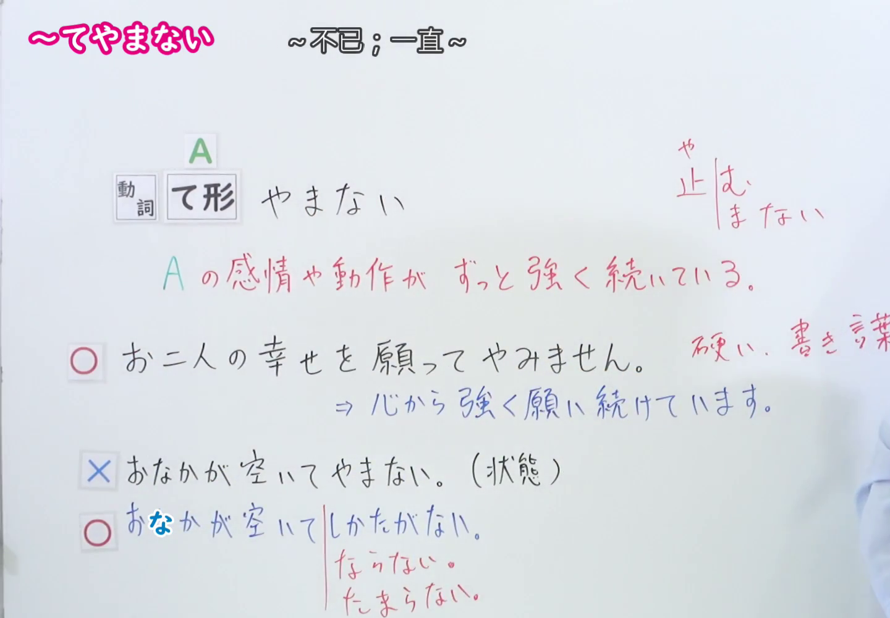

---
{
  "id": "N1-G-0035",
  "kind": "grammar",
  "level": "N1",
  "title": "～てやまない（～不已；一直～）",
  "card_revision": 1,
  "schema_version": 1,
  "source": {
    "lesson": "N1 第35个语法",
    "material": "出口日語原视频板书、日语自动字幕与はごろも正文",
    "video": "https://www.youtube.com/watch?v=YhtTq8HEu6Q",
    "screenshot": "assets/grammar/n1/N1-G-0035-connection.png",
    "screenshot_seconds": 150,
    "screenshot_crop": {
      "x": 0,
      "y": 0,
      "width": 1440,
      "height": 1000
    }
  },
  "tags": [
    "感情・態度",
    "強調",
    "N1"
  ],
  "confusions": [
    "～てたまらない",
    "～てならない",
    "～てしかたがない"
  ]
}
---
# N1 第35个语法：～てやまない

# 视频学习资料整理

- 原视频链接：[出口日語 - 【Ｎ１文法】～てやまない](https://www.youtube.com/watch?v=YhtTq8HEu6Q)

## 接续板书截图

- 真实时间：02:30（第150秒）
- 替换说明：原视频00:01处教师站位于板书前方，人像遮挡了板书接续、红字释义与例句；选择02:30时点，教师移至最右侧，双手自然下垂，接续形式（動詞 て形 やまない）、红字释义（A の感情や動作が ずっと強く続いている。）、右上词源说明（止む／やまない、硬い、書き言葉）以及正误对照例句（◯ お二人の幸せを願ってやみません。与✕ おなかが空いてやまない。及辨析おなかが空いてしかたがない／ならない／たまらない）均完整清晰无遮挡。
- 原图尺寸：1920×1080
- 裁切区域：x: 0, y: 0, width: 1440, height: 1000（固定左上角，收拢右下角，裁去底部多余托盘与右侧教师身体，完整保留接续形式、红字说明、板书例句与对比辨析）
- 图片链接：[../../assets/grammar/n1/N1-G-0035-connection.png](../../assets/grammar/n1/N1-G-0035-connection.png)

## 课程例句截图

- 真实时间：02:55（第175秒）
- 原图尺寸：1920×1080
- 裁切区域：x: 0, y: 0, width: 1900, height: 1060（固定左上角，收拢右下角，裁去底部白边，完整保留黑板中的4条课程例句与中文翻译）
- 图片链接：[../../assets/grammar/n1/N1-G-0035-example.png](../../assets/grammar/n1/N1-G-0035-example.png)

# 核心

## 功能一：A 的感情或动作一直强烈持续

- **最上位意味カテゴリー：** 考え・感情
- **中位意味カテゴリー：** 主張・断定的評価
- **意味：** 主張
- **くわしい意味記述：** ある感情が強く続いていることを表す。感情を表す動詞と使われる。書き言葉でよく使われる。（表示某种感情强烈且持续存在。与表示感情的动词连用。常用于书面语。）
- **派生語：** 記載なし

### 例句

1. 卒業生諸君の今度の活躍を願ってやみません。〔作例〕

   （衷心祝愿各位毕业生今后大展宏图、活跃于各自领域。）

2. クライマックスシリーズ優勝、そして日本一になることを願ってやまない。〔ブログ〕

   （由衷期盼球队能够赢得季后赛冠军，进而夺得全日本第一。）

3. 列強の中の日独両国——このテーマは相変わらず私を引きつけてやまない。〔新聞〕

   （列强中的日德两国——这一研究主题依然深深吸引着我。）

4. とにかく、日本の安全保障について全国民的な真剣な討議がこれを機に行われることを希望してやまない。〔新聞〕

   （无论如何，我由衷希望以此为契机，能够在全日本国民中展开关于安全保障的认真讨论。）

# 来源

- [出口日語原视频](https://www.youtube.com/watch?v=YhtTq8HEu6Q)
- [機能語用例文データベース はごろも「Vてやまない」](https://www.hagoromo-text.work/)（查询日期：2026-09-24）
