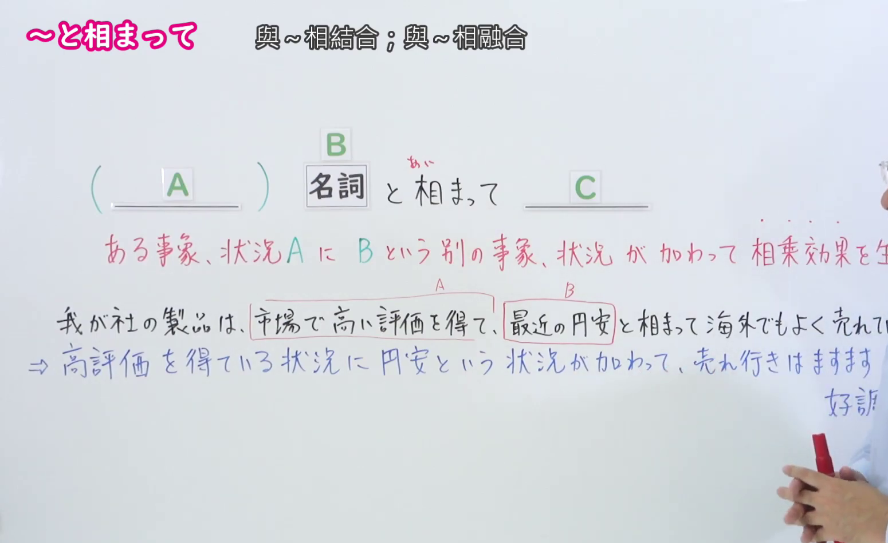
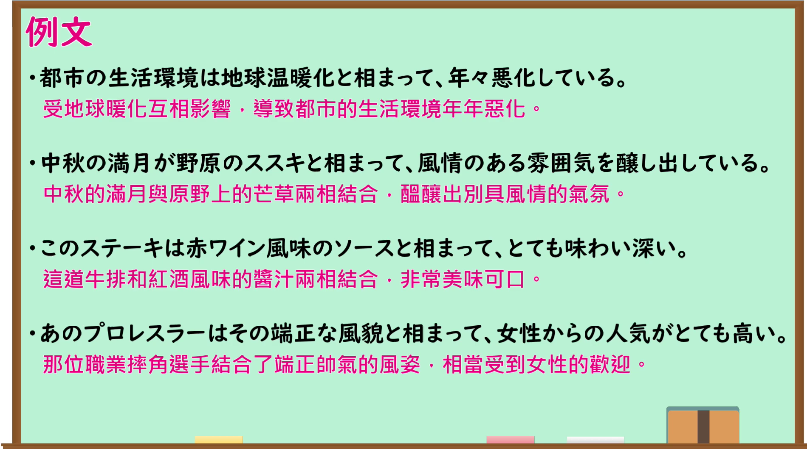

---
{
  "id": "N1-G-0036",
  "kind": "grammar",
  "level": "N1",
  "title": "～と相まって（与～相结合）",
  "card_revision": 1,
  "schema_version": 1,
  "source": {
    "lesson": "N1 第36个语法",
    "material": "出口日語原视频板书、日语自动字幕与はごろも正文",
    "video": "https://www.youtube.com/watch?v=yWP_zjQO7Mc",
    "screenshot": "assets/grammar/n1/N1-G-0036-connection.png",
    "screenshot_seconds": 140,
    "screenshot_crop": {
      "x": 0,
      "y": 0,
      "width": 1550,
      "height": 950
    }
  },
  "tags": [
    "付加",
    "相乗効果",
    "N1"
  ],
  "confusions": [
    "～に伴って",
    "～とともに",
    "～につれて"
  ]
}
---
# N1 第36个语法：～と相まって

# 视频学习资料整理

- 原视频链接：[出口日語 - 【Ｎ１文法】～と相まって](https://www.youtube.com/watch?v=yWP_zjQO7Mc)

## 接续板书截图

- 真实时间：02:20（第140秒）
- 替换说明：原视频00:01处教师站位于板书正前方，人像遮挡了板书接续、红字释义与例句中间区域；选择02:20时点，教师移至最右侧，板书接续形式（( ＿＿A＿＿ ) 名詞 B と相まって ＿＿C＿＿）、红字核心释义（ある事象、状況 A に B という別の事象、状況が加わって 相乗効果を生む）以及下方板书例句（我が社の製品は、市場で高い評価を得て、最近の円安と相まって海外でもよく売れている。⇒ 高評価を得ている状況に 円安という状況が加わって、売れ行きはますます好調）均完整清晰无遮挡。
- 原图尺寸：1920×1080
- 裁切区域：x: 0, y: 0, width: 1550, height: 950（固定左上角，收拢右下角，裁去底部多余托盘与右侧教师身体，完整保留接续形式、红字说明与完整板书例句）
- 图片链接：[../../assets/grammar/n1/N1-G-0036-connection.png](../../assets/grammar/n1/N1-G-0036-connection.png)

## 课程例句截图

- 真实时间：02:50（第170秒）
- 原图尺寸：1920×1080
- 裁切区域：x: 0, y: 0, width: 1900, height: 1060（固定左上角，收拢右下角，裁去底部白边，完整保留黑板中的4条课程例句与中文翻译）
- 图片链接：[../../assets/grammar/n1/N1-G-0036-example.png](../../assets/grammar/n1/N1-G-0036-example.png)

# 核心

## 功能一：事物或状况 A 加上 B 这一另外的事物或状况，产生协同乘数效应

- **最上位意味カテゴリー：** ものごとの関係
- **中位意味カテゴリー：** 付加
- **意味：** 付加
- **くわしい意味記述：** ある事柄にNが加わって，より一層の効果を生み出す，という意味を表す。（表示在某件事项上加上了N，从而产生更进一步的效果的意思。）
- **派生語：** 記載なし

### 例句

1. その博物館は周りの景色と相まって、優美な雰囲気を作り出している。〔作例〕

   （那座博物馆与周围的景色相互映衬，营构出优雅优美的氛围。）

2. 為朝は、討論の心得はなかった。が、後世、悲壮な戦いぶりとあいまって、保元の乱第一の英雄とたたえられた。〔CASTEL/J〕

   （为朝虽不谙辞令争辩，但在后世，配合其悲壮的征战英姿，被赞誉为保元之乱中的第一大英雄。）

3. 内容における理論的な展開よりも、部分的叙述のいくつかがタイトルの「タテ社会」のイメージとあいまって、読者にある種の思いこみを与えてしまったためではなかろうかと思っています。〔CASTEL/J〕

   （我认为，与其说是内容上的理论展开，不如说是书中的几处局部叙述与标题“纵向社会”的既定意象相结合，反倒让读者产生了一种先入为主的偏见。）

4. その後、バブル経済は崩壊し、金融の自由化とあいまって、保険各社は生き残りを最大の企業目的にするようになった。〔新聞〕

   （其后泡沫经济破灭，加之金融自由化的推进，各大保险公司纷纷将艰难求生作为最首要的企业经营目标。）

# 来源

- [出口日語原视频](https://www.youtube.com/watch?v=yWP_zjQO7Mc)
- [機能語用例文データベース はごろも「とあいまって」](https://www.hagoromo-text.work/)（查询日期：2026-09-24）
