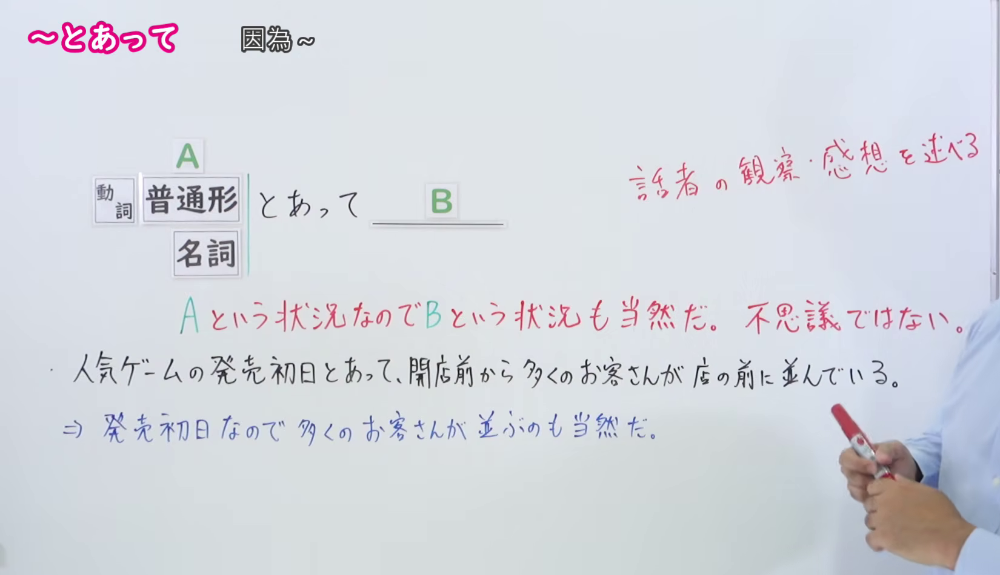
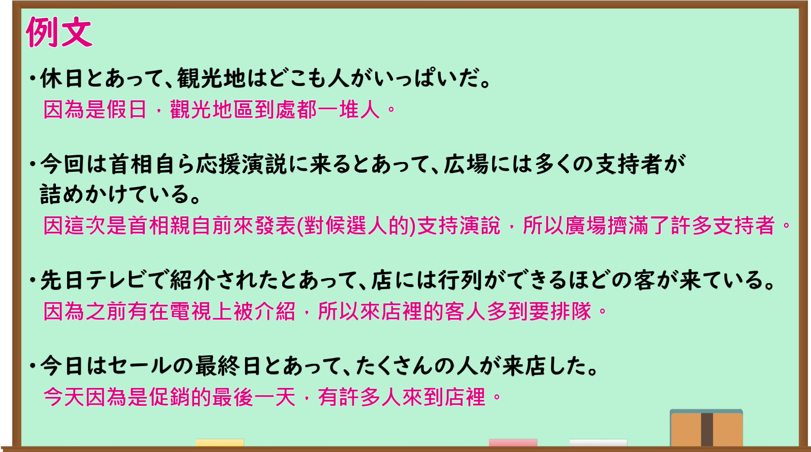

---
{
  "id": "N1-G-0037",
  "kind": "grammar",
  "level": "N1",
  "title": "～とあって（正因为……）",
  "card_revision": 1,
  "schema_version": 1,
  "source": {
    "lesson": "N1 第37个语法",
    "material": "出口日語原视频板书、日语自动字幕与はごろも正文",
    "video": "https://www.youtube.com/watch?v=zVTNQp8zRqQ",
    "screenshot": "assets/grammar/n1/N1-G-0037-connection.png",
    "screenshot_seconds": 74,
    "screenshot_crop": {
      "x": 0,
      "y": 0,
      "width": 1650,
      "height": 950
    }
  },
  "tags": [
    "原因・理由",
    "状況・場合",
    "N1"
  ],
  "confusions": [
    "～とあれば",
    "～こともあって",
    "～だけに"
  ]
}
---
# N1 第37个语法：～とあって

# 视频学习资料整理

- 原视频链接：[出口日語 - 【Ｎ１文法】～とあって](https://www.youtube.com/watch?v=zVTNQp8zRqQ)

## 接续板书截图

- 真实时间：01:14（第74秒）
- 替换说明：原视频00:01处教师站位于板书正前方，人像遮挡了板书接续、红字释义与例句中间区域，且当时尚未书写核心说明红字；选择01:14时点，教师刚写完红字核心补充说明并移至最右侧，板书接续形式（[動詞 普通形 / 名詞] A とあって B）、红字核心释义（A という状況なのでB という状況も当然だ。不思議ではない。／話者の観察・感想を述べる）以及下方板书例句（人気ゲームの発売初日とあって、開店前から多くのお客さんが店の前に並んでいる。⇒ 発売初日なので 多くのお客さんが並ぶのも当然だ。）均完整清晰无遮挡。
- 原图尺寸：1920×1080
- 裁切区域：x: 0, y: 0, width: 1650, height: 950（固定左上角，收拢右下角，裁去底部多余托盘与右侧教师身体，完整保留接续形式、红字说明与完整板书例句）
- 图片链接：[../../assets/grammar/n1/N1-G-0037-connection.png](../../assets/grammar/n1/N1-G-0037-connection.png)

## 课程例句截图

- 真实时间：02:20（第140秒）
- 原图尺寸：1920×1080
- 裁切区域：x: 0, y: 0, width: 1900, height: 1060（固定左上角，收拢右下角，裁去底部白边，完整保留黑板中的4条课程例句与中文翻译）
- 图片链接：[../../assets/grammar/n1/N1-G-0037-example.png](../../assets/grammar/n1/N1-G-0037-example.png)

# 核心

## 功能一：正因为处于 A 这种状况，发生 B 这种状况也是理所当然的（叙述说话人的观察与感想）

- **最上位意味カテゴリー：** ものごとの関係
- **中位意味カテゴリー：** 原因・理由
- **意味：** 状況・場合
- **くわしい意味記述：** 「（他とは違う）〜という状況なので」という意味を表す。「最終日/連休前/夏休みとあって」と特別な日を表す名詞，動詞は「楽しめる/ただで利用できる」と可能形を伴う形や「何年も会っていなかった」などのタ形を伴うもの（タ形を伴う場合は「せっかくの好機を見逃した/1点も取れずに負けた＋とあっては」のように「とあっては」の形で現れやすい），ナ形容詞は「お手頃/〜可能とあって」，イ形容詞は「クリスマスも近いとあって」といった形が使われる。
- **派生語：** 記載なし

### 例句

1. 年に一度のお祭りとあって、村中の人が出て楽しんでいる。〔作例〕

   （正因为是一年一度的祭典，全村的人都跑出来尽情享受。）

2. 開業二日目を迎えたＵＳＪは一日、日曜日とあって初日を上回る三万人以上の入場者でにぎわった。〔新聞〕

   （迎来开业第二天的日本环球影城（USJ），正因为逢周日，吸引了超过首日的逾三万人入场，热闹非凡。）

3. 一般的な国産ものより割安とあって、国産リンゴには脅威となりそうだ。〔新聞〕

   （正因为比一般的国产货更便宜合算，看来会对国产苹果构成不小的威胁。）

4. 政党内閣制の確立、文官任用令の改正、軍部大臣武官制への反対の要求は、山本内閣の呑めるものではなかったが、桂内閣をたおした直後とあって、民衆の意気はあがっていた。〔CASTEL/J〕

   （确立政党内阁制、修改文官任用令、反对军部大臣现役武官制的要求，虽非山本内阁所能全盘接受，但正因为是在推翻桂内阁之后不久，民众的斗志十分高昂。）

# 来源

- [出口日語原视频](https://www.youtube.com/watch?v=zVTNQp8zRqQ)
- [機能語用例文データベース はごろも「とあって」](https://www.hagoromo-text.work/)（查询日期：2026-09-24）
