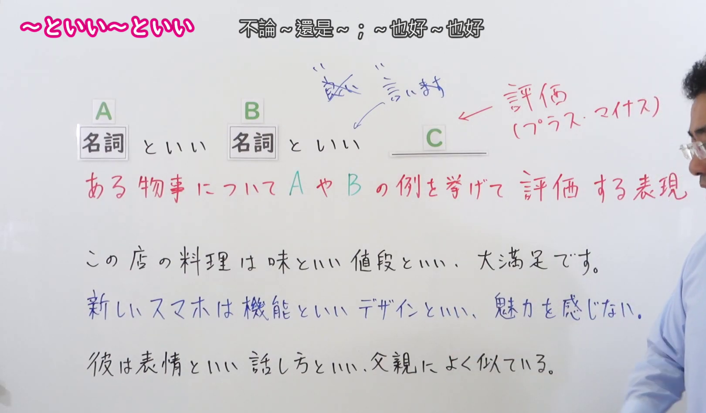
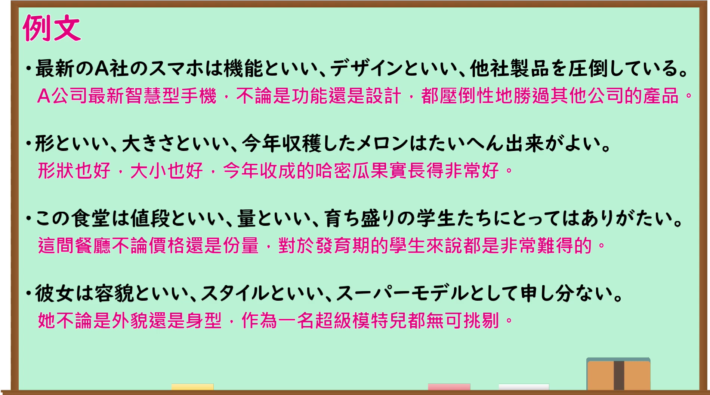

---
{
  "id": "N1-G-0039",
  "kind": "grammar",
  "level": "N1",
  "title": "～といい～といい（不论～还是～；～也好～也好）",
  "card_revision": 1,
  "schema_version": 1,
  "source": {
    "lesson": "N1 第39个语法",
    "material": "出口日語原视频板书、日语自动字幕与はごろも正文",
    "video": "https://www.youtube.com/watch?v=D6n-5lJKAAI",
    "screenshot": "assets/grammar/n1/N1-G-0039-connection.png",
    "screenshot_seconds": 140,
    "screenshot_crop": {
      "x": 0,
      "y": 0,
      "width": 1620,
      "height": 950
    }
  },
  "tags": [
    "例示",
    "評価",
    "N1"
  ],
  "confusions": [
    "～につけ～につけ",
    "～であれ～であれ",
    "～やら～やら"
  ]
}
---
# N1 第39个语法：～といい～といい

# 视频学习资料整理

- 原视频链接：[出口日語 - 【Ｎ１文法】～といい～といい](https://www.youtube.com/watch?v=D6n-5lJKAAI)

## 接续板书截图

- 真实时间：02:20（第140秒）
- 替换说明：原视频00:01处教师站位于板书正前方，人像遮挡了板书接续、红字释义与例句中间区域，且当时尚未书写核心说明红字与评价说明；选择02:20时点，教师移至最右侧，板书接续形式（名詞 A といい 名詞 B といい ＿＿C＿＿）、红字核心释义（ある物事について A や B の例を挙げて 評価する表現）、右上评价性质标注（評価（プラス・マイナス）／良い・悪い評判）以及下方3条完整板书例句（この店の料理は味といい 値段といい、大満足です。／新しいスマホは機能といい デザインといい、魅力を感じない。／彼は表情といい 話し方といい、父親によく似ている。）均完整清晰展示。
- 原图尺寸：1920×1080
- 裁切区域：x: 0, y: 0, width: 1620, height: 950（固定左上角，收拢右下角，裁去底部多余托盘与右侧教师身体，完整保留接续形式、红字说明、评价标注与全部板书例句）
- 图片链接：[../../assets/grammar/n1/N1-G-0039-connection.png](../../assets/grammar/n1/N1-G-0039-connection.png)

## 课程例句截图

- 真实时间：03:20（第200秒）
- 原图尺寸：1920×1080
- 裁切区域：x: 0, y: 0, width: 1900, height: 1060（固定左上角，收拢右下角，裁去底部白边，完整保留黑板中的4条课程例句与中文翻译）
- 图片链接：[../../assets/grammar/n1/N1-G-0039-example.png](../../assets/grammar/n1/N1-G-0039-example.png)

# 核心

## 功能一：列举某事物的 A 与 B 等示例，并对其进行评价

- **最上位意味カテゴリー：** ものごとの関係
- **中位意味カテゴリー：** 例示
- **意味：** 例示
- **くわしい意味記述：** ある事柄の複数の側面や複数の例をあげて，「どの面から見ても〜だ」と言いたい時に使う。（列举某件事物的多个侧面或多个代表性例子，用以表达“无论从哪一方面来看都……”的含义。）
- **派生語：** 記載なし

### 例句

1. 壁といい、ソファーといい、薄汚れた感じだ。〔作例〕

   （无论是墙壁还是沙发，都给人一种陈旧脏兮兮的感觉。）

2. 服装といい、趣味、動作といい、これ以上のパリジェンヌはいないと思われるほどの立派なパリジェンヌだったが、二人はまだ独身であった。〔新聞〕

   （不论是着装打扮，还是品味趣味与举手投足，她们都算得上无懈可击的标准巴黎女郎，但两人却至今仍是单身。）

3. ローマ解放といい、パリ解放といい、いずれも現地レジスタンス部隊の支援があったことを見落としてはならない。〔CASTEL/J〕

   （不论是罗马的解放还是巴黎的解放，都绝不能忽视当地抵抗力量所给予的有力支援。）

4. 資材の発注といい、生産計画表の作成といい、工程の管理といい、言葉だけではなんとか理解出来ても当方に具体的な基礎知識がないのだから、一向にイメージが浮かんで来ないのである。〔CASTEL/J〕

   （无论是采购原材料、制定生产计划表，还是把控工序进度，就算字面意思能勉强听懂，由于我缺乏具体的基础专业知识，脑子里也根本无法形成直观的概念。）

# 来源

- [出口日語原视频](https://www.youtube.com/watch?v=D6n-5lJKAAI)
- [機能語用例文データベース はごろも「といい〜といい」](https://www.hagoromo-text.work/)（查询日期：2026-09-24）
