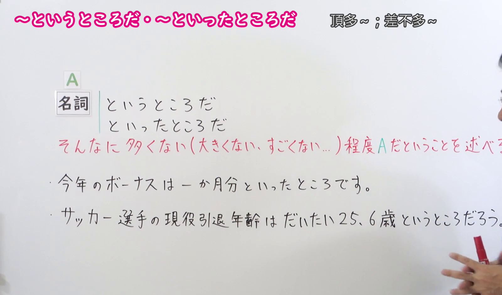
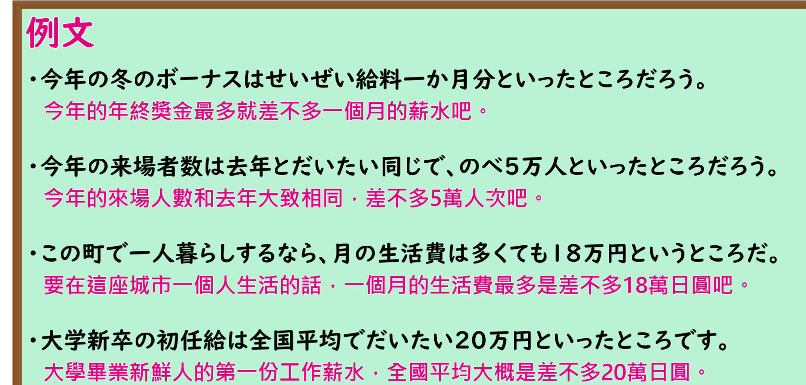

---
{
  "id": "N1-G-0040",
  "kind": "grammar",
  "level": "N1",
  "title": "というところだ／といったところだ（顶多…；差不多…）",
  "card_revision": 1,
  "schema_version": 1,
  "source": {
    "lesson": "N1 第40个语法",
    "material": "出口日語原视频板书、日语自动字幕与 Hagoromo 文型検索正文",
    "video": "https://www.youtube.com/watch?v=46OysQ3yuDo",
    "screenshot": "assets/grammar/n1/N1-G-0040-connection.png",
    "screenshot_seconds": 110,
    "screenshot_crop": {
      "x": 0,
      "y": 0,
      "width": 1600,
      "height": 940
    }
  },
  "tags": [
    "というところだ",
    "N1"
  ],
  "confusions": [
    "本课的「ところ」是形式名词，不表示场所；同形的「改札口を出たところで会いましょう」里的「ところ」才是场所名词",
    "「Ｖたところで」的「ところ」表示动作阶段或让步，与本课用法不同",
    "「といったところだ」也可说成「というところだ」，两者可互换，无需区分",
    "前件多为数量词，整体表示「顶多、最高也就…」的偏低评价"
  ]
}
---

# N1 第40个语法：というところだ／といったところだ（顶多…；差不多…）

## 视频学习资料整理

原视频：[出口日語 N1 第40课「というところだ・といったところだ」](https://www.youtube.com/watch?v=46OysQ3yuDo)（时长 3:51）

### 接续图（真实时间 1:50.00）

- 原图尺寸：1920×1080；裁切区域：x=0, y=0, width=1600, height=940。
- 固定左上角、收拢右下角，裁去底部空白与人像躯干。
- 板书内容：接续「名詞＋というところだ」「名詞＋といったところだ」，红色含义说明「そんなに多くない（大きくない、すごくない…）程度Aだということを述べる」，以及两条课程例句。
- 替换说明：0:01 时点红色说明只写到「…だということ」、表头右端被教师遮挡，改用说明写全的 1:50.00 时点。该时点红色说明的末字「る」被教师身体遮挡，其余板书文字完整。

### 例句图（真实时间 2:40.00）

- 原图尺寸：1920×1080；裁切区域：x=0, y=0, width=1860, height=890。
- 固定左上角、收拢右下角，裁去底部空白与桌面物品。
- 板书内容：课程例句页的四条例句及其中文翻译。

# 核心

## 功能一：表示「不那么多／不大／不厉害…」的A这种程度

**最上位意味カテゴリー：**

- **というところだ：** 考え・感情（思考与感情）
- **といったところだ：** ものごとの関係（事物之间的关系）

**中位意味カテゴリー：**

- **というところだ：** 主張・断定的評価（主张与断定性的评价）
- **といったところだ：** 説明（说明）

**意味：**

- **というところだ：** 評価（评价）
- **といったところだ：** 判断（判断）

**くわしい意味記述：**

- **というところだ：** 「せいぜい〜だ」「最高でも〜だ」という意味を表す。（表示「顶多也就是〜」「最高也就〜」。）
- **といったところだ：** ある段階におけるおおよその状況を述べる時に用いる。「というところだ」と言うこともある。（用于陈述某一阶段的大致状况。也可说成「というところだ」。）

**派生語：** 未列出

### 例句

1. 時給は700円から1000円というところだ。

   （时薪大约是700日元到1000日元。）

2. 田中くんの実力は、まあ、中級というところだ。

   （田中君的实力嘛，也就是中级左右。）

3. 採点すれば、百点満点の五十点というところだろう。

   （打分的话，大概是满分一百分里的五十分吧。）

4. 帰省？まあ、２年に１回といったところだ。

   （回家探亲？嘛，大概两年一次吧。）

5. いいかえれば、わが国の現状は権威主義と無政府状態の化合物といったところだ。

   （换言之，我国的现状可以说是权威主义与无政府状态的化合物。）

# 来源

- [出口日語原视频](https://www.youtube.com/watch?v=46OysQ3yuDo)
- [Hagoromo 文型検索「というところだ」](https://www.hagoromo-text.work/lookup?vid=920)（查询日期：2026-09-24）
- [Hagoromo 文型検索「といったところだ」](https://www.hagoromo-text.work/lookup?vid=943)（查询日期：2026-09-24）

