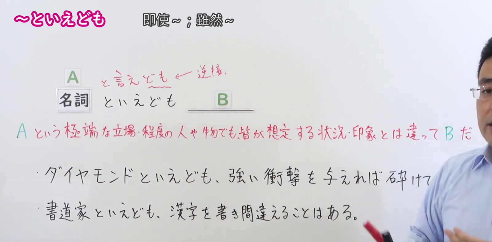
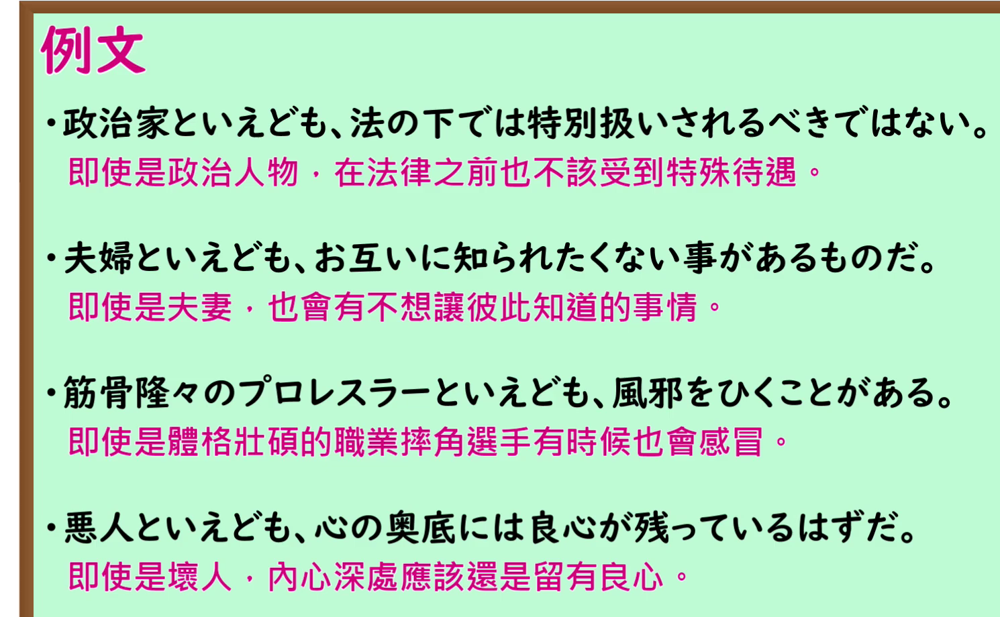

---
{
  "id": "N1-G-0041",
  "kind": "grammar",
  "level": "N1",
  "title": "といえども：即使……也……",
  "card_revision": 1,
  "schema_version": 1,
  "source": {
    "lesson": "N1 第41个语法",
    "material": "出口日語原视频板书、日语自动字幕与日本語NET正文",
    "video": "https://www.youtube.com/watch?v=kBAnBnz-Ko4",
    "screenshot": "assets/grammar/n1/N1-G-0041-connection.png",
    "screenshot_seconds": 40,
    "screenshot_crop": {
      "x": 0,
      "y": 0,
      "width": 1600,
      "height": 790
    }
  },
  "tags": [
    "逆接",
    "N1"
  ],
  "confusions": [
    "といっても",
    "とはいえ"
  ]
}
---

# といえども

# 视频学习资料整理

- 课程：[出口日語 N1 第41个语法](https://www.youtube.com/watch?v=kBAnBnz-Ko4)。清单英文标题为“Even though”；原视频板书及口播确认日文形式为「といえども」。日语自动字幕将部分同音词误识，以下以原视频画面为准。
- 接续图：原视频 **0:40.00**，原图 **1920×1080**，从左上角裁至 **(0, 0, 1600, 790)**。保留语法形式、红字含义说明及板书例句；右侧人物遮住第一条例句末尾，第二条例句完整可见。

- 例句图：原视频 **3:36.67**，原图 **1920×1080**，从左上角裁至 **(0, 0, 1490, 920)**。四条例句及课程原有中文说明均完整可见。

# 核心

## 功能一：即使是处于 A 这种极端立场或程度的人或物，B 也与人们预想的情况或印象不同

**くわしい意味記述：**

- **といえども：** たとえ〜であっても / いくら〜でも（即使是……也……／无论多么……也……）

### 例句

1. 未成年といえども、罪を犯したのであれば償うべきだ。

   （即使是未成年人，犯了罪也应当承担责任。）

2. プロのギタリストといえども、ミスをすることはあり得る。

   （即使是专业吉他手，也可能出错。）

3. たった１０円といえども、粗末にしてはならない。

   （即使只有十日元，也不能随意糟蹋。）

4. 会社の社長といえども、簡単には社員をクビにすることはできない。

   （即使是公司社长，也不能轻易解雇员工。）

# 来源

- [出口日語 N1 第41课原视频](https://www.youtube.com/watch?v=kBAnBnz-Ko4)
- [日本語NET「〜といえども」](https://nihongokyoshi-net.com/2019/07/02/jlptn1-grammar-toiedomo/)（查询日期：2026-09-24；采用「意味」原文及例句）
