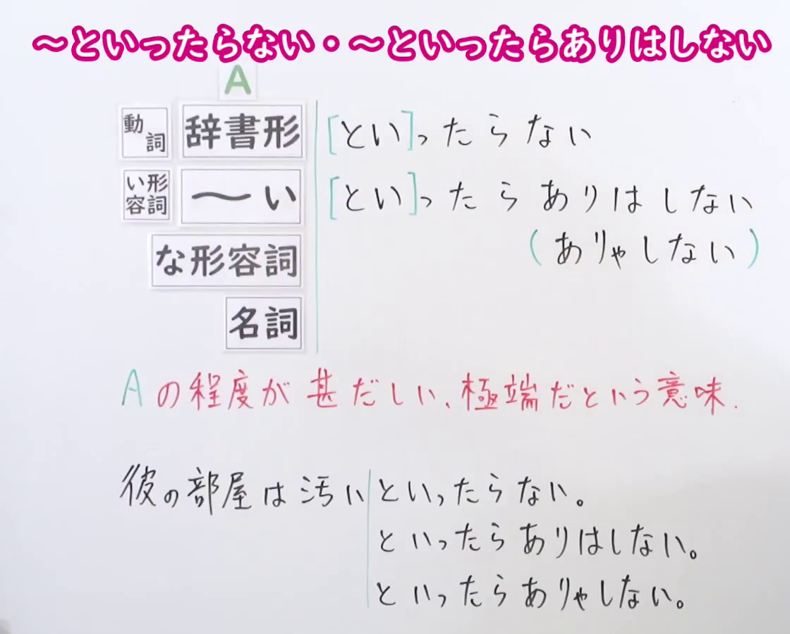
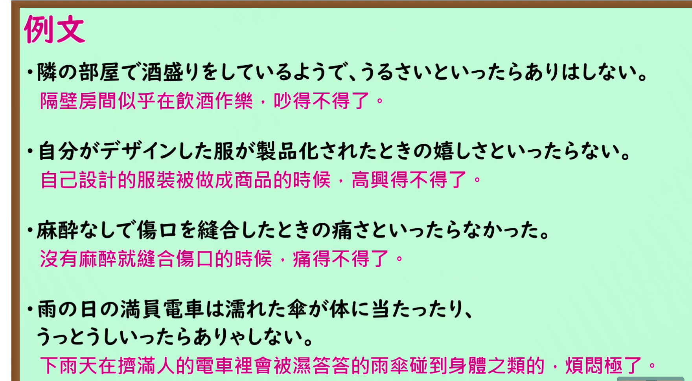

---
{
  "id": "N1-G-0042",
  "kind": "grammar",
  "level": "N1",
  "title": "といったらない・といったらありはしない：极其、不得了",
  "card_revision": 1,
  "schema_version": 1,
  "source": {
    "lesson": "N1 第42个语法",
    "material": "出口日語原视频板书、日语自动字幕与毎日のんびり日本語教師正文",
    "video": "https://www.youtube.com/watch?v=OEuN8W1gHk4",
    "screenshot": "assets/grammar/n1/N1-G-0042-connection.png",
    "screenshot_seconds": 1,
    "screenshot_crop": {
      "x": 0,
      "y": 0,
      "width": 1120,
      "height": 900
    }
  },
  "tags": [
    "程度強調",
    "N1"
  ],
  "confusions": [
    "極まる",
    "てたまらない"
  ]
}
---

# といったらない・といったらありはしない

# 视频学习资料整理

- 课程：[出口日語 N1 第42个语法](https://www.youtube.com/watch?v=OEuN8W1gHk4)。课程清单中的英文标题是机器译名；日文形式以原视频板书为准。日语自动字幕有同音字误识，整理时已对照画面。
- 接续图：原视频 **0:01.00**，原图 **1920×1080**，从左上角裁至 **(0, 0, 1120, 900)**。保留两种主要形式、缩约形式、红字含义说明与板书例句。

- 例句图：原视频 **4:51.83**，原图 **1920×1080**，从左上角裁至 **(0, 0, 1760, 970)**。保留四条例句及课程原有中文说明。

# 核心

## 功能一：表示 A 的程度很高，达到极端程度

**くわしい意味記述：**

- **といったらない／といったらありはしない／といったらありゃしない：** 程度や状態を表す語について、それを強調する表現です。（针对表示程度或状态的词，强调其程度或状态的表达。）「といったら」「ありはしない」の口語形はそれぞれ「ったら」「ありゃしない」です。（「といったら」「ありはしない」的口语形式分别是「ったら」「ありゃしない」。）

### 例句

1. 泥遊びなんて汚いといったらありゃしない。

   （玩泥巴脏得不得了。）

2. 初めての一人暮らしの心細さといったらない。

   （第一次独自生活时的孤单无助，简直难以形容。）

3. 課題が終わった後の達成感といったらありゃしない。

   （完成任务后的成就感，真是无以言表。）

4. 次から次へと情報が入って来て、忙しいったらない。

   （消息接连不断地涌来，忙得不得了。）

# 来源

- [出口日語 N1 第42课原视频](https://www.youtube.com/watch?v=OEuN8W1gHk4)
- [毎日のんびり日本語教師「～といったらありはしない／といったらありゃしない／ったらありゃしない／といったらない／ったらない」](https://mainichi-nonbiri.com/grammar/n1-toittaraarihashinai/)（查询日期：2026-09-24；采用「解説」原文及例句）
