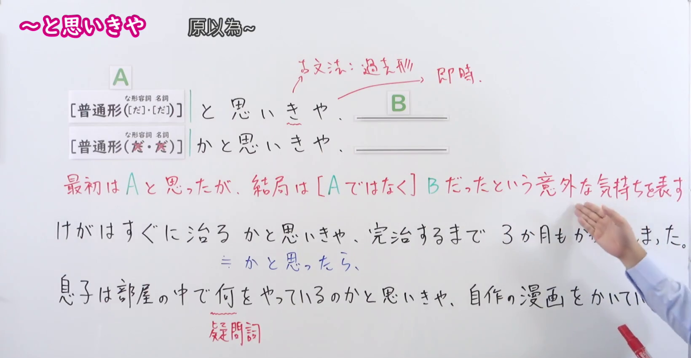
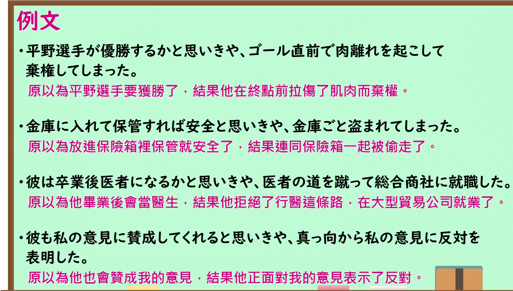

---
{
  "id": "N1-G-0043",
  "kind": "grammar",
  "level": "N1",
  "title": "とおもいきや(と思いきや)：原以为……结果却……",
  "card_revision": 1,
  "schema_version": 1,
  "source": {
    "lesson": "N1 第43个语法",
    "material": "出口日語原视频板书、日语自动字幕与日本語教師のN1et正文",
    "video": "https://www.youtube.com/watch?v=8YdlTg-AiJk",
    "screenshot": "assets/grammar/n1/N1-G-0043-connection.png",
    "screenshot_seconds": 120,
    "screenshot_crop": {
      "x": 0,
      "y": 0,
      "width": 1640,
      "height": 850
    }
  },
  "tags": [
    "意外",
    "N1"
  ],
  "confusions": [
    "かと思ったら",
    "かと思えば"
  ]
}
---

# とおもいきや(と思いきや)

# 视频学习资料整理

- 课程：[出口日語 N1 第43个语法](https://www.youtube.com/watch?v=8YdlTg-AiJk)。清单标题仅保留“～”，板书及口播确认本课形式为「と思いきや」，板书同时列出「かと思いきや」。日语自动字幕已对照原画面校正。
- 接续图：原视频 **2:00.00**，原图 **1920×1080**，从左上角裁至 **(0, 0, 1640, 850)**。0:01 的红字说明被人物遮挡，故选用红字说明和主要板书较完整的此帧；右下方部分例句仍有人物遮挡。

- 例句图：原视频 **4:06.77**，原图 **1920×1080**，从左上角裁至 **(0, 0, 1850, 1050)**。保留四条例句及课程原有中文说明。

# 核心

## 功能一：起初以为是 A，结果却是与 A 不同的 B，表达意外之感

**くわしい意味記述：**

- **とおもいきや(と思いきや)／かとおもいきや(かと思いきや)：** Xかと思ったら、そうではなくYだ（原以为是 X，结果并非如此，而是 Y。）「普通はXだと思うが、この場合はYだった」と言いたいときに使う（想表达“通常会以为是 X，但在这个情况下实际是 Y”时使用。）

### 例句

1. 宝くじが当たったと思いきや数字が１つ違った。

   （还以为中了彩票，结果有一个数字不对。）

2. 電車に間に合ったと思いきや、目の前でドアが閉まった。

   （还以为赶上了电车，结果车门就在眼前关上了。）

3. 彼女は家族に会いたいとずっと言っていたから、帰国したらすぐに家族に会うと思いきや、彼氏に会いに行った。

   （她一直说想见家人，我以为她回国后会马上去见家人，结果她去见了男朋友。）

4. これで和解と思いきや、先方が急に態度を変えてきた。

   （还以为这样就和解了，结果对方突然改变了态度。）

# 来源

- [出口日語 N1 第43课原视频](https://www.youtube.com/watch?v=8YdlTg-AiJk)
- [日本語教師のN1et「と思いきや」](https://jn1et.com/katoomoikiya-n1/)（查询日期：2026-09-24；采用「意味・使い方」原文及例句）
