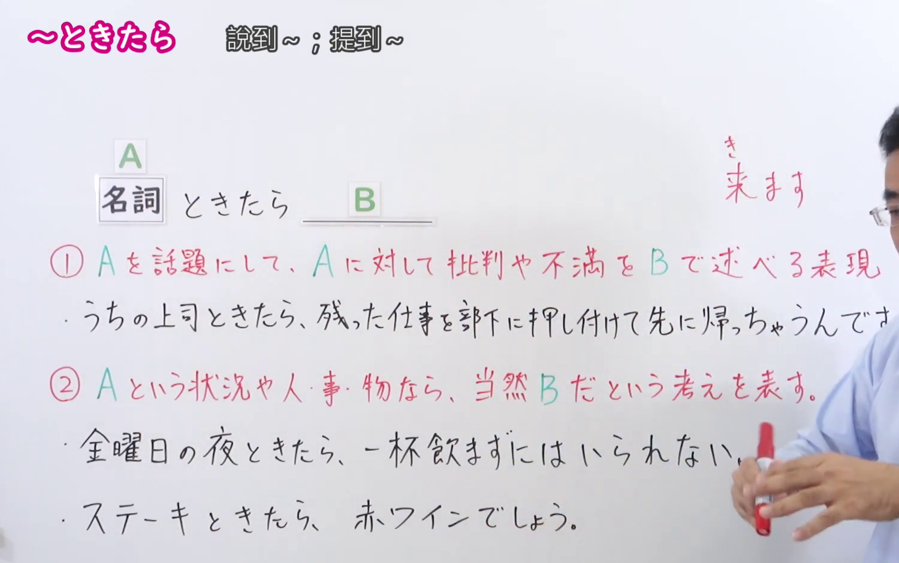
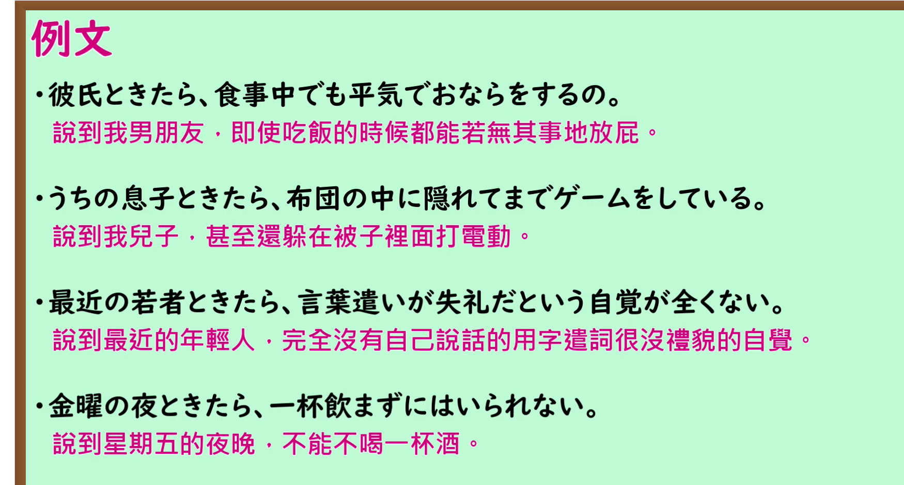

---
{
  "id": "N1-G-0044",
  "kind": "grammar",
  "level": "N1",
  "title": "ときたら：说到……／要是……",
  "card_revision": 1,
  "schema_version": 1,
  "source": {
    "lesson": "N1 第44个语法",
    "material": "出口日語原视频板书、日语自动字幕与毎日のんびり日本語教師正文",
    "video": "https://www.youtube.com/watch?v=v_AtbLYgtTw",
    "screenshot": "assets/grammar/n1/N1-G-0044-connection.png",
    "screenshot_seconds": 150,
    "screenshot_crop": {
      "x": 0,
      "y": 0,
      "width": 1500,
      "height": 940
    }
  },
  "tags": [
    "话题提示",
    "必然判断",
    "N1"
  ],
  "confusions": [
    "といったら",
    "といえば"
  ]
}
---

# ときたら

# 视频学习资料整理

- 课程：[出口日語 N1 第44个语法](https://www.youtube.com/watch?v=v_AtbLYgtTw)。清单标题为罗马字译名“tokitara”；视频板书与口播确认形式为「ときたら」。日语自动字幕将该形式误识为同音字，以原视频画面为准。
- 接续图：原视频 **2:30.00**，原图 **1920×1080**，从左上角裁至 **(0, 0, 1500, 940)**。0:01 的两条红字说明受人物遮挡，故选用本帧；两种功能的说明均可见，第一条板书例句末尾仍受人物遮挡。

- 例句图：原视频 **3:14.90**，原图 **1920×1080**，从左上角裁至 **(0, 0, 1750, 940)**。四条例句及课程原有中文说明完整可见。

# 核心

## 功能一：以 A 为话题，在 B 中表达对 A 的批评或不满

**くわしい意味記述：**

- **ときたら：** 比較的身近な人物や物事を表す名詞に接続して、それらの極端な行為や性質に対する否定的な評価や強い非難を行う文型です。（接在表示较亲近的人物或事物的名词后，对其极端行为或性质作出负面评价或强烈批评的句型。）

### 例句

1. うちの猫ときたら、すぐトイレットペーパーで遊んで散らかしたがる。

   （说到我家的猫，它总爱玩卫生纸，把东西弄得一团乱。）

2. 最近の若者ときたら、挨拶もまともにできない人が多い。

   （说到最近的年轻人，有很多人连招呼都打不好。）

3. 旦那ときたら、休みになればどこにも出掛けず家で寝てばかりいる。

   （说到我丈夫，一到休息日就哪儿也不去，只在家睡觉。）

## 功能二：如果是 A 这样的情况或人、事、物，就认为 B 理所当然

**くわしい意味記述：**

- **ときたら：** 前件の状況下において導かれる必然的な判断や結果、それと最も適当だと思われる組み合わせを後件で述べる文型です。（在前项所述的情形下，于后项说出由此导出的必然判断或结果，或认为与之最相配的组合。）良いことにも悪いことにも用いることができます。（既可用于好事，也可用于坏事。）

### 例句

1. ポテチときたら、やっぱりコーラが合う。

   （说到薯片，果然还是配可乐最合适。）

2. 残業も多く、休日も少ないときたら、過労で倒れてもしょうがない。

   （加班又多，休息日又少，累倒了也不足为奇。）

3. 安くて美味いときたら最高でしょ。

   （既便宜又好吃，那当然是最棒的。）

# 来源

- [出口日語 N1 第44课原视频](https://www.youtube.com/watch?v=v_AtbLYgtTw)
- [毎日のんびり日本語教師「～ときたら／と来た日には」](https://mainichi-nonbiri.com/grammar/n1-tokitara/)（查询日期：2026-09-24；采用两种用法的「解説」原文及对应例句）
