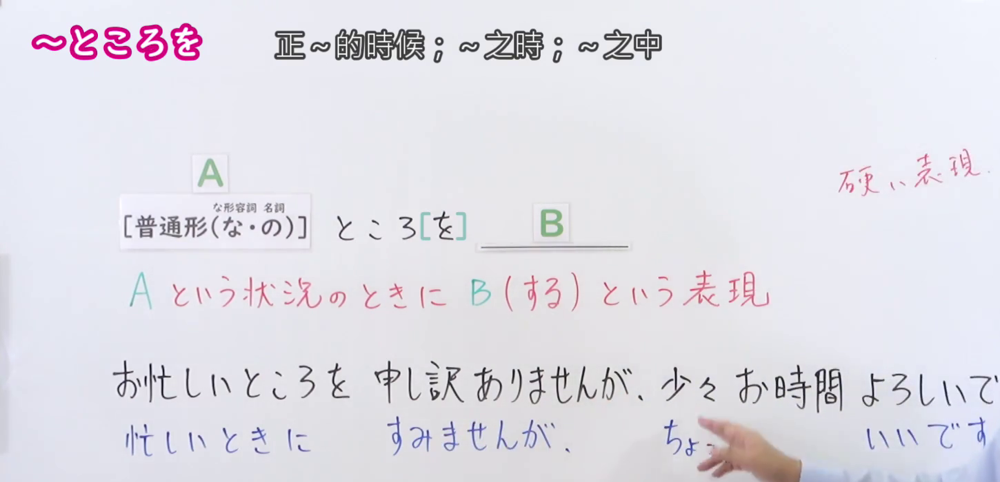
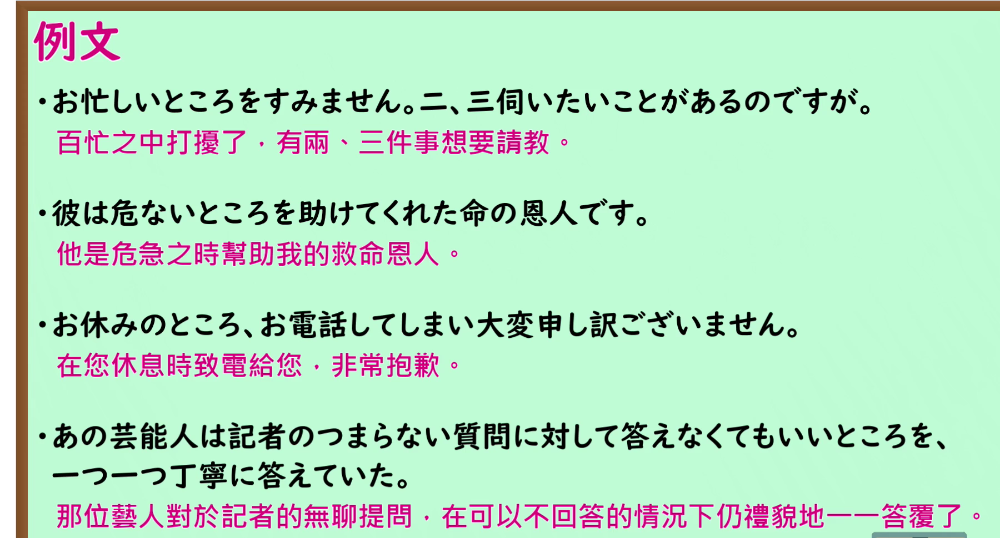

---
{
  "id": "N1-G-0045",
  "kind": "grammar",
  "level": "N1",
  "title": "ところを：在……的时候（却）……",
  "card_revision": 1,
  "schema_version": 1,
  "source": {
    "lesson": "N1 第45个语法",
    "material": "出口日語原视频板书、日语自动字幕与毎日のんびり日本語教師正文",
    "video": "https://www.youtube.com/watch?v=KoIcD_oxl-M",
    "screenshot": "assets/grammar/n1/N1-G-0045-connection.png",
    "screenshot_seconds": 90,
    "screenshot_crop": {
      "x": 0,
      "y": 0,
      "width": 1450,
      "height": 700
    }
  },
  "tags": [
    "情境前提",
    "礼貌表达",
    "N1"
  ],
  "confusions": [
    "ところに",
    "ところへ"
  ]
}
---

# ところを

# 视频学习资料整理

- 课程：[出口日語 N1 第45个语法](https://www.youtube.com/watch?v=KoIcD_oxl-M)。清单标题仅保留“～”，板书与口播确认本课为「ところを」。日语自动字幕已对照原画面校正。
- 接续图：原视频 **1:30.00**，原图 **1920×1080**，从左上角裁至 **(0, 0, 1450, 700)**。0:01 的例句受人物遮挡较多，故改用本帧；语法形式与红字含义完整，第一条板书例句的末尾仍被人物遮住。

- 例句图：原视频 **2:04.33**，原图 **1920×1080**，从左上角裁至 **(0, 0, 1800, 970)**。四条例句及课程原有中文说明完整可见。

# 核心

## 功能一：处于 A 这种情形时做 B

**くわしい意味記述：**

- **ところを：** 相手に対するお願いや謝罪、挨拶などをする前置きとして用います。（用作向对方提出请求、道歉或寒暄等话语的开场铺垫。）前件には前置き、後件には「申し訳ありません」「ありがとうございます」「お願いいたします」などの感謝、謝罪、依頼を述べます。（前项作铺垫，后项以「申し訳ありません」「ありがとうございます」「お願いいたします」等表达感谢、道歉或请求。）相手に何らかの迷惑をかける場合に用いるへりくだった表現です。（这是在可能给对方添麻烦时使用的谦逊表达。）

### 例句

1. お忙しいところを申し訳ありませんが、よろしくお願いいたします。

   （百忙之中打扰您，实在抱歉，还请多多关照。）

2. お取込み中のところを失礼致します。

   （您正忙于处理事情时前来打扰，失礼了。）

3. お忙しいところご丁寧にお答えくださり、どうもありがとうございました。

   （感谢您在百忙之中如此细致地回答。）

4. お忙しいところ恐れ入ります、お伺いしたいことがあるのですがよろしいですか？

   （百忙之中打扰您，实在抱歉。我有件事想请教，可以吗？）

# 来源

- [出口日語 N1 第45课原视频](https://www.youtube.com/watch?v=KoIcD_oxl-M)
- [毎日のんびり日本語教師「～ところ／ところを」](https://mainichi-nonbiri.com/grammar/n1-tokoro/)（查询日期：2026-09-24；采用「解説」原文及例句）
