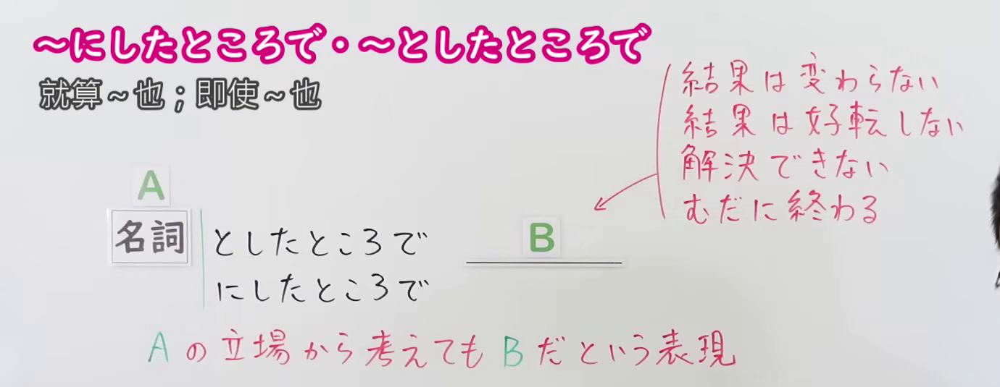
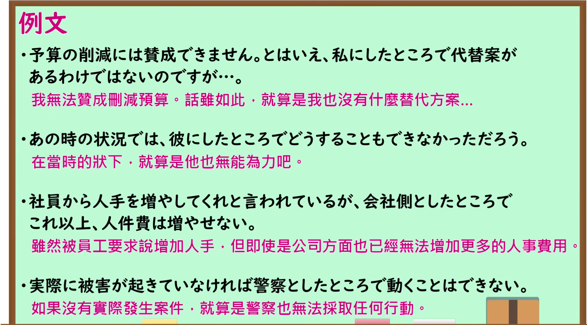

---
{
  "id": "N1-G-0046",
  "kind": "grammar",
  "level": "N1",
  "title": "にしたところで／としたところで：即使从该立场考虑也……",
  "card_revision": 1,
  "schema_version": 1,
  "source": {
    "lesson": "N1 第46个语法",
    "material": "出口日語原视频板书、日语自动字幕与 Japanese Exercises、Iku老師日文正文",
    "video": "https://www.youtube.com/watch?v=ZAeqJdd57Pw",
    "screenshot": "assets/grammar/n1/N1-G-0046-connection.png",
    "screenshot_seconds": 1.0,
    "screenshot_crop": {
      "x": 0,
      "y": 0,
      "width": 1380,
      "height": 535
    }
  },
  "tags": [
    "にしたところで",
    "としたところで",
    "N1"
  ],
  "confusions": [
    "たところで",
    "にしてみれば"
  ]
}
---

# N1 第46个语法：にしたところで／としたところで

# 视频学习资料整理

- 原视频：[出口日語 N1 第46课](https://www.youtube.com/watch?v=ZAeqJdd57Pw)。
- 接续图：视频 00:01.00；原图 1920 × 1080，固定左上角裁切区域 `(0, 0, 1380, 535)`。保留名词接续、红字释义及后项结果提示。

- 例句图：视频 03:32.35；原图 1920 × 1080，固定左上角裁切区域 `(0, 0, 1895, 1050)`。保留课程例句与原有中文说明。

# 核心

## 功能一：即使从 A 的立场考虑，结论仍是 B

**くわしい意味記述：**

- **にしたところで（Japanese Exercises）：** 他とは違うと思われている～も、実は他と同じだ（即使人们认为某人或某事有别于其他，实际上也同样如此。）
- **にしたところで／としたところで（Iku老師日文）：** ある立場・人・組織から見ても、状況は変わらない／同じ困難・限界がある（即使从某个立场、某个人或某个组织的角度来看，情况仍不会改变，也面临同样的困难或限制。）

### 例句

1. 社長にしたところで、この問題をすぐに解決できるわけではない。

   （即使是社长，也无法立刻解决这个问题。）

2. どんなに優秀なエンジニアにしたところで、一人で大きなシステムを作るのは無理だ。

   （即使是再优秀的工程师，也无法独自开发大型系统。）

3. 政府としたところで、少子化の根本的な解決策は持っていない。

   （即使是政府，也没有解决少子化问题的根本对策。）

4. 専門家としたところで、未来の経済を正確に予測するのは不可能に近い。

   （即使是专家，要准确预测未来经济也几乎不可能。）

# 来源

- [出口日語原视频](https://www.youtube.com/watch?v=ZAeqJdd57Pw)
- [Japanese Exercises「【JLPT N1 ～にしたところで／にしたって 文法解説・問題】」](https://japaneseexercises.com/2025/03/20/%E3%80%90jlpt-n1-%EF%BD%9E%E3%81%AB%E3%81%97%E3%81%9F%E3%81%A8%E3%81%93%E3%82%8D%E3%81%A7%EF%BC%8F%E3%81%AB%E3%81%97%E3%81%9F%E3%81%A3%E3%81%A6%E3%80%80%E6%96%87%E6%B3%95%E8%A7%A3%E8%AA%AC%E3%83%BB/)（にしたところで的释义与例句；查询日期：2026-09-24）
- [Iku老師日文「〜にしたところで」](https://jp.ikuchannel.com/grammar/pattern-ni-shitatokorode)（两种形式的立场用法释义与としたところで例句；查询日期：2026-09-24）
