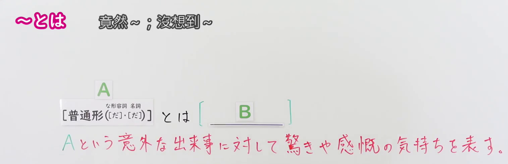
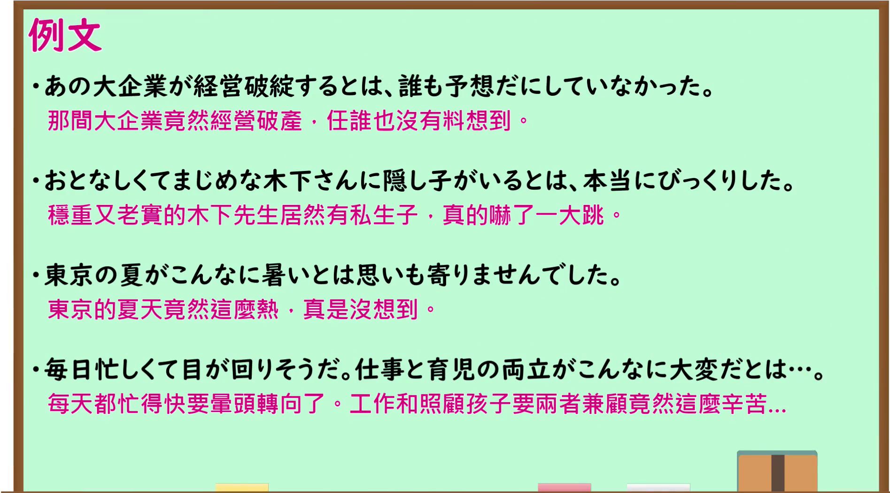

---
{
  "id": "N1-G-0047",
  "kind": "grammar",
  "level": "N1",
  "title": "とは：对意外之事表示惊讶或感慨",
  "card_revision": 1,
  "schema_version": 1,
  "source": {
    "lesson": "N1 第47个语法",
    "material": "出口日語原视频板书、日语自动字幕与毎日のんびり日本語教師正文",
    "video": "https://www.youtube.com/watch?v=bmKC3veQbTs",
    "screenshot": "assets/grammar/n1/N1-G-0047-connection.png",
    "screenshot_seconds": 90.0,
    "screenshot_crop": {
      "x": 0,
      "y": 0,
      "width": 1515,
      "height": 490
    }
  },
  "tags": [
    "とは",
    "惊讶",
    "N1"
  ],
  "confusions": [
    "とは（定义）",
    "とは（引用）",
    "なんて"
  ]
}
---

# N1 第47个语法：とは

# 视频学习资料整理

- 原视频：[出口日語 N1 第47课](https://www.youtube.com/watch?v=bmKC3veQbTs)。
- 接续图：视频 01:30.00；原图 1920 × 1080，固定左上角裁切区域 `(0, 0, 1515, 490)`。保留课程标题、接续与红字功能说明。

- 例句图：视频 04:35.23；原图 1920 × 1080，固定左上角裁切区域 `(0, 0, 1895, 1050)`。保留课程例句与原有中文说明。

# 核心

## 功能一：对 A 这一意外之事表达惊讶或感慨

**くわしい意味記述：**

- **とは（毎日のんびり日本語教師・用法③）：** 話者の驚きの感情を表します。後件には驚きから繋がる何らかの感情が述べられますが省略可能です。（表达说话人的惊讶。后项可以说出由惊讶引出的某种感受，也可以省略。）

### 例句

1. あの若さ、５０歳を超えているとは信じられない。

   （看起来那么年轻，真不敢相信他已经过了五十岁。）

2. こんな短期間で結果が出るとは。

   （没想到这么短的时间就有了结果。）

3. まさか落とした財布が戻ってくるとは。

   （没想到丢失的钱包竟然能找回来。）

4. 彼がこんなにも優しいとは。

   （没想到他竟然这么温柔。）

# 来源

- [出口日語原视频](https://www.youtube.com/watch?v=bmKC3veQbTs)
- [毎日のんびり日本語教師「～とは」用法③〈驚き・意外・あきれ〉](https://mainichi-nonbiri.com/grammar/n3-toha/)（释义与例句；查询日期：2026-09-24）
