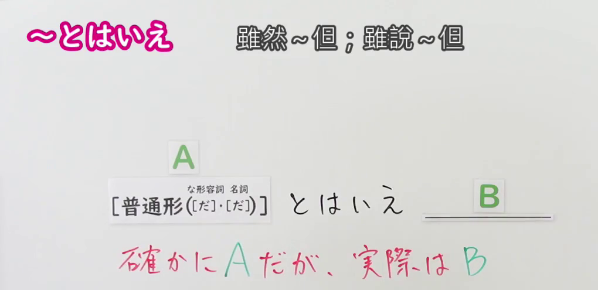
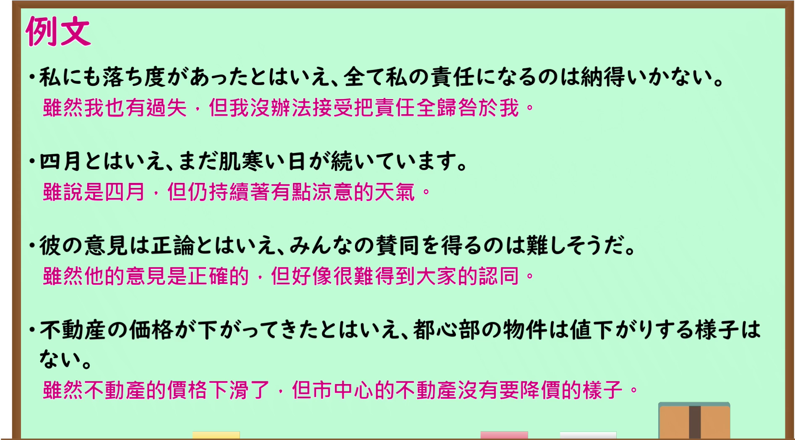

---
{
  "id": "N1-G-0048",
  "kind": "grammar",
  "level": "N1",
  "title": "とはいえ：虽说如此，但实际情况……",
  "card_revision": 1,
  "schema_version": 1,
  "source": {
    "lesson": "N1 第48个语法",
    "material": "出口日語原视频板书、日语自动字幕与日本語NET正文",
    "video": "https://www.youtube.com/watch?v=3fZI-tTo3-c",
    "screenshot": "assets/grammar/n1/N1-G-0048-connection.png",
    "screenshot_seconds": 1.0,
    "screenshot_crop": {
      "x": 0,
      "y": 0,
      "width": 1020,
      "height": 495
    }
  },
  "tags": [
    "とはいえ",
    "逆接",
    "N1"
  ],
  "confusions": [
    "といっても",
    "とはいうものの"
  ]
}
---

# N1 第48个语法：とはいえ

# 视频学习资料整理

- 原视频：[出口日語 N1 第48课](https://www.youtube.com/watch?v=3fZI-tTo3-c)。
- 接续图：视频 00:01.00；原图 1920 × 1080，固定左上角裁切区域 `(0, 0, 1020, 495)`。保留接续和红字释义。

- 例句图：视频 03:53.25；原图 1920 × 1080，固定左上角裁切区域 `(0, 0, 1895, 1050)`。保留课程例句与原有中文说明。

# 核心

## 功能一：确实是 A，但实际上是 B

**くわしい意味記述：**

- **とはいえ（日本語NET）：** 〜といっても / 〜であるが、しかし（虽说如此；虽是这样，但实际情况却……。）

### 例句

1. ここは最寄り駅とはいえ、自宅から自転車でも20分はかかる。

   （虽说这里是离家最近的车站，从家骑自行车过来也要二十分钟。）

2. 親しい関係だとはいえ、最低限の礼儀を忘れてはいけない。

   （虽说关系亲近，也不能忘记起码的礼貌。）

3. 私は日本人だとはいえ、アメリカで育ったので、漢字があまり読めません。

   （虽说我是日本人，但因为在美国长大，不太会读汉字。）

4. 分かっているとはいえ、やっぱり別れは辛いものだ。

   （虽然心里明白，分别终究还是令人难过。）

# 来源

- [出口日語原视频](https://www.youtube.com/watch?v=3fZI-tTo3-c)
- [日本語NET「【JLPT N1】文法・例文：〜とはいえ」](https://nihongokyoshi-net.com/2019/02/17/jlptn1-grammar-towaie/)（释义与例句；查询日期：2026-09-24）
