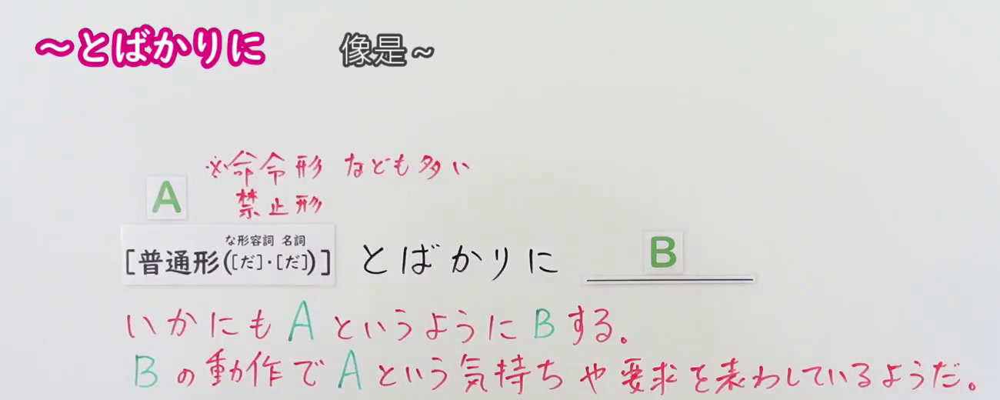
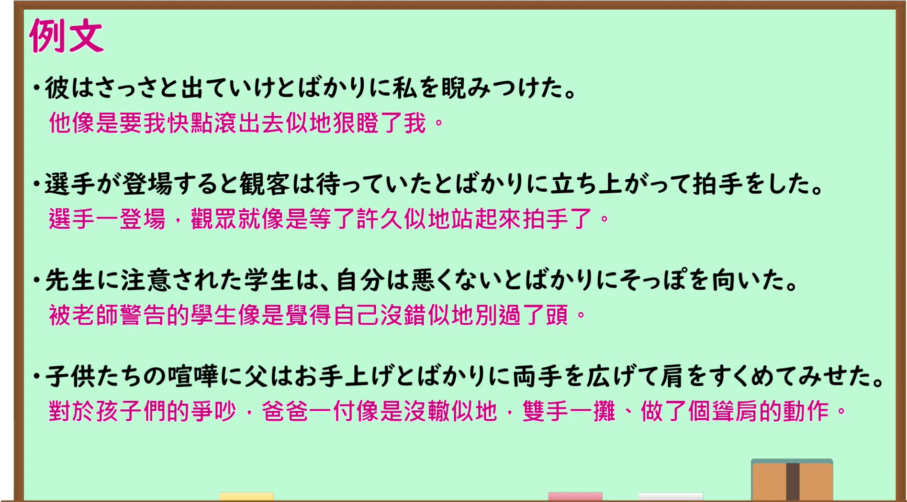

---
{
  "id": "N1-G-0049",
  "kind": "grammar",
  "level": "N1",
  "title": "とばかりに：像是在说……似的做出动作",
  "card_revision": 1,
  "schema_version": 1,
  "source": {
    "lesson": "N1 第49个语法",
    "material": "出口日語原视频板书、日语自动字幕与毎日のんびり日本語教師正文",
    "video": "https://www.youtube.com/watch?v=yQ_JzvONvbQ",
    "screenshot": "assets/grammar/n1/N1-G-0049-connection.png",
    "screenshot_seconds": 1.0,
    "screenshot_crop": {
      "x": 0,
      "y": 0,
      "width": 1300,
      "height": 520
    }
  },
  "tags": [
    "とばかりに",
    "动作表达",
    "N1"
  ],
  "confusions": [
    "と言わんばかりに",
    "ばかりに"
  ]
}
---

# N1 第49个语法：とばかりに

# 视频学习资料整理

- 原视频：[出口日語 N1 第49课](https://www.youtube.com/watch?v=yQ_JzvONvbQ)。
- 接续图：视频 00:01.00；原图 1920 × 1080，固定左上角裁切区域 `(0, 0, 1300, 520)`。保留接续、两行红字释义和课程提示。

- 例句图：视频 04:12.28；原图 1920 × 1080，固定左上角裁切区域 `(0, 0, 1895, 1050)`。保留课程例句与原有中文说明。

# 核心

## 功能一：像是在说 A 似的做出 B 动作，以动作表达 A 的心情或要求

**くわしい意味記述：**

- **とばかりに（毎日のんびり日本語教師）：** 発話文に接続して、そう言うくらいの程度で後項の動作が行われることを表します。（接在所要表达的话语后，表示后项动作表现得像是要说出这句话一样。）

### 例句

1. 彼の登場で、待ってましたとばかりに大きな拍手が起こった。

   （他一登场，现场就爆发出热烈掌声，仿佛在说“等你好久了”。）

2. お前が悪いとばかりに指を指され怒られた。

   （对方指着我责骂，仿佛在说“都是你的错”。）

3. カッコいいだろうとばかりに腕時計を自慢してくる。

   （他向我炫耀手表，仿佛在说“很帅吧”。）

# 来源

- [出口日語原视频](https://www.youtube.com/watch?v=yQ_JzvONvbQ)
- [毎日のんびり日本語教師「～とばかりに／と言わんばかりに」](https://mainichi-nonbiri.com/grammar/n1-tobakarini/)（释义与例句；查询日期：2026-09-24）
