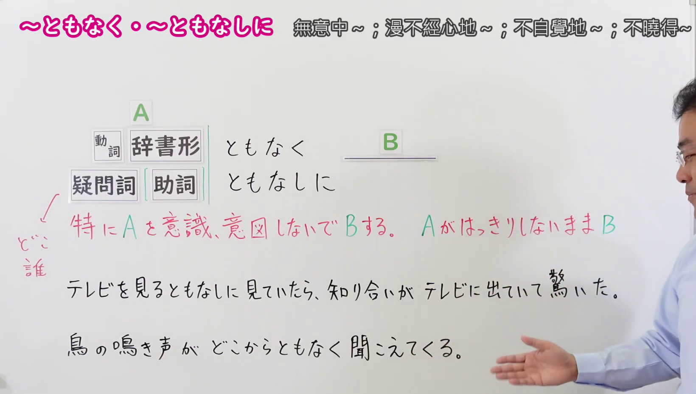
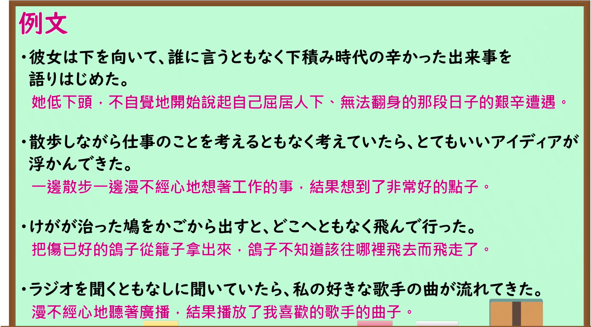

---
{
  "id": "N1-G-0050",
  "kind": "grammar",
  "level": "N1",
  "title": "ともなく／ともなしに：无意识地；不知从何处",
  "card_revision": 1,
  "schema_version": 1,
  "source": {
    "lesson": "N1 第50个语法",
    "material": "出口日語原视频板书、日语自动字幕与毎日のんびり日本語教師正文",
    "video": "https://www.youtube.com/watch?v=T6ifZr7bnbk",
    "screenshot": "assets/grammar/n1/N1-G-0050-connection.png",
    "screenshot_seconds": 100.0,
    "screenshot_crop": {
      "x": 0,
      "y": 0,
      "width": 1640,
      "height": 930
    }
  },
  "tags": [
    "ともなく",
    "ともなしに",
    "N1"
  ],
  "confusions": [
    "ともあれ",
    "となく"
  ]
}
---

# N1 第50个语法：ともなく／ともなしに

# 视频学习资料整理

- 原视频：[出口日語 N1 第50课](https://www.youtube.com/watch?v=T6ifZr7bnbk)。
- 接续图：视频 01:40.00；原图 1920 × 1080，固定左上角裁切区域 `(0, 0, 1640, 930)`。保留两种接续、红字释义、下方板书例句及课程标题。

- 例句图：视频 02:25.53；原图 1920 × 1080，固定左上角裁切区域 `(0, 0, 1895, 1050)`。保留课程例句与原有中文说明。

# 核心

## 功能一：A 不明确，就在 A 不清楚的情况下出现 B

**くわしい意味記述：**

- **ともなく／ともなしに（毎日のんびり日本語教師・用法①）：** 疑問詞について、動作や場所、時間等が特定できないことを表します。（接在疑问词之后，表示动作、地点或时间等无法确定。）

### 例句

1. どこからともなく銃声が聞こえてくる。

   （不知从哪里传来了枪声。）

2. 誰にともなく言いたい。この気持ちを誰かに知ってほしい。

   （真想说出来，却不知道该对谁说；希望有人能了解这份心情。）

3. 何処からともなしにお香の香りが漂ってきた。

   （不知从哪里飘来了香的气味。）

## 功能二：不特别意识或打算做 A，就做了 B

**くわしい意味記述：**

- **ともなく／ともなしに（毎日のんびり日本語教師・用法②）：** 意志動詞に接続し、その動作が無意識的に行われることを表します。（接在意志动词之后，表示该动作是无意识地进行的。）

### 例句

1. 夜空を見るともなく見ていた。

   （漫无目的地望着夜空。）

2. 掃除をしながらテレビを見るともなく見ていた。

   （一边打扫，一边心不在焉地看着电视。）

3. 過去にあった嫌なことを考えるともなしに考えてしまう。

   （不知不觉就想起了过去那些不愉快的事。）

# 来源

- [出口日語原视频](https://www.youtube.com/watch?v=T6ifZr7bnbk)
- [毎日のんびり日本語教師「～ともなく／ともなしに」](https://mainichi-nonbiri.com/grammar/n1-tomonaku/)（两类用法的释义与例句；查询日期：2026-09-24）
