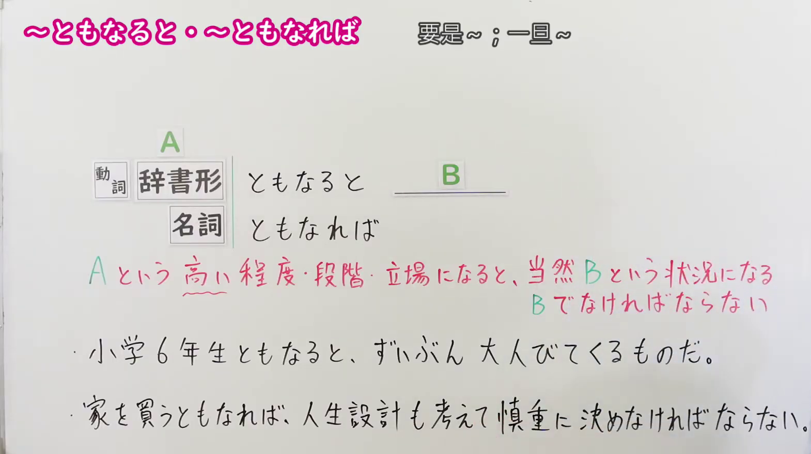
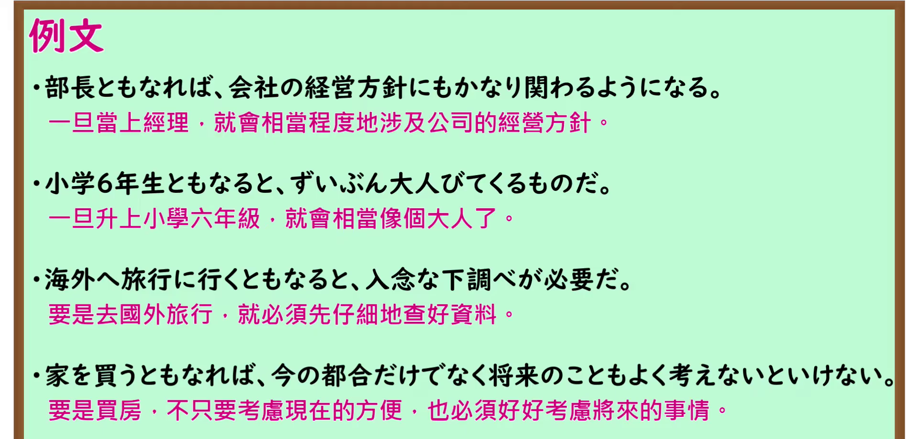

---
{
  "id": "N1-G-0051",
  "kind": "grammar",
  "level": "N1",
  "title": "～ともなると／～ともなれば：到了某种程度或阶段，就会……",
  "card_revision": 1,
  "schema_version": 1,
  "source": {
    "lesson": "N1 第51个语法",
    "material": "出口日語原视频板书、日语自动字幕与Hagoromo文型检索正文",
    "video": "https://www.youtube.com/watch?v=fuil6s0c6tE",
    "screenshot": "assets/grammar/n1/N1-G-0051-connection.png",
    "screenshot_seconds": 125,
    "screenshot_crop": {
      "x": 0,
      "y": 0,
      "width": 1570,
      "height": 880
    }
  },
  "tags": [
    "程度・阶段",
    "N1"
  ],
  "confusions": [
    "～となると／～となれば"
  ]
}
---

# ～ともなると／～ともなれば

# 视频学习资料整理

- [出口日語 N1 第51课原视频](https://www.youtube.com/watch?v=fuil6s0c6tE)：课程讲解「～ともなると／～ともなれば」。自动字幕把「動詞」「名詞」等词误转写，以下内容以原视频板书和讲解核对。
- 接续图：视频 **2:05（125 秒）**；原图 **1920 × 1080**，固定左上角裁切区域 **(x=0, y=0, 宽=1570, 高=880)**。0:01 画面中老师遮挡了必要板书，故改用讲解中板书清晰的画面；图中保留接续、红字说明和两条例句。

- 例句图：视频 **2:45.77（165.77 秒）**；原图 **1920 × 1080**，固定左上角裁切区域 **(x=0, y=0, 宽=1895, 高=920)**。保留例句页的四条例句及其原视频翻译。

# 核心

## 功能一：达到 A 所表示的较高程度、阶段或地位后，自然会出现 B 的状况，或必须做到 B

**最上位意味カテゴリー：**

- **ともなると：** ものごとの関係（事物之间的关系）
- **ともなれば：** ものごとの関係（事物之间的关系）

**中位意味カテゴリー：**

- **ともなると：** 判断の立場（判断的立场）
- **ともなれば：** 基準（基准）

**意味：**

- **ともなると：** 評価（评价）
- **ともなれば：** 評価（评价）

**くわしい意味記述：**

- **ともなると：** 「〜ともなると」の「〜」には，程度が進んだ立場がきて，そのような立場に進むとこのようになる，という意味を表す。「ともなれば」と同じ。（「～ともなると」前接表示程度已发展到一定阶段的地位，表示到了这样的地位便会出现相应情况；与「ともなれば」相同。）
- **ともなれば：** 「〜ともなれば」の「〜」には，程度が進んだ立場がきて，そのような立場に進むとこのようになる，という意味を表す。「ともなると」と同じ。（「～ともなれば」前接表示程度已发展到一定阶段的地位，表示到了这样的地位便会出现相应情况；与「ともなると」相同。）

**派生語：** 两个条目均未列出

### 例句

1. 春ともなると、花見やハイキングの客が増えはじめる。

   （到了春天，赏花和徒步的游客便开始增多。）

2. 会社に就職するのは簡単だ。しかし、会社を始めるともなると、かなりの資本が必要だ。

   （进入公司工作容易；但要创办公司，就需要相当多的资金。）

3. 大臣ともなれば、常に日常生活まで見られている。

   （一旦当上大臣，连日常生活也会一直受到关注。）

4. 転勤なら慣れているが、退職するともなれば、仕事の整理が必要だ。

   （调职倒是已经习惯了；但若要退休，就得把工作整理妥当。）

# 来源

- [出口日語原视频](https://www.youtube.com/watch?v=fuil6s0c6tE)
- [Hagoromo「ともなると」](https://hagoromo-text.work/lookup?vid=1071)（查询日期：2026-09-24；含[用例](https://hagoromo-text.work/get_reibun?vid=1071)）
- [Hagoromo「ともなれば」](https://hagoromo-text.work/lookup?vid=1072)（查询日期：2026-09-24；含[用例](https://hagoromo-text.work/get_reibun?vid=1072)）
